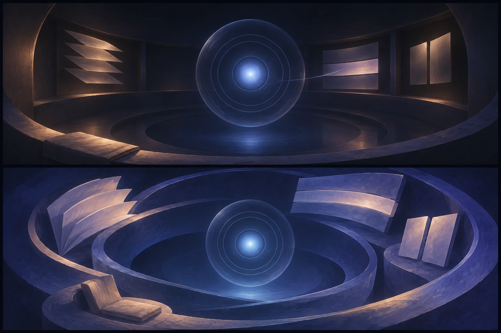

# Plan 2 · Walk inside ERA’s brain

**Build a first-person, walkable 3D level on the existing Local Delivery Game route.** The owner can cross the floor, approach a phase chamber, look behind the sphere, inspect work at arm’s length, and speak to ERA from wherever they stop. Overview is a raised map camera in this same level. Take seat lowers the player into its reading alcove. Both the realistic and illustrated editions support the full walk. [Conversation and questions](<01 - A conversation with ERA.md>) · [All topic sphere designs](<Delivery sphere atlas.md>)



*This earlier study sets the relationship between ERA’s core and the room. Build traversable floor, deep bays, a rear view and working instruments in geometry. A stationary background cannot deliver the experience below.*

## The first minute of play

You enter HUB-118 at the inner door. You can see the central sphere, the edge of a low seat, and a light crossing the floor toward Build. Press **W** and pass the seat on your left. Strafe behind the sphere. The near ring occludes the far one and the engraved signs rotate out of sight. Your position has changed. Now you are close enough to see a line of light terminate at a single file tile.

Choose **Track** on the retained edit to `src/app/g/drinks-admin/page.tsx`. Replay the gesture. Its light runs along the floor and the tile acquires a cut edge. Walk either side of the tile to inspect it. Press **E** to read the recorded actor and path. Press **Q** and choose **What changed here?** The answer points to this edit. Pin it. Take three steps into the adjacent part of the Build chamber and inspect the later typecheck invocation at Bench. Verify has no recorded host check result for this run. Those two places should look different.

Sit at the alcove facing the sphere. Ask **What went wrong?** at the latest moment. HUB-118 ends in failure after an agent message saying it was implemented. You can compare that message with the terminal record. **Stand up** returns you to the pose from which you chose to sit. The receipt you pinned is still available. [HUB-118 recording](http://127.0.0.1:4317/#/delivery/run/local-cac958d7-1f8e-4e65-9cb8-1471c839f796)

## Level blockout

Use metres in a Y-up world. These are first playable dimensions, adjustable after walking the greybox. The outer wall has a 10 m inner radius and a 5 m ceiling. The solid central well has a 2 m radius, with the sphere centered above it at y = 2.25 m. A continuous walkable floor runs from the well to the perimeter. Six open chambers extend another 2.5 m beyond the wall. Leave at least 1.5 m clearance beside instruments and behind the freestanding Build tile. Spawn 7.5 m south of center looking north. Put the seat slightly west of that approach, about 3 m from the core.

| Location around the core | Walk up to | Read or do here |
| --- | --- | --- |
| Southwest · Plan | Upright fan of broad leaves; a complete outline is visible from spawn. | **Brief** opens the frozen plan. A milestone in its text and a recorded delivery phase have distinct labels. |
| West · Setup | Short ribs under an open arch; the most recent setup milestone stays near the opening. | **Setup**, including dependency installation and a last event if the run stopped here. |
| Northwest and north · Build | Wide bay with a viewing lens, sound niche, freestanding split tile, command bench and closing seal. | **Explore, Think, Build, Bench, Seal**. Think plays or displays shared narration when recorded. Commands open their recorded details. |
| Northeast · Verify | Two inspection plates under a narrow collar of light. The result surface can stay empty. | **Verify** shows host check starts and separate returned outcomes and outputs. |
| East · Test | Transfer dock faces the seat across the sphere. A second ledge holds owner scenarios. | **Handover, Test**. Work lights the dock when evidence makes it ready. Owner acceptance has its own receipt. |
| Southeast · Ship | An incomplete outer ring with a clearly visible join. | **Ship**, pending push, recorded shipment and revert. |
| South · entry and inner alcove | Recognizable break in the perimeter at the entry and a crescent seat overlooking the core. | **Take seat, Ask ERA, Stand up, Overview**. Return to the entry via **Recenter**. |

Top-down blockout. The blank floor between the bays and the well is yours to cross.

```text
                            NORTH
                 ┌────── BUILD ───────┐
             SETUP                    VERIFY
              ╱      · · walk · ·       ╲
             │       ·  ◎ ERA  ·         │
             │ PLAN  ·  well   ·    TEST │
              ╲       ◡ seat           ╱
               ╲                    SHIP
                └────── ENTRY ───────┘
```

Give the observer three ways to locate the same event: a physical shape in the world, a station label when in range or focused, and a direct phase/action link in the DOM. **Plan → output**, **All actions**, the six existing tools and exact-row replay remain usable from every viewpoint. Crossing into a chamber selects its local question context. It never advances run phase or recorder time. All chambers remain walkable even in a cancelled run. [Eleven current zones](../../../../scripts/pm/app/stage/config.ts) · [Evidence navigation](<01 - A conversation with ERA.md>)

## Controls and camera ownership

| Intent | Desktop | Touch and accessible equivalent |
| --- | --- | --- |
| Enter and move | **Explore** enters at the saved walk pose or spawn. W/S move forward/backward, A/D strafe relative to yaw. Start at 2.4 m/s, normalize diagonals, eye height 1.65 m, horizontal collision radius 0.30 m. | Left thumb pad translates on the floor. **Go to station** moves to a labeled safe arrival point in one action. |
| Look | Mouse look after an explicit click in the viewport. Offer drag-to-look without pointer lock. Arrow keys turn or tilt at a steady rate. Use a starting vertical field of view of 65°, pitch limited to ±65°. | Right-side drag looks. Labeled turn controls and previous/next station work one-handed. No gyroscope required. |
| Inspect / track | Aim at an object within about 2 m, or approach it, and press **E**. Choose **Track** on a row to trace its route. The reader's **Replay here** explicitly seeks. | Tap the object or its equivalent in the action list. Provide a visible **Inspect** target for the focused station. |
| Ask | **Q** from any walkable position, including an empty chamber. Freeze movement and release mouse capture. The first suggested question reflects the focused object, station or run. | Persistent **Ask ERA** opens the identical question list with focus on the first choice. |
| Seat, stand, overview | **E** at the seat or **Take seat** from the HUD. **Stand up** returns to the saved walk pose. **Map** raises Overview; **Explore** restores your walk pose. **Recenter** is deliberate. | Use the named controls. The phase strip and DOM reader work throughout. |
| Pause navigation / read | Escape closes only the active layer or releases mouse capture. Typing, text selection, browser shortcuts and recorder-focused Space/arrow controls own their input. | Drawer dismissal returns to its opener. Leave movement paused after closing until fresh movement input. |

Move using elapsed time and sweep a player capsule against the well, walls and station hulls. Slide along an obstacle, constrain the floor, cap long frame deltas and substep after stalls. Clear held inputs on blur, unlock, reader open, hidden tab and route disposal. Preserve normal wheel scroll outside the world. Give the Walk controller sole ownership while Walk is active. The current board already binds F, 0 and Escape. Unregister inactive camera handlers. Keep head bob, automatic walking, camera roll and bobbing text off. [Current board shortcuts](../../../../scripts/pm/app/stage/engineCamera.ts)

## What makes it playable

**Track → follow → inspect → compare.** Select a recorded action and trace one light path from its source to its chamber. Follow on foot or choose **Go to station**. The world object bears a persistent visual change that you can inspect and pin. Select **Compare** on another row and open the two observations side by side at the seat or in the accessible reader. Exploration rewards you with understanding: exactly when a check returned, what the last edit touched, or where a delivery stopped. Every event stays directly accessible from its step.

**Walk inside the signal.** Route one strand from the nucleus under a translucent strip of floor and up through the work surface. Seen from the map, this reads as a connection. Seen standing over it, light crosses beneath your feet and arrives at a real receiver. The next time you rewind that edit, you can watch it from the opposite side. The path relates one event to its station. Draw a dependency between two actions only when their records establish it.

**Enter the core.** At the inner rim, offer **Inside ERA**. The core’s outermost circle fills the frame and becomes a threshold. Beyond it the player stands *between* the orbital shells at human scale. Looking overhead reveals the topic motif from the inside. Along a short walkable curve, the previous, selected and next retained actions occupy three recesses. You can walk up to one and read its recorded narration or output and ask about that exact moment. Future rows in the replay timeline appear as unlabelled positions until the owner explicitly selects **Step forward**. Walking past a recess never seeks the recorder. At the start or end of the recording, the corresponding recess stays empty. On TRIP-33 there are only two moments to discover.

Implement the interior as a second spatial area of Walk with three reusable receipt objects in the same renderer. Use an authored threshold interaction from a safe point beside the well, a short matched dissolve, and a saved exterior pose. **Back to room** restores the original spot. In reduced motion cut directly. Include this encounter in the full release after the first playable walk. In the owner's playtest, enter on an edit, circle its signal, open its exact receipt, and return to the same spot outside with the same selected row.

### Animation score

Use the observed event kind for the gesture and the phase for its energy. Timings below are tuning values at normal motion. A recorded phase change can alter the steady width of illuminated arcs. The short impulse plays only when a row crosses the replay cursor or arrives live. On a seek, materialize the exact settled state immediately. **Replay gesture** can repeat its cosmetic clip without reissuing a command. Derive a reproducible filament path from the stable event ID. An unrecorded actor remains unnamed.

| Trigger | Anticipation, contact and settle | Lasting information |
| --- | --- | --- |
| Brief / Setup | A low steady nucleus. A 250 ms thin wave reveals one ring; the reached setup rib takes a steady edge. | The last evidenced preparation milestone remains inspectable. |
| Read / search | In about 240 ms a strand draws **inward** from the source station. The lens tips toward the named object, then returns. | Retain only the recorded target and summary. |
| Edit / Build | The core draws tight for 100 ms. Over 220 ms two or three local lightning branches resolve to one path **outward**. At contact a tile separates, settles over 180 ms and keeps one seam. | The file action and actor remain available. The seam represents an observed edit, not its unavailable line-level diff. |
| Worker command / host check | A worker command presses down one Bench key. A host check start instead narrows the Verify collar over 280 ms. On a returned result the two plates meet and leave a shaped stamp for pass, fail or inconclusive. | Invocation, check start and check result have three distinct states. Read the recorded stdout/stderr only once exposed. |
| Owner question / handoff | A pending question sends a thin steady thread to the seat. A confirmed handoff sends the largest, slower wave (about 650 ms) across to the dock. The core then settles to give the owner the floor. | Live attention, historical question and reviewable candidate each keep their actual state. |
| Ship / revert | A recorded ship closes the outside ring over 450 ms. A pending push keeps its seam open. Revert unlocks that seam and reverses one segment. | Outcome and available receipt stay legible in a still. |
| Quiet / cancellation / failure | Quiet work rests at its last observed contact. Cancellation cools the reached rib in place. Failure leaves a broken contour on the last known affected station, or a run-level mark when the station is unknown. Link loss freezes the frame with observation age. | The exact signal, time and reason when available. No invented cause or success. |

For the more aggressive feel in later phases, increase the **area under tension**: Setup energizes one fine inner strand, Build releases narrow branching paths, Verify locks all three shells into alignment, and handoff crosses the whole room once. Cap local peak brightness to preserve the core silhouette. Merge overlapping burst accents and keep every receipt in the reader. Reduced motion replaces transit and lightning with stationary endpoints, folds and stamps. With sound on, localize contact at its station and make the seat cue close and soft. Keep bursts bounded and supply the same information when muted.

## Realistic and Illustrated are two treatments of one level

| | Realistic | Illustrated |
| --- | --- | --- |
| At eye level | Kiln-dark ceramic, inset floor glass, an optically thin outer shell and a softly luminous depth inside the sphere. A grazing practical light reveals the back of a station as you round it. | Painted bevels, bold silhouettes, expressive contact poses and restrained rim lines. Model and paint the sides, backs and undersides that a standing player can actually see. |
| From Overview | Raise the camera above the ring. Fade occluding wall sections while preserving station placement, selected moment and player marker. | Use the same geometry as a dollhouse cutaway. Painted interiors and large station profiles should read at thumbnail size. |
| In motion | Give instruments inertia and believable contact. Bake environment lighting, reserve live emission for the active signal. | Pose the same motions with a deliberate hold before contact and a short settle. Use painted gradients, stepped material accents and limited secondary motion. |
| Collision and picking | Use the authored walk mesh and shared hit volumes. | Bind painted surfaces to the same mesh IDs, hit volumes and station anchors. Changing style preserves player pose and recorder time. |

Use the current PM theme for controls, opaque readers and type. Keep the topic motif visible during outcome changes in Blue and Pink. Both editions must pass the rear-of-sphere walk, the same phase and Q&A walkthrough, and the grayscale landmark check. [Topic atlas](<Delivery sphere atlas.md>) · [PM styles](../../../../scripts/pm/app/styles.css)

## One continuous move between views

Maintain independent state for **viewpoint** (Map / Walk / Seat), **art** (Realistic / Illustrated) and **recorder** (Live / Replay). Keep player pose, last safe standing pose, selected station, reader, pins and conversation under the run ID. Persist art preference separately. Migrate the existing overview/seat preference. A saved preference cannot automatically capture a mouse.

For Map → Walk, frame the player marker and descend along the entry sightline. For Walk → Seat from beside the chair, lower eye height to about 1.15 m, rotate gently toward the nucleus and bring the selected receipt onto the reading ledge. Use roughly 350–500 ms. If the player chooses Take seat from across the room, use a brief matched dissolve anchored on the sphere rather than dragging them through intervening walls. From Seat → Walk, restore the saved standing transform. Return to Map restores its last framing. If the seat was entered directly from Map, **Overview** returns there and **Stand up** uses the chair's safe exit point.

Keep controls usable from the first input. Latest intent cancels the prior camera move. A paused row stays paused; playing replay continues according to its own clock. No poll, message, phase or art change can seize the player camera. Under reduced motion cut to the target pose, restore focus and keep the same evidence visible. If a canvas fails, keep the reader and the board map available.

## Engineering sequence

1. **One greybox you can inhabit.** On the current local game route, add a separately loaded Three.js scene with floor, capsule collision, three shells, chair and six grey phase bays. Use the current stage IDs as anchors. Render a perspective camera capable of translation on both horizontal axes. Prove the player can reach the north and south sides of the sphere, pass behind the Build object, and return to spawn. Keep the flat Overview usable during rollout. [Installed graphics dependencies](../../../../package.json) · [Existing Canvas2D engine](../../../../scripts/pm/app/stage/engine.ts)
2. **Load it through the real PM build.** The current esbuild wrapper returns the first JS and CSS outputs. Add a separately addressable optional renderer entry and serve it through the PM app asset handler in normal and watch builds. Keep each rebuild’s asset set coherent. On import failure, missing WebGL or context loss show the existing board/reader, retain run state and allow a retry. No Three.js download should be needed to use other PM pages. [Build](../../../../scripts/pm/app-build.mjs) · [Local asset handler](../../../../scripts/pm/app-shell.mjs)
3. **Play one meaningful encounter.** Bind one edit, one command, terminal failure and the TRIP-33 setup/cancellation to exact rows from the existing timeline. Implement Track, Inspect, Q, seat/stand and return-to-pose before commissioning finished environment art. The motion loop consumes the selected projection. Keep recorder time and held input out of React per-frame state. Do not feed camera position back into progress, attention or action admission. [Run controller](../../../../scripts/pm/app/LocalRunGame.tsx) · [Scene projection](../../../../scripts/pm/app/localRunScene.ts) · [Playback clock](../../../../scripts/pm/app/useStageClock.ts)
4. **Finish the level and its topics.** Deliver all eleven station interactions, static collisions and anchors, both 360° art treatments, the atlas profiles, and the clip set above. Reuse one skeleton for the three orbital shells. Instance repeated geometry, bake room light, pool filaments and preload the next material set only when requested. Map, Walk and Seat use the same renderer. The fallback board can mount independently when needed. Keep the existing attention controls, A/B read model and UAT admission in the shared shell. [Workshop mount](../../../../scripts/pm/app/DeliveryWorkshop.tsx) · [Existing room model](../../../../scripts/pm/app/transferRoomModel.ts)
5. **Measure movement, then tune.** Capture cold entry, idle, a full lap, an edit burst, rapid camera reversals and a live poll while reading at 1280 × 640, 390 px and the owner's usual desktop size. Target 60 fps desktop and a stable 30 fps minimum in the low-detail profile. Use the existing 8 ms stage frame-work and 3 ms p95 script budgets as starting targets, measure GPU time separately where available, and report misses. Reduce reflections, filament count and resolution first. Hidden panes release input and stop rendering. At rest with reduced motion, redraw on change. [Existing stage budgets](../../../../scripts/pm/app/stage/config.ts)

## Owner acceptance route

| Try | Pass condition |
| --- | --- |
| Walk a full lap, back away from the sphere, approach again, then walk behind a file tile. Repeat in both styles. | Independent translation and look, real occlusion and parallax, solid walls and well. Every station is reachable. Keyboard-only and touch users can ask and inspect. |
| On TRIP-33, enter Setup and ask “Where did it stop?” Walk into Ship. | The Trips motif remains visible. Installing dependencies and cancellation have receipts. Visiting Ship cannot light a successful outcome. [TRIP-33](http://127.0.0.1:4317/#/delivery/run/local-c7059ebf-f657-470c-9f6c-bc80ae3672a9) |
| Perform the HUB-118 encounter at the start of this plan; repeat once while facing away from the active station. | A spatial cue and Now identify the station without a camera cut. The agent command has evidence. Verify never invents a passed check. Ask / close, seat / stand and A/B retain the intended pose, focus and exact selected row. |
| On the synthetic handoff recording, pause on an edit, move one detent over tied timestamps and inspect Verify and Handover. | No future output before its receipt. Only a real returned check stamps the plate. Only a real handoff reaches the seat. Walking, Q&A presets and replay issue zero delivery commands and zero provider requests. [Existing synthetic fixture](../../../../tests/pm-ui/transfer-room.browser.mjs) |
| Switch theme and material style mid-walk, lose mouse lock with W held, simulate a failed renderer load, then return with motion reduced. | No stuck motion or input trap. Evidence stays legible. The fallback preserves exact replay and the local questions. A standing player in either style can explain where they are, what ERA just did and what needs them. |

**First milestone:** a complete walk → inspect → ask → sit → stand encounter on a real retained run. **Full delivery:** a complete level in both styles, every topic in the atlas, all phase outputs and the owner acceptance route above. The first milestone is intentionally playable with unfinished materials.
