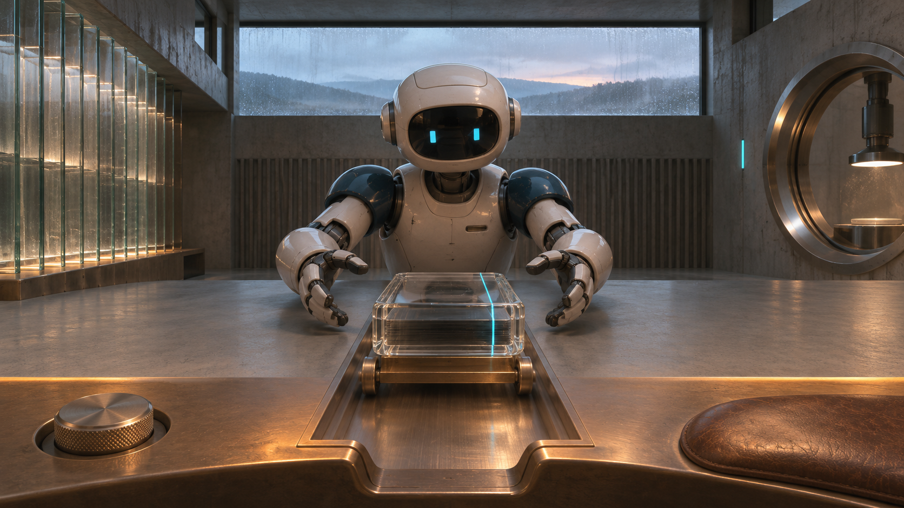

# The Transfer Room

**Current game, R137.** ERA’s centerpiece takes its shape from the delivery topic. Trips uses a compass, Expense uses the rising Budget trail, and Schedule uses a dial with unequal hands. From the Board, choose **Explore 3D** to see the mark suspended at the center of the room. The recorded work determines which station draws power. The Board operator uses the same isometric projection and material colors as the workstations. [Sphere atlas](<Delivery sphere atlas.md>) · [Controls](<Controls and Replay.md>) · [Owner UAT](<../../../../docs/Delivery-UAT.md#board-robot-era-identity-and-walk--r137>)

**Walk, R138.** The Trips compass hangs above a machined receiver that picks up its green light. Look across the instrument benches towards the orbital horizon, then turn up to see the canopy meet the roof ribs. The exterior and canopy use separate image plates. Desks, fittings, working instruments, the seat and the capsule are 3D geometry. [Observatory](../../../../scripts/pm/assets/transfer-observatory.webp) · [Canopy](../../../../scripts/pm/assets/transfer-canopy.webp) · [Owner UAT](<../../../../docs/Delivery-UAT.md#trips-walk-at-full-window-size--r138>)

**Walkable implementation, R132 (2026-11-21)**

Open a Local Game run and select **Explore 3D**. Map, Walk, Seat, the core interior and both material treatments share the recording and output reader. Q opens questions from your current station or action. The browser fixture covers interaction and fallback. Owner perception, physical performance and a review of every topic design are pending. [Owner UAT](<../../../../docs/Delivery-UAT.md#walk-inside-eras-brain--r132>)

**Phase circuit implementation, R135 (2026-11-21).** The Board operator now uses an articulated tool. Explore 3D lights the recorded instrument and connects it to ERA. Review this in a retained run and check the physical phone separately. [Visual baseline and brief sequence](<03 - Start here - visual review and run order.md>) · [Owner UAT](<../../../../docs/Delivery-UAT.md#era-and-the-phase-circuit--r135>) · [Preparation to Verify clip](../../../../.pm/transfer-room-implementation/room/prepare-build-verify.webm) · [Hardware benchmark](../../../../.pm/transfer-room-implementation/performance/results.json)

**Design and implementation plans**

1. [A conversation with ERA](<01 - A conversation with ERA.md>) specifies asking from any station and carrying a question and its evidence to the seat.
2. [Walk inside ERA’s brain](<02 - Watching ERA work.md>) is the level and animation specification. It covers first-person movement, six phase chambers, eleven stations, two fully walkable art treatments and camera transitions.

The [delivery sphere atlas](<Delivery sphere atlas.md>) supplies the topic mapping and art direction for both plans. Start with Plan 2 to build the room and Plan 1 to wire the first playable conversation.

The following concept documents the first bench prototype, R131. Use its control and replay notes for compatibility when implementing the new plans.

## The R131 bench prototype

You sit across a workbench from ERA. Between you is a short brass track, just long enough for one glass cassette to pass from one pair of hands to another. Beyond ERA’s shoulder you can see the pale strip of morning through a high window. At your left thumb is a heavy jog wheel. Turn it one click and the room goes back **one recorded action**. The edit lifts off the glass. The output that belonged to that instant opens right where you were looking.

*Concept plate for the handover shot. The finished interface would place readable text and controls over reserved areas around this view. The painting sets eye height, lighting and scale.*

The owner’s role is the second person at the bench. ERA can prepare the work and bring it within reach. Only you can read what came back, try the candidate and decide what happens next. The room gives that division of responsibility a physical shape.

**Read next** · [Controls and Replay](<Controls and Replay.md>) for steps, outputs and exact playback · [Build and Playtest](<Build and Playtest.md>) for a playable first cut, frame budgets and an owner comparison.

**Local Game preview, 2026-11-21.** Open a Local Delivery run with Game enabled and choose **Take seat**. The browser remembers Seat or Overview. Both use the same retained recording. [R131 acceptance](<../../PM Tooling/PM Tooling — Master Book.md#r131>) · [Owner scenarios](<../../../../docs/Delivery-UAT.md#local-delivery-transfer-room--r131>)

## What led here

In the saved R129 Overview, the whole delivery line fits on one slab. It is easy to learn that Verify sits beside Handover. In Follow, the camera enlarges those machines, while the place you act from is still a column of cards outside the scene. At 390 pixels the board fits, but the stations recede enough that the labels carry much of the work. These are observations from stills. The reported hiccups need a moving trace to diagnose. [Overview still](../../../../.pm/r129-evidence/1358-blue-open-overview.png) · [Follow still](../../../../.pm/r129-evidence/1358-blue-open-follow.png)

The room keeps that spatial memory. **Overview** unfolds the eleven-zone map on your desk. **Seat** brings you back to eye level. From either view the same step strip leads straight to Plan, Build, Verify, owner Test and the other recorded work. You can read an output before the scene finishes moving. The previous specifications explain how the recorder, machines and camera arrived here. [Live Stage](<../Local Run Game Mode.md>) · [Art and Motion](<../Local Run Stage Art and Motion.md>) · [Board and Attention](<../Local Run Stage Board and Attention.md>) · [Game and Cockpit Corrections](<../Agentic OS Game and Cockpit Corrections.md>)

## A minute at the bench

*An illustrative run. The times describe this storyboard. The actual recording sets the pace.*

| Moment | From your seat |
|---|---|
| **Arrival** | You open a run already in progress. There is glass in the cradle. ERA’s last recorded action, actor if known, and signal age are legible on the desk edge. Selecting **Plan** puts the stored brief on the reading surface. Closing it returns to the same view. |
| **A read, then an edit** | At the left wall, light grazes one glass leaf when a read arrives. The edit leaves a small opaque seam in the cassette across from you. Select the seam to read the action and its recorded path. A second edit to the same file catches the same seam. Its two events remain individually selectable. |
| **A burst** | Several actions arrive together. The latest action updates immediately. From your seat you see one short sweep over the affected part of the glass. Turn the dial and every underlying action is there, in order. You choose which one deserves a close-up. |
| **A quiet stretch** | ERA’s hands come to rest. A stripe of daylight still catches the wheel. The last recorded action keeps its time, then the existing quiet or stale caption appears. You can read the brief or shuttle through earlier work. When a receipt arrives, the bench picks up from that evidence. |
| **A real question** | ERA draws its hands back and looks across the bench. A slim message plate lights at your end of the rail. The question and its actual choices are already usable. Open it, answer with the existing **Send** button and see the recorded answer when it arrives. Reading older output keeps your scroll position. |
| **Your turn** | On a ready handover the full cassette rolls those last few centimetres and stops against the near rest. Its reflected light now falls on your side. Pick **Test steps** to open the actual scenarios. Closing the reader leaves the cassette at your side for as long as the decision belongs to you. |

The handover is the biggest movement in the room. Save it for a recorded handover. A question can interrupt a build halfway through, so it gets a smaller plate of its own. A failed run has a third ending. The inspection light stops on the affected station where known, the glass stays accessible, and the desk offers the recorded reason and diagnostic lines. On a return visit you find the settled scene immediately.

## A room you learn by touch

**Three landmarks survive every cut.** Glass leaves on the left catch a thin vertical reflection. The inspection aperture on the right throws a round pool of light. In the foreground, the wheel has one worn rim where your thumb would land. Their positions stay fixed through changes of step, theme and screen size. At narrow width, frame the wheel, the cassette and ERA’s eyes together. The step strip handles travel to the edges of the room.

**ERA has weight.** Give the character a recognisable visor, ceramic shell, articulated wrists and a clear resting pose. An edit ends with the fingers lifting away so you can see what changed. A host check puts the work under the separate inspection lamp. During a recorded utterance the visor turns toward your seat and the actual words open in Comms. Subagent attribution comes from its recorded identity. An incoming contribution can light a side slot bearing that identity without inventing another body doing unseen work.

**Build the light into the materials.** The bench lip is brushed alloy, the cassette is smoked glass, the handrest has worn through to a warmer grain. A single high window lights all three. Blue or Pink appears in the powered seams and controls. The operator’s lamp uses amber, a raised shape and a text cue. Keep a dark, flat reading surface under every output. Crop the image as a thumbnail, turn off motion and mute audio. A viewer should still be able to point to ERA, the thing being worked on and where it will come to them.

**Use sound at the distance of the object.** With sound enabled, the drawer on the left has a dry slide, the inspection ring a short resonant tap, and the cassette coming to your hand a close, soft mechanical stop. Repeated rows in a burst make one phrase. The near stop has a distinct silhouette and caption in silence. While reading or shuttling rapidly, the sound settles so it never competes with the evidence.

**Let the owner direct the camera.** The seat opens at rest. Selecting a seam can bring the glass into a close-up while the wheel stays under the same corner of the frame. A close-up is one continuous sightline from the seat. A new message can change the desk-edge readout while the owner studies a file. Only the owner’s next input can move that reading surface. On leaving Inspect, the window and desk lip land exactly where the owner remembers them.

## The part worth playing twice

The cassette doubles as an **optical comparator**. Leave a reference mark on a retained action, then move the wheel forward. The same glass stays in the same place. What was visible at the reference sits in fine outline beside what the selected moment has gained. A read and an edit of the same known path line up. A check that has since returned gains its recorded result. Select either mark to see its source. After a long build or a surprise failure, you can answer *what changed between the last moment I understood and this one?* The interaction also works with buttons and plain text in reduced motion.

On a finished attempt, lay the cassette flat. Seen edge-on, its fine marks form a strip of the retained run, with visible intervals of silence. Touch a mark and the room reassembles at that row. The work ID and outcome are enough inscription. Two attempts on the same task have different traces because different things actually happened. The pleasure of returning comes from recognizing the work you did together.

## The first playable minute

Prove one encounter end to end. Use a recording with an edit, a host check and a handover. Make the glass easy to find, let the owner open the check’s output, and let them wind back to the edit without losing their place. Play the same encounter in today’s board and in the room, once with sound off. Ask the owner to point to where they belong, show what ERA just did, and find the moment the work became theirs.

If those answers come more easily in the room, build the rest of the stations. If the picture looks beautiful and the owner still feels like a spectator, revise the distance across the desk, the gesture and the handoff before spending another day on effects.
