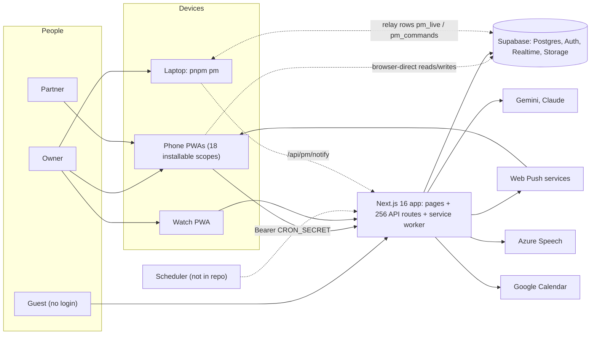
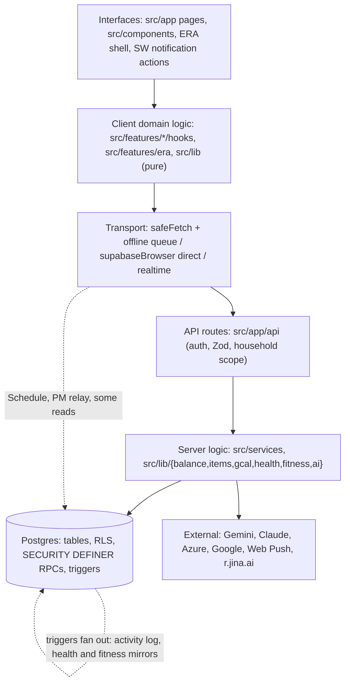
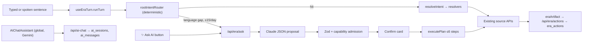
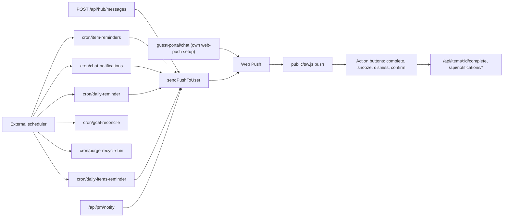

# ERA Architecture

[README](README.md) · [Capability Map](CAPABILITY-MAP.md) · **Architecture** · [Critical Flows](CRITICAL-FLOWS.md) · [Change Impact](CHANGE-IMPACT-GUIDE.md)

How ERA's interfaces, business logic, data and external services connect, what the repo shows that its documents do not, and three proposals. Sections 1–7 describe CURRENT IMPLEMENTATION unless a line says otherwise. Section 8 holds findings, section 9 holds PROPOSED DESIGN, and the two never mix.

---

## 0. Reader guide — returning after six months

Do these in order. Each step says what it answers.

1. **Find the new baseline.** `git log --oneline 53443c0..HEAD` lists what changed since this atlas. If more than about a third of `src/app/api/` or `src/features/` changed, treat the tables here as history and re-run the scans in [§10](#10-how-this-atlas-was-produced).
2. **Ask "what is live?" before "what is built?"** Read [CAPABILITY-MAP §9](CAPABILITY-MAP.md#9-unknowns-that-change-a-capabilitys-real-status). Then refresh the database evidence: paste `migrations/db-state.sql` into the Supabase SQL Editor, save the result over `migrations/db-state.json`, and run `pnpm db:verify-rls`. On 2026-11-04 the snapshot was 92 days old; most post-August capabilities could not be proven live.
3. **Re-read the rules that encode real constraints.** `CLAUDE.md` Hard Rules (especially 6, 13, 24, 26, 27), then `ERA Notes/01 - Architecture/Design Doctrine.md` §2–§5. They explain choices that look odd here: LBP stored in thousands, custom billing month, 8 s timeouts, no confirmation dialogs.
4. **Pick the journey you care about** in [CRITICAL-FLOWS.md](CRITICAL-FLOWS.md). Each one names every file and table it crosses, so you can re-trace it quickly.
5. **Before changing anything shared,** look it up in [CHANGE-IMPACT-GUIDE.md](CHANGE-IMPACT-GUIDE.md). The dangerous parts of ERA are the ones with many quiet consumers: the balance writer, `item_occurrence_actions`, the offline queue, the service worker, the household link.
6. **Check the open defect lists** in `ERA Notes/10 - Project Management/Research/Major Bug Sweep.md` and `ERA Notes/01 - Architecture/Mutation Integrity Audit.md` (both 2026-11-04). If a row there is still open, the matching flow in this atlas carries the same risk.
7. **Then read the campaign's Master Book** for the area you will work on. Master Books own plans, decisions and the Shipped Log; this atlas does not.

Three facts to keep in mind while reading: the Git history in this clone starts at 2026-09-26 (shallow clone); documents in `ERA Notes/` disagree with code in the places listed in [§8.4](#84-conflicting-or-stale-sources); and "implemented" in this atlas never means "accepted by the owner".

---

## 1. System context

- ERA serves exactly one household: two people linked by one `household_links` row, plus guests on public tag pages (Design Doctrine §1, `migrations/schema.sql` `household_links`).
- Hosting is not described by repo config. Docs mention a Vercel log stream (HUB-98) and code reads `VERCEL_URL`; the deployed platform, region and revision are UNKNOWN.
- The scheduler that calls cron routes is outside the repo. Notifications decision D1 assigns it to an owner-configured Supabase pg_cron/pg_net job (`ERA Notes/10 - Project Management/Plans/ERA Top Layer.md:341`). Whether it exists is UNKNOWN.

---

## 2. Layers and how they connect

| Layer        | What is there                                                                                                                                             | Size at `53443c0`                                                   |
| ------------ | --------------------------------------------------------------------------------------------------------------------------------------------------------- | ------------------------------------------------------------------- |
| Interfaces   | 42 `page.tsx`, 22 `layout.tsx`, the ERA shell (`src/components/era/`), the service worker (`public/sw.js`, 1,415 lines)                                   | `src/components/` holds 36 folders                                  |
| Client logic | 35 folders under `src/features/` (one is a `graphify-out` cache); pure libraries in `src/lib/`                                                            | —                                                                   |
| Transport    | `safeFetch` (`src/lib/safeFetch.ts`), offline queue and sync engine, `supabaseBrowser()` singleton, Supabase Realtime                                     | —                                                                   |
| API          | 256 `route.ts` files; largest groups: trips 24, notifications 17, era 16, healthcare 15, catalogue 13, hub 12                                             | 49 route files use the service-role client                          |
| Server logic | `src/services/transaction.service.ts`, `src/lib/balance.ts`, `src/lib/items/*`, `src/lib/gcal/*`, `src/lib/health/*`, `src/lib/fitness/*`, `src/lib/ai/*` | —                                                                   |
| Data         | 122 tables (`schema.sql`), 79 functions in the 2026-08-04 snapshot plus later migrations, ~30 RPCs called from code                                       | 46 dated migrations                                                 |
| Tooling      | `scripts/pm/` (188 files), `scripts/delivery/` (33), `scripts/delivery-v2/` (85)                                                                          | ~89,000 lines of script code vs ~309,000 lines of non-test app code |

The module rule in `CLAUDE.md` (standalone feature folders never import each other) mostly holds inside `src/features/`. The only standalone→standalone import is `chores → items` (3 files); `era` imports eight feature folders as a Junction should. Coupling moves elsewhere instead:

- **Components act as junctions.** `src/components/hub/HubPage.tsx` imports six feature folders, including the ERA turn and Ask AI hooks. `src/components/expense/MobileExpenseForm.tsx` imports six, including `useEraHandoff`. A defect in ERA's hooks can therefore surface inside the Hub and inside the precision expense form.
- **The database acts as a junction.** Triggers connect Schedule to Healthcare and Fitness, and every module to the Activity Log (§3, style F).
- **Shared libraries act as junctions.** `src/lib/utils/date.ts`, `dayOccurrences.ts`, `balance.ts` and `createContract.ts` are each used by several modules and by ERA.

---

## 3. Data access styles

ERA uses six ways to reach data. Each has different authorization and failure behaviour.

| Style                       | How                                                                                                                                                      | Authorization                                                            | Where it is used                                                                                                                                                       | Failure behaviour                                                                                                                                                 |
| --------------------------- | -------------------------------------------------------------------------------------------------------------------------------------------------------- | ------------------------------------------------------------------------ | ---------------------------------------------------------------------------------------------------------------------------------------------------------------------- | ----------------------------------------------------------------------------------------------------------------------------------------------------------------- |
| A. API route, user session  | `supabaseServer()` in `src/app/api/**`                                                                                                                   | RLS plus route checks (e.g. `getAccessibleAccount()`, `canMutateItem()`) | Most modules                                                                                                                                                           | Route returns JSON errors; client `safeFetch` maps timeouts and offline                                                                                           |
| B. API route, service role  | `supabaseAdmin()`                                                                                                                                        | Bypasses RLS; the route's own checks are the only guard                  | 49 route files: money balances, recycle bin, guest portal, crons, storage signed URLs, household names                                                                 | A missing check is a visibility or integrity hole (M3, S1)                                                                                                        |
| C. Browser-direct PostgREST | `supabaseBrowser().from(...)` in hooks                                                                                                                   | RLS only                                                                 | Schedule updates/deletes/subtasks/exceptions (`src/features/items/useItems.ts`, `useItemActions.ts`, `useFlexibleRoutines.ts`), PM relay, a few reads; 17 client files | No API side effects run (Google Calendar sync, alert deactivation) unless the hook re-implements them (`src/features/items/gcalSync.ts` header says exactly this) |
| D. Bundle RPCs              | `get_schedule_bundle`, `get_trip_bundle`, `get_health_bundle`, `get_fitness_bundle`                                                                      | SECURITY DEFINER; visibility coded in SQL                                | Hot reads (Hard Rule 21)                                                                                                                                               | Function bodies for older RPCs live only in the snapshot                                                                                                          |
| E. Write RPCs               | `create_item_complete`, `create_items_bulk`, `health_*`, `fitness_*`, `claim_household_code`, `activate_trip`                                            | SECURITY DEFINER or invoker, per migration                               | Item creation, health, fitness, household claim, trips                                                                                                                 | Missing function → `PGRST202` → "not started" (`src/lib/items/createContract.ts:151`)                                                                             |
| F. Triggers                 | Generic `capture_household_activity` on 80 tables; `health_mirror_occurrence_action` and `fitness_mirror_occurrence_action` on `item_occurrence_actions` | Run inside the source transaction                                        | Activity Log, medication doses, workout completion                                                                                                                     | A trigger error rolls back the user's write (Activity Log Overview §write path)                                                                                   |

---

## 4. State and caching layers

A value shown on screen may come from any of these layers:

| Layer                      | Holds                                                                                                                                                      | Lifetime                                                                   | Invalidated by                                                                                                      |
| -------------------------- | ---------------------------------------------------------------------------------------------------------------------------------------------------------- | -------------------------------------------------------------------------- | ------------------------------------------------------------------------------------------------------------------- |
| React Query memory         | Every query                                                                                                                                                | `gcTime` 24 h, `staleTime` 5 min default (`src/app/providers.tsx:112-114`) | `invalidateQueries`, theme change (Hard Rule 10)                                                                    |
| Persisted query cache      | Only `STABLE_KEYS`: accounts, categories, account-balance, preferences, recurring payments, trips, fitness, household allergens, … (`providers.tsx:23-47`) | 7 days, localStorage key `hm-rq-cache-v3`, buster `hm-v4`                  | Restored before queries run; cleared on user switch (`:191-205`)                                                    |
| localStorage side caches   | `balance_cache_*`, `user_preferences` (`src/lib/queryConfig.ts:68-147`)                                                                                    | Until overwritten                                                          | Used by `AccountBalance.tsx` when offline                                                                           |
| Service-worker API cache   | GETs under `/api/accounts`, `/api/user-preferences`, `/api/categories`, `/api/onboarding`, `/api/drafts`, `/api/future-payments` (`public/sw.js:57-65`)    | Until the SW cache name changes                                            | **Never invalidated by app code**; returns the cached response first, then refreshes in the background (`:184-209`) |
| Service-worker shell cache | `/offline`, `/expense`, `/dashboard`, `/reminders`, `/recurring`, `/`                                                                                      | Cache name `app-shell-v5`                                                  | SW update                                                                                                           |
| IndexedDB offline queue    | Unsent mutations                                                                                                                                           | Deleted after 24 h except fitness (`src/lib/offlineQueue.ts:422-435`)      | Replay or expiry                                                                                                    |

**Consequence (CURRENT IMPLEMENTATION).** Right after a spend, the mutation invalidates `account-balance`; React Query refetches `/api/accounts/<id>/balance`; an active service worker answers that refetch from `api-cache-v1` with the **previous** response and only then stores the fresh one. The fresh value appears on the next refetch. The same applies to ERA's balance and draft reads (`src/features/era/intents/resolvers/budgetFamilies.ts:101`, `budget.ts:786`). Whether phones run this SW version is UNKNOWN.

---

## 5. Write contracts

| Domain                      | Contract in code                                                                                                                                              | Exactly-once guard                                                                                   | Atomicity                                                                                                             |
| --------------------------- | ------------------------------------------------------------------------------------------------------------------------------------------------------------- | ---------------------------------------------------------------------------------------------------- | --------------------------------------------------------------------------------------------------------------------- |
| Money: transactions         | `createTransaction()` inserts, then `adjustAccountBalance()` (`src/services/transaction.service.ts:383-556`)                                                  | None (no client id)                                                                                  | Row and balance are separate writes; a failed balance CAS is logged, not raised (`src/lib/balance.ts:114-122`)        |
| Money: transfers            | Client id, same-id retry, server replay on 23505 (`src/features/transfers/hooks.ts`, `src/app/api/transfers/route.ts`)                                        | Yes                                                                                                  | Two balance writes, not one DB transaction (BUD-63)                                                                   |
| Money: confirm/settle flows | Read, check, write                                                                                                                                            | Draft confirm only (`is_draft = true`)                                                               | No (M2)                                                                                                               |
| Money: statement import     | Import record, then rows, then the revert ledger, then one balance write per account (`src/app/api/statement-import/commit/route.ts:236-1004`)                | Unique `statement_hash` per account                                                                  | Balances wait for the ledger; rows do not (Mutation Integrity Audit #9). Revert planner `src/lib/statement-revert.ts` |
| Schedule: create            | `prepareItemCreate()` → `create_item_complete` → typed receipt `complete / partial / not_started / rolled_back / unknown` (`src/lib/items/createContract.ts`) | Offline replay fenced with `reviewRequired` before dispatch (`src/lib/offlineSyncEngine.ts:240-270`) | One SQL transaction                                                                                                   |
| Schedule: bulk              | Client ids, ≤50 items, per-item outcome (`src/app/api/items/bulk/route.ts`)                                                                                   | Yes                                                                                                  | Per chunk                                                                                                             |
| Schedule: edit/delete       | Browser-direct writes, or API when replayed offline                                                                                                           | None                                                                                                 | Varies by hook                                                                                                        |
| AI proposals                | Model output → Zod → capability admission → confirm card → `executePlan()` (`src/features/era/capabilities/plan.ts`)                                          | A card is consumed once (`confirmation.ts`)                                                          | Up to six sequential steps; no whole-plan rollback (AI Assistant Overview, HUB-108)                                   |
| PM phone commands           | Row id = command id end to end; laptop journal claim → started → effected (`scripts/pm/relay.mjs:197-266`)                                                    | Yes                                                                                                  | Per command                                                                                                           |

---

## 6. Assistant architecture

- Native turns never call a model; typing help and memory are deterministic (`src/features/era/capture*.ts`, `src/lib/era/captureMemory.ts`).
- The model sees 18 registered capabilities (`src/features/era/capabilities/registry.ts`). Navigation to a page is not permission to act there (AI Assistant Overview, "What is actually available").
- The legacy Gemini assistant is mounted for every signed-in user by `src/components/DeferredComponents.tsx:8` and stores conversations in different tables. See F-D1.
- Voice on `/era` goes through `runTurn`; voice on `/chat` keeps a legacy classifier and its own speech templates (Feature Map `ai-assistant.md`, "Edit voice mode flow").

---

## 7. Notifications and background work

- Producers write `notifications` rows and push through `sendPushToUser()` (`src/lib/pushSender.ts:46`), except guest chat, which configures `web-push` itself (`src/app/api/guest-portal/chat/route.ts:5-15`).
- Service-worker action buttons call the API directly with plain `fetch`. A failure opens the app at the item instead of queuing (`public/sw.js:1269-1311`).
- Item alerts are deactivated by API deletes and by `useArchiveItem`, but a browser hard delete relies on the foreign-key cascade (Items Overview gotcha 6).

---

## 8. Findings

Findings describe what is, with evidence. Proposals are in §9. "Tracked" names the existing PM owner when there is one.

### 8.1 Duplicated responsibilities

#### F-D1 Two assistant brains

ERA (`/era`, native router + Claude Ask AI, tables `era_conversations`, `era_messages`, `era_actions`) and the older floating `AIChatAssistant` (Gemini, `/api/ai-chat`, tables `ai_sessions`, `ai_messages`) both run for every signed-in user. Budget context in the older path uses the calendar month, while ERA's `spend.month` uses the billing month (AI Assistant Overview, HUB-108 review). The Design Doctrine's standing decision forbids "a second assistant brain" (§4). Tracked: partly HUB-41/HUB-45 (context), no item retires the old surface.

#### F-D2 Three meanings of "delete an item"

| Path                                                             | Code                                                                                                           | Result                                                                             |
| ---------------------------------------------------------------- | -------------------------------------------------------------------------------------------------------------- | ---------------------------------------------------------------------------------- |
| `useDeleteItem()` online                                         | `supabase.from("items").delete()` (`src/features/items/useItems.ts:649-679`)                                   | **Hard delete**; cascades children; not in Recycle Bin; Google event removed first |
| `useDeleteItemWithUndo()` (day planner)                          | `update({ archived_at })` (`src/features/items/useItemActions.ts:704-740`)                                     | Archive; Undo clears `archived_at`                                                 |
| `DELETE /api/items/[id]` (offline replay, ERA `reminder.delete`) | `update({ deleted_at })`, deactivates alerts, removes Google event (`src/app/api/items/[id]/route.ts:192-260`) | Soft delete into Recycle Bin for 30 days                                           |

The same tap in Catalogue, Event dialog or Assign gives a hard delete online and a recoverable soft delete when it was queued offline. ERA's delete is always recoverable. Not documented as a choice anywhere found. Not tracked.

#### F-D3 Two write paths for Schedule

Item **creates** go through `/api/items`; item **edits** go browser-direct to PostgREST (style C). Consequences already visible in code: Google Calendar sync must be triggered twice, once in API routes and once from hooks (`src/features/items/gcalSync.ts:1-10`); authorization for edits is RLS only, while the API checks `canMutateItem()`; ERA reschedules through `PATCH /api/items/[id]` while the Schedule UI patches rows directly. Tracked indirectly: SCH-10 (prerequisite access), HUB-46 (source idempotency).

#### F-D4 Several occurrence expanders

| Expander                                                                                                                                                 | Used by                                                                        |
| -------------------------------------------------------------------------------------------------------------------------------------------------------- | ------------------------------------------------------------------------------ |
| `getOccurrencesInRange()` (`src/lib/utils/date.ts:224`)                                                                                                  | `dayOccurrences.ts`, `RemindersInsightsPage.tsx`                               |
| `expandOccurrencesInRange()` (`src/lib/utils/dayOccurrences.ts:39`)                                                                                      | `WebDayPlanner.tsx`, `WebTodayView.tsx`, `choreWeek.ts`, ERA schedule resolver |
| Inline `RRule.fromString(rule.rrule).after(now)` without the DTSTART builder                                                                             | `SwipeableItemCard.tsx:462`                                                    |
| Inline `RRule.fromString(buildFullRRuleString(...)).after(...)`                                                                                          | `cron/item-reminders/route.ts:434-435`                                         |
| Own logic                                                                                                                                                | `WebCalendar.tsx`, `ItemsListView.tsx`                                         |
| `expandOccurrencesForRange()` in `src/lib/schedule/expandOccurrences.ts`, whose header calls it the "single canonical" helper replacing the inline loops | **Only its own test**                                                          |

The recurrence-safety skill already warns that "item recurrence has diverging expansion engines". The unwired canonical helper is the concrete form of that warning. Tracked: Schedule Master Book staged recurrence refactor.

#### F-D5 Four ways to create a Schedule item

`create_item_complete` (forms, ERA, offline replay), `create_items_bulk` (chores and multi-day), `health_rebuild_medication_reminders` (SQL that deletes and re-inserts a course's items, rules, alerts and occurrence actions; `migrations/2026-09-26_healthcare-medications.sql:177-306`), and Fitness activation (documented as going through `create_item_complete`). A new invariant on items (a column, a check, a default alert) has to be added in each.

#### F-D6 Three caches of money truth

Persisted query cache, `balance_cache_*` in localStorage and the service worker's API cache all hold balances (§4). The SW layer is the only one with no invalidation and is the one the docs say does not exist (§8.4, `Sync and Offline.md` row).

#### F-D7 Household link looked up in about 54 places

45 API route files and 9 other modules query `household_links` themselves, with at least two incompatible patterns (`.maybeSingle()` vs `.order().limit(1)`). Tracked: H1/HUB-121.

#### F-D8 Three query-key systems

`qk` (`src/lib/queryKeys.ts`), `queryKeys` (`src/lib/queryConfig.ts:47`) and nine feature `queryKeys.ts` files coexist with 236 inline `queryKey: ["…"]` literals, although `CLAUDE.md` says "never inline arrays". `FEATURE_QUERY_KEYS` in `src/lib/offlineSyncEngine.ts:28` is a fourth, hand-maintained list for replay invalidation.

#### F-D9 Cross-cutting checks written per route

Cron authorization is hand-written in six routes, two of them failing open (S2/NOTIF-22). Push setup exists twice (§7). Isolated-route lists exist in both `ConditionalHeader.tsx` and `MobileNav.tsx` (Feature Map `layout-and-nav.md`).

#### F-D10 Copied watch screens

`src/components/watch/WatchView.tsx` (765 lines, used in `/expense`) and `SimpleWatchView.tsx` (857 lines, used in `/dashboard` and `TabContainer`) differ only in names and comments in their first 200 lines. `/watch` itself renders a third screen, `WatchEraFace.tsx`.

#### F-D11 More than one way to complete a reminder

`/api/items/[id]/complete` and `/api/items/bulk/complete` share `src/lib/items/completeItems.ts` (prerequisites, Google sync, occurrence actions). The service-worker action button uses that route. The in-app notification "Complete" uses `/api/notifications/actions` `complete_task` instead, which sets `items.completed_at`, a column `items` does not have (`src/app/api/notifications/actions/route.ts:106-135`; `migrations/schema.sql` `items`), and still answers success. `useCompleteReminder()` writes `items` and `reminder_details` browser-direct (`src/features/items/useItems.ts:722`). Tracked: Mutation Integrity Audit #6.

### 8.2 Isolated modules and residue

#### F-I1 Modules nothing imports

A static import scan of `src/` (excluding Next.js entry files and tests) finds **48 files with no importers**. The ones docs still present as live:

| File                                                                                                                                                 | Documented as                                                          |
| ---------------------------------------------------------------------------------------------------------------------------------------------------- | ---------------------------------------------------------------------- |
| `src/lib/schedule/expandOccurrences.ts`                                                                                                              | Canonical expander (its own header)                                    |
| `src/features/items/useFocusInsights.ts`                                                                                                             | Focus insights hook (Feature Map `focus.md`)                           |
| `src/features/voice-conversation/{azureWake,sttCapture,vadGate}.ts`                                                                                  | Voice pipeline (Feature Map `ai-assistant.md`)                         |
| `src/components/nfc/PwaRedirectBanner.tsx`                                                                                                           | NFC tap → PWA prompt (Feature Map `nfc-tags.md`)                       |
| `src/components/dashboard/TransactionsTable.tsx`, `src/components/expense/EditableWidgetGrid.tsx`                                                    | Dashboard pieces (Feature Map `dashboard.md`)                          |
| `src/components/web/WebBottomNav.tsx`, `src/components/navigation/AppModeToggle.tsx`                                                                 | Navigation (Feature Map `layout-and-nav.md`)                           |
| `src/components/shared/EraAvatar.tsx`                                                                                                                | ERA avatar (Feature Map `ai-assistant.md`)                             |
| `src/components/items/MobileItemForm.tsx`                                                                                                            | Dead per one line of `items-and-reminders.md`, "open this" per another |
| `src/components/watch/WatchVoiceEntry.tsx`, `src/components/expense/DraftTransactionsBadge.tsx`, `src/components/web/DisableCatalogueItemDialog.tsx` | Watch, Drafts, Catalogue maps                                          |

Five unimported files sit in `src/components/ui/`, which Hard Rule 11 protects from edits. The full list is reproducible with the scan in §10.

#### F-I2 API routes with no caller in the repo

Approximate static scan (path strings in `src/`, `public/`, `scripts/`): `suggest-schedule`, `transactions/bulk-update`, `recurring-payments/match-fields`, `notifications/{status,push-logs,sync,daily-reminder,send-transaction-reminders}`, `auth/{login,logout,test-connection}`. Cron routes are expected to have no in-repo caller. `useDeleteMessageAction()` (`src/features/hub/messageActions.ts:97`) targets a route that does not exist and has no callers.

#### F-I3 Tables without readers, readers without tables

No app code reads `account_balance_archives`, `account_daily_summaries`, `default_categories` (only a foreign key from `user_categories` points at it), `household_members` or `item_attachments`. Code reads five tables that neither `schema.sql` nor the snapshot contains: `household_memories`, `item_categories`, `item_completion_patterns`, `item_completion_stats`, `notification_templates` (CAPABILITY-MAP §4).

#### F-I4 Isolation by design

Outfits is personal and never household-shared (locked D4); Trips, Healthcare, Fitness and Outfits are reachable from ERA by navigation only (`ERA Notes/03 - Junction Modules/AI Assistant/ERA Reach Matrix.md`). These are decisions, not defects; they are listed so they are not "fixed" by accident.

#### F-I5 Where the tests are

299 `*.test.ts` files: 172 cover PM/Delivery tooling, 56 cover ERA/AI, 71 cover everything else. Thirteen of the 256 API routes have a test file beside them: Activity Log, two ERA routes, statement import commit and reconcile, transfers, recurring confirm and mark-covered, split, recycle-bin restore, items, bulk items and prerequisites. This is consistent with the execution warning in Design Doctrine §6, where tooling and documentation draw effort away from product work.

### 8.3 Important behaviour the documents do not explain

#### F-U1 Money GETs can be answered from a stale service-worker cache

§4. `ERA Notes/01 - Architecture/Sync and Offline.md` §Service Worker Caching says API requests are "Network-only (never cache)" and names SW version 3.2.0; `public/sw.js` caches six API prefixes with stale-while-revalidate in `api-cache-v1` (the shell cache is `app-shell-v5`). Neither the Major Bug Sweep nor the Mutation Integrity Audit mentions it.

#### F-U2 Whether a deleted item can be recovered depends on the network

F-D2. Online: gone. Offline then synced: in the Recycle Bin.

#### F-U3 The service worker is a write path

Notification actions complete items, snooze, dismiss, mark read and confirm transactions straight from `public/sw.js` (`handleCompleteItem`, `handleConfirmTransactions`, `:1178-1311`), outside `safeFetch`, the offline queue and React Query invalidation. The open app learns about the change only on its next fetch.

#### F-U4 One trigger records writes to 80 tables

The Activity Log Overview documents the trigger and that it runs in the source transaction. The module docs of the 80 source tables do not mention it. Every balance CAS update (`account_balances` is a source), every notification row a cron inserts and every item edit also writes `household_activity`. A schema change that breaks the trigger function (for example renaming an identity column) fails the module's own writes.

#### F-U5 `item_occurrence_actions` is a shared bus

Three triggers listen to it: the medication mirror (`health_mirror_occurrence_done` / `_undone`), the fitness mirror (`fitness_mirror_occurrence_done` / `_undone`) and the Activity Log. Completing, reopening or re-dating an occurrence in Schedule changes medication logs and workout sessions. Each module doc mentions its own mirror; no document states the shared contract (which `action_type`, which `occurrence_date` meaning, insert vs update).

#### F-U6 The trip cascade that would return is only visible in a stale snapshot

`activate_trip` and `complete_trip` are not in any repo migration. In the 2026-08-04 snapshot (`migrations/db-state.json`, functions):

- Chores are skipped with **one** `item_occurrence_actions` row at the trip's start date, under a comment that says "skip each occurrence in the window". A seven-day household trip leaves six days of chore occurrences active.
- The meal-plan loop selects `planned_date` in range and `(for_user_id = ANY(users) OR household_id IS NOT NULL)` inside a SECURITY DEFINER function, so any household-scoped meal plan in the date range matches, not only this household's.
- `complete_trip` reactivates **all** alerts of a skipped event (`UPDATE item_alerts SET active = true WHERE item_id = …`), not only those it deactivated.

The cascade is switched off (`TRIP_CASCADE_ENABLED = false`, `src/features/trips/cascade.ts:9`), so none of this runs today. It matters for TRIP-39 (re-enable), whose acceptance does not yet mention these points. Live function bodies may differ: UNKNOWN until the snapshot is refreshed.

#### F-U7 Schedule capture fails closed without one owner-run migration

`POST /api/items` calls only `create_item_complete`. Without `2026-10-11_atomic-item-create.sql`, every reminder, task and event created from a form, from ERA or from offline replay returns 500 "Item was not saved". The Feature Map records the migration as "owner-run, unapplied" (`items-and-reminders.md` gotchas) but not this consequence.

#### F-U8 Editing a medication replaces its reminder items

`health_rebuild_medication_reminders` deletes the course's items and inserts new ones. Item ids change on every save, so ERA artifacts, Activity Log rows and Schedule deep links that point at the old ids stop resolving. Google events are removed and re-pushed (`src/lib/health/medicationServer.ts:93-114`).

#### F-U9 The "legacy shopping queue" has no producer, and shopping edits are not queued at all

`SyncContext` still loads, saves and replays a localStorage queue, but `addPendingOperation` (`src/contexts/SyncContext.tsx:580`) has no callers. Adding a shopping item offline uses the IndexedDB queue (`src/features/hub/hooks.ts:1064`). Checking off, reordering, assigning or recolouring uses raw `fetch` PATCH calls (`src/components/hub/ShoppingListView.tsx:1292-2075`) that fail offline and have no timeout.

#### F-U10 Environment names in code differ from `docs/ENV.md`

Code reads `GEMINI_API_KEY` (`src/lib/ai/gemini.ts:4`), ENV.md says `GOOGLE_AI_API_KEY`. Code reads `NEXT_SUPABASE_SERVICE_ROLE_KEY` (`src/lib/supabase/admin.ts`), ENV.md's backend list says `SUPABASE_SERVICE_ROLE_KEY`. Code prefers `AZURE_SPEECH_KEY/REGION`, ENV.md lists only `AZURE_TTS_*`. ENV.md documents `VOICE_SECRET`, which nothing reads. A fresh environment set up from ENV.md would have no working Gemini features.

#### F-U11 Next.js loads only one of the two middleware files

`src/middleware.ts` (the `/pm` gate) runs; root `proxy.ts` (session refresh with a 3 s cap) does not, because Next 16 looks next to `src/app`. Tracked: S3/R83. External corroboration and its limits are in [CAPABILITY-MAP §9](CAPABILITY-MAP.md#9-unknowns-that-change-a-capabilitys-real-status).

#### F-U12 Most prerequisite types can never be met

`PrerequisitePicker.tsx` offers four condition types: NFC state, item completed, time window, schedule. The time-window and schedule evaluators (with weather and custom formula) are stubs that always return `met: false` (`src/lib/prerequisites/evaluators/`). The engine handles an `item_completed` event (`src/lib/prerequisites/engine.ts:139`), but nothing emits one: the only caller of `findAndActivateTriggeredItems` is the NFC tap route (`src/app/api/nfc/[slug]/tap/route.ts:138`), and completion only resets the completed item itself (`src/lib/items/completeItems.ts:201`). An item set to wait for another item's completion, a time window or a schedule stays dormant and hidden. The Schedule Master Book already records the four inert evaluators (DEC-10, time window parked); it does not record that the picker offers two of them, or that `item_completed` is never emitted. The Prerequisites Overview marks `item_completed` as implemented and says item completion fires the engine.

### 8.4 Conflicting or stale sources

| Source                                                                             | Says                                                                                                                                        | Code at `53443c0`                                                                                                                                                                  |
| ---------------------------------------------------------------------------------- | ------------------------------------------------------------------------------------------------------------------------------------------- | ---------------------------------------------------------------------------------------------------------------------------------------------------------------------------------- |
| Design Doctrine §4                                                                 | "All balance writes through `adjustAccountBalance()`"                                                                                       | Deltas do; the manual balance set upserts `account_balances` directly (`src/app/api/accounts/[id]/balance/route.ts:182-190`), and account creation seeds zero rows                 |
| `ERA Notes/03 - Junction Modules/ERA/Overview.md` (created 2026-05-03)             | "Phase 0 (skeleton)", "DB Tables: none", stub `IntentRouter`, mic is a stub, lists `FaceHeader.tsx`, `FaceCanvas.tsx`, `QuickFaceChips.tsx` | Six `era_*` tables, Claude Ask AI, voice; those components were deleted (Feature Map, HUB-17). The current account is the AI Assistant Overview plus Feature Map `ai-assistant.md` |
| `Sync and Offline.md`                                                              | SW 3.2.0, API network-only; queue features without `trip`/`fitness`                                                                         | F-U1; `src/lib/offlineQueue.ts:14`                                                                                                                                                 |
| `CLAUDE.md`, Feature Maps `shopping-list.md`, `sync-and-offline.md`, `hub-chat.md` | The legacy localStorage queue is used by the Hub shopping list                                                                              | No producer (F-U9)                                                                                                                                                                 |
| `CLAUDE.md` Junction table, Feature Map `notifications.md`                         | Notifications connect "Recurring (payment reminders), Budget (spending alerts)"                                                             | Neither producer exists                                                                                                                                                            |
| Feature Map `recurring-payments.md`                                                | A cron auto-posts due payments                                                                                                              | No such cron; confirm is manual (vault Recurring Payments Overview agrees with code)                                                                                               |
| `CLAUDE.md` Feature Index, Feature Map `focus.md`                                  | `src/app/focus/`, `src/components/focus/`, route `/focus`                                                                                   | None of these exist                                                                                                                                                                |
| Feature Map `drafts.md`                                                            | Table `transaction_drafts`                                                                                                                  | `transactions.is_draft`                                                                                                                                                            |
| Feature Map `statement-import.md`                                                  | Commit "writes the revert ledger BEFORE touching money"                                                                                     | Rows are written before the ledger; only balances wait for it (Mutation Integrity Audit #9)                                                                                        |
| Feature Map `transactions.md`                                                      | `safeFetch` default 3 s                                                                                                                     | 8 s (`src/lib/safeFetch.ts:14`); the Design Doctrine was corrected 2026-10-17, this map was not                                                                                    |
| Feature Map `items-and-reminders.md`                                               | `MobileItemForm.tsx` is dead code, and also the file to open first                                                                          | No importers                                                                                                                                                                       |
| Feature Map `outfits.md` one-liner                                                 | Weekly planner and wear log                                                                                                                 | Not built (vault Outfits Overview: Phases 2 + 4 remain)                                                                                                                            |
| Feature Map `plan-my-day.md`                                                       | Migration `2026-06-16_plan-my-day.sql`                                                                                                      | Not in `migrations/`                                                                                                                                                               |
| `ERA Notes/03 - Junction Modules/Prerequisites/Overview.md`                        | `item_completed` "✅ Implemented"; "item completion" is a trigger event                                                                     | Never emitted (F-U12)                                                                                                                                                              |
| `migrations/README.md`                                                             | Lists `add_account_balances.sql`, `add_default_account.sql`                                                                                 | Neither exists; earliest file is 2026-08-03                                                                                                                                        |
| `CLAUDE.md` Engineer Playbooks                                                     | Lists a `graphify` playbook                                                                                                                 | No `.claude/skills/graphify/`; only `src/graphify-out/` and `src/features/graphify-out/` cache folders                                                                             |
| `docs/ENV.md`                                                                      | Variable names                                                                                                                              | F-U10                                                                                                                                                                              |

---

## 9. Proposed designs

PROPOSED DESIGN only. Each is small, reuses an existing choke point and can be accepted or declined on its own. Fixes already owned by the Major Bug Sweep (shared household helper H1, cron auth helper S2, offline review state O1, transaction client ids O2, money claim-first M1–M5, raw fetch R44) are not repeated here.

### P1 — One Schedule write contract

**Change.** Route every item mutation (update, delete, archive, complete, subtask, exception, rule edit) through API routes that already exist or mirror `DELETE /api/items/[id]`: `canMutateItem()`, alert deactivation, Google sync and a typed receipt. Keep reads on `get_schedule_bundle`. "Delete" means soft delete everywhere; "archive" stays an explicit action.

**Why ERA needs it.** It closes F-D2, F-D3 and F-U2 together, and gives ERA, forms, notifications and offline replay one meaning per verb, which HUB-46 (source idempotency) needs as a base.

**Tradeoffs.** One extra network hop per edit; the Design Doctrine prices a PostgREST round-trip at roughly 170–200 ms, so expect a similar order of cost. Hooks lose their direct optimistic `.update()` and must apply the same optimistic patch before the request. More server code in a module whose handoff readiness was scored 4 of 10 (FABLED 3 Master Index, 2026-07-18).

**Failure behaviour.** Offline: queue the same endpoint (already the replay target today). Timeout: `RequestTimeoutError`, no queue, row shows "unverified" (the create path's existing wording). Partial (row changed, Google failed): source wins, `gcal-reconcile` heals.

**Dependencies.** `recurrence-safety` and `cache-invalidation` skills; owner decision D-1; SCH-24 migration applied (otherwise creates are already broken, F-U7).

**Acceptance (fictional data).** "Dentist, Thu 12 Nov 2026 16:00, alert 30 min before":

1. Delete it online from the Event dialog → appears in Recycle Bin, its alert is inactive, Google event gone.
2. Repeat in airplane mode, reconnect → identical end state, one queue entry, no duplicate.
3. Ask ERA "delete the dentist reminder" → identical end state and one artifact.
4. Restore from Recycle Bin → item returns with an active alert for 12 Nov 15:30 if that time is still ahead.

### P2 — Network-first money reads in the service worker

**Change.** For `/api/accounts*`, `/api/drafts`, `/api/future-payments`: try the network with the SW's existing adaptive timeout, fall back to cache only when the network fails, and mark fallback responses with a response header (for example `x-era-cache: stale`). `AccountBalance.tsx` shows its existing offline styling when it sees the header. Bump the cache name so old entries go.

**Why.** Money correctness ranks first in the Design Doctrine's tradeoff order; a correct balance after a spend matters more than instant paint (§5). Closes F-U1 and narrows F-D6.

**Tradeoffs.** Online cold paint of accounts waits for the network (bounded by the SW timeout). Categories and preferences can stay stale-while-revalidate; they are not money.

**Failure behaviour.** Offline: last good response, labelled stale. Slow network: timeout → cached response, labelled stale, then the next refetch corrects it. SW not installed: unchanged behaviour.

**Dependencies.** None in the DB. Needs a device check per Hard Rule 5 and the PWA rules in `.claude/skills/pwa-install/SKILL.md`.

**Acceptance (fictional data).** Wallet (USD, expense account) at $240.00. Log "Bakery 12.50" online → the balance card shows $227.50 on the first refetch, with the SW active. Airplane mode, close and reopen → $227.50 with the offline style. ERA "what's my Wallet balance?" right after the spend answers $227.50.

### P3 — "Is it live?" in the existing DB-state check

**Change.** Extend `scripts/check-db-state.mjs` (already run as `pnpm db:verify-rls`) to also compare the tables and RPCs the code references (the static scan in §10, excluding `.storage.from(...)` buckets) against the snapshot. Report three states: present, referenced-but-absent, newer-than-snapshot (unknown). No new store, no new command, no network.

**Why.** Today, deciding whether Schedule capture, Activity Log, Fitness or Brain notes work at all needs a manual audit like this one. The Design Doctrine §6 warns against meta-tooling; this replaces a recurring manual audit with a few lines in an existing check, which is the opposite trade.

**Tradeoffs.** Static scans miss dynamic table names and can flag storage buckets; keep an allowlist. Still needs the owner to refresh the snapshot.

**Failure behaviour.** Stale or missing snapshot: every unseen object reports "unknown", never "missing". Parse failure: warn and exit 0, as the script does today.

**Dependencies.** Owner refreshes `db-state.json` (Hard Rule 26 forbids agents from doing it).

**Acceptance.** With the 2026-08-04 snapshot: `household_memories`, `item_categories`, `item_completion_patterns`, `item_completion_stats`, `notification_templates` → referenced-but-absent; `create_item_complete`, `create_items_bulk`, `get_household_activity`, `fitness_activate_plan` → newer-than-snapshot (unknown); `get_schedule_bundle` → present.

### Decisions that need the owner

Work on the rest of the atlas did not wait on these.

| ID  | Decision                                                                                                           | Why it is the owner's                                      |
| --- | ------------------------------------------------------------------------------------------------------------------ | ---------------------------------------------------------- |
| D-1 | Should deleting a Schedule item always be recoverable (soft delete), or is hard delete intended for some surfaces? | Product semantics and data retention (F-D2)                |
| D-2 | Keep the floating Gemini assistant beside ERA, merge it, or retire it?                                             | Two assistant brains contradict a standing decision (F-D1) |
| D-3 | May money screens trade instant paint for correctness (P2)?                                                        | Changes perceived speed on weak networks                   |
| D-4 | What should happen to offline writes older than 24 h? (Already HUB-119; restated because P1 relies on it.)         | Data-loss policy                                           |
| D-5 | Before TRIP-39 re-enables the cascade, fix or accept the three F-U6 behaviours?                                    | Household schedule semantics; SQL is owner-run             |
| D-6 | Build payment reminders and spending alerts, or remove them from `CLAUDE.md` and the Notifications docs?           | Scope                                                      |
| D-7 | Refresh `db-state.json` and confirm the five missing tables and the cron scheduler                                 | Only the owner may touch production (Hard Rule 26)         |
| D-8 | Which document is authoritative for ERA when the ERA Overview and the AI Assistant Overview disagree; retire one?  | Documentation ownership                                    |
| D-9 | Which watch screen is canonical?                                                                                   | Product surface                                            |

---

## 10. How this atlas was produced

Commands and scans, all read-only and local (reproduce them from the repo root):

| Question                     | Method                                                                                                                         |
| ---------------------------- | ------------------------------------------------------------------------------------------------------------------------------ |
| Routes and methods           | `find src/app/api -name route.ts` and a grep for exported `GET/POST/PUT/PATCH/DELETE`                                          |
| Tables in schema vs snapshot | Parse `CREATE TABLE` in `migrations/schema.sql`; parse `migrations/db-state.json`; `node scripts/check-db-state.mjs`           |
| Tables used by code          | Grep `.from("…")` in `src/`, minus `.storage.from(...)` buckets                                                                |
| Unimported modules           | Resolve `@/…` and relative imports across `src/`, `tests/`, `scripts/`; exclude `page`, `layout`, `route`, `loading` and tests |
| Orphan routes                | Search API path prefixes in `src/`, `public/`, `scripts/` outside `src/app/api/`                                               |
| Cross-feature imports        | Grep `from "@/features/<x>"` inside `src/features/<y>`                                                                         |
| Test census                  | `find src tests -name "*.test.ts"` grouped by folder                                                                           |

Not done: `pnpm typecheck`, `pnpm lint`, `pnpm test` (no `node_modules` in this container; the Major Bug Sweep records `pnpm test` passing at `e053ac9`), any browser or device run, any production or paid call. Web pages at `nextjs.org` and `vercel.com` were blocked by the session's network policy.
