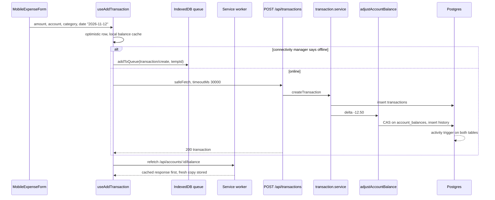
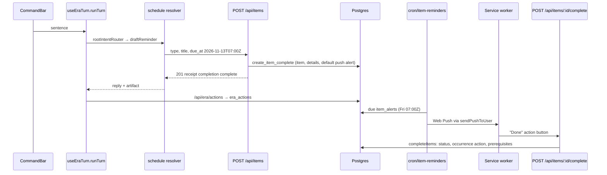
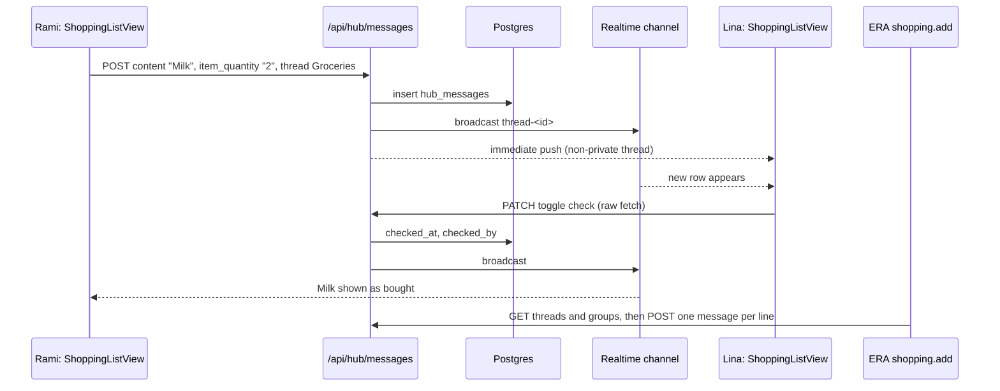
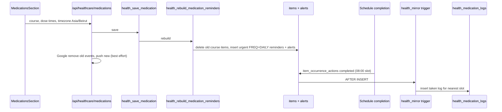
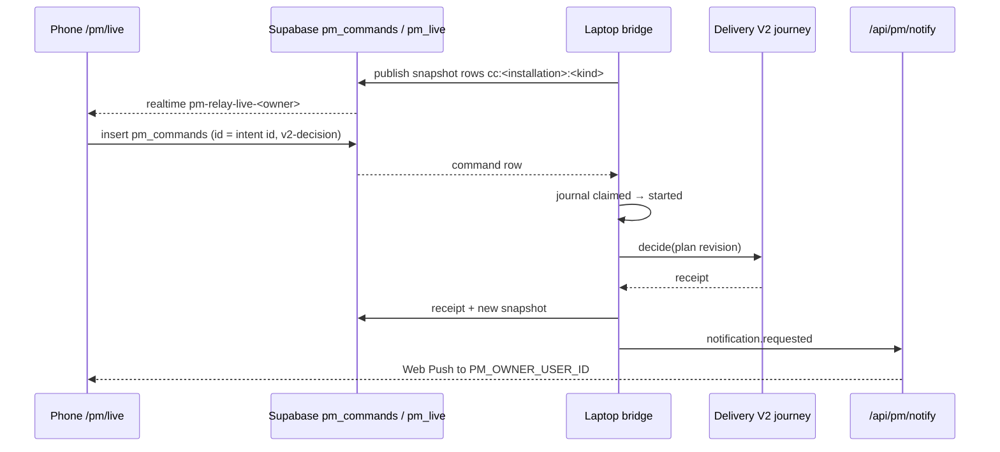

# ERA Critical Flows

[README](README.md) · [Capability Map](CAPABILITY-MAP.md) · [Architecture](ARCHITECTURE.md) · **Critical Flows** · [Change Impact](CHANGE-IMPACT-GUIDE.md)

Five journeys, each through a different part of ERA, traced file by file. Every step is CURRENT IMPLEMENTATION unless marked. People, amounts and items are fictional: **Rami** uses the blue theme, **Lina** the pink theme, and they share one household. Beirut is UTC+2 from 25 October 2026 (after daylight saving ends).

| # | Journey | Parts of ERA crossed |
|---|---|---|
| J1 | Log a spend on a weak connection | Budget, Sync & Offline, service worker, Activity Log |
| J2 | Tell ERA to set a reminder, get the push, finish it from the notification | ERA, Schedule, Notifications, Prerequisites, Google Calendar |
| J3 | Share a shopping list across two phones | Hub, Household Sharing, Realtime, ERA Shopping, Kitchen |
| J4 | Start a medication course and tick a dose | Healthcare, Schedule, DB triggers, Google Calendar |
| J5 | Approve Delivery work from the phone | PM Command Center, Supabase relay, laptop bridge, push |

Each journey ends with **acceptance examples**: what an owner test should observe. Where today's code would fail an example, the row says so and names the tracked defect.

---

## J1 — Log a spend on a weak connection

**Scenario.** Thursday 12 Nov 2026, 00:40 in Beirut (22:40 UTC on the 11th). Rami logs "Bakery 12.50" against **Wallet** (USD, expense account, balance $240.00) in a basement with one bar of signal.

| Step | Code | Writes |
|---|---|---|
| 1. Form builds the payload with the **local** date | `src/components/expense/MobileExpenseForm.tsx:897` (`format(date, "yyyy-MM-dd")`) | — |
| 2. Optimistic insert, local balance cache updated | `src/features/transactions/useDashboardTransactions.ts:574-684` (`useAddTransaction`), `setCachedBalance()` | React Query cache, `localStorage balance_cache_*` |
| 3a. Offline before sending → queue | `queueOfflineCreate()` → `addToQueue({ feature: "transaction", tempId })` | IndexedDB `budget-offline` |
| 3b. Online → POST with a 30 s budget | `safeFetch("/api/transactions", { timeoutMs: 30_000 })` (`:647-653`) | — |
| 4. Server validates the account the caller may write | `getAccessibleAccount()` in `createTransaction()` (`src/services/transaction.service.ts:403-410`) | — |
| 5. Insert, then balance | insert (`:498`), `adjustAccountBalance(account_id, delta, "transaction")` (`:551`) | `transactions`; `account_balances` (CAS); `account_balance_history` |
| 6. Activity recorded | Generic trigger on `transactions` and `account_balances` (`migrations/2026-09-26_household-activity-log.sql`) | `household_activity` ⛁ |
| 7. Replay when back online | `OfflineSyncEngine.processQueue()` (`src/lib/offlineSyncEngine.ts`), 10 s per op (`:255`); invalidates `FEATURE_QUERY_KEYS.transaction` (`:28-34`) | Same as 4–6 |

**What can go wrong**

| Situation | What happens today | Evidence |
|---|---|---|
| Signal drops after the server committed | `TypeError: Failed to fetch` → `OfflineError` → queued → replayed later → **second transaction** | No client id on transactions (O2/HUB-120) |
| Request runs past 30 s | `RequestTimeoutError` → error toast and optimistic rollback; React Query then **re-sends once** (`mutations: { retry: 1 }`, `src/app/providers.tsx:131-134`) | Mutation Integrity Audit #1 |
| Other writers keep changing the balance during all 5 compare-and-swap attempts, or the update errors | Transaction exists, balance unchanged, row in `error_logs`, response 200 | `src/lib/balance.ts:66-122`; Audit #2 |
| Phone stays offline more than 24 h | Queued spend deleted on the next sync pass, no notice | `src/lib/offlineQueue.ts:422-435`; O1/HUB-119 |
| Session expired during a long offline stretch | Replay gets 401 → treated as permanent → deleted | `src/lib/offlineSyncEngine.ts` 4xx branch; O1 |
| Balance card right after the spend | Active SW returns the **previous** `/balance` response first | `public/sw.js:184-209`; [ARCHITECTURE F-U1](ARCHITECTURE.md#f-u1-money-gets-can-be-answered-from-a-stale-service-worker-cache) |
| Night-time entry | Transaction is dated 12 Nov (client date) but its balance-history row is dated **11 Nov**, because `adjustAccountBalance` defaults `effective_date` to UTC today and this caller passes none | `src/lib/balance.ts:126`; `transaction.service.ts:551-555`; related to T1/BUD-93 |
| Partner view | Lina sees the spend when Wallet is shared (`accounts.is_public`) and the row is not private (`transactions.is_private`) | `src/app/api/accounts/route.ts:28-52`, `transaction.service.ts` |

**Acceptance examples**

1. Online, good signal: one transaction "Bakery", −$12.50, date 2026-11-12; Wallet $227.50; one history row with change −12.50.
2. Airplane mode, then reconnect within an hour: the pending pill shows one item; after sync exactly one row exists and Wallet is $227.50.
3. Throttle to a request longer than 30 s that the server still completes: **expected** one row. **Today:** two rows are possible (Audit #1, O2).
4. Leave the phone offline for 25 h, then reconnect: **expected** the spend is sent or held for review. **Today:** it is gone (O1).
5. With the SW active, log the spend and look at the balance card without reloading: **expected** $227.50. **Today:** $240.00 may show until the next refetch (F-U1; P2 in ARCHITECTURE proposes the fix).

---

## J2 — Tell ERA to set a reminder, get the push, finish it from the notification

**Scenario.** Tuesday 10 Nov 2026, 19:05 Beirut. Lina types "remind me to renew the car insurance Friday at 9" into ERA.

| Step | Code | Writes |
|---|---|---|
| 1. One entry point from sentence to reply | `src/components/era/CommandBar.tsx` → `useEraTurn().runTurn()` (`src/features/era/useEraTurn.ts`) | Optimistic transcript rows |
| 2. Deterministic routing; no model call for this sentence | `rootIntentRouter.parse()` (`useEraTurn.ts:272`) → `resolveIntent()` | — |
| 3. Parse title, day and time; refuse recurrence | `src/features/era/intents/resolvers/schedule.ts:156-203` | — |
| 4. Create through the shared source contract | `safeFetch("/api/items", { timeoutMs: 8_000 })` (`schedule.ts:209-219`) → `prepareItemCreate()` adds a push alert at due time when none is given (`src/lib/items/createContract.ts:99`) → `create_item_complete` (`src/app/api/items/route.ts:23`) | `items`, `reminder_details`, `item_alerts` ⛁ |
| 5. Google backup, best effort | `syncItemToGoogleCalendar()` (`items/route.ts:31`) | Google event, `items.google_event_id` |
| 6. Artifact | `eraArtifact("reminder","created",…)` (`schedule.ts:250`) → `recordEraArtifacts()` → `/api/era/actions` | `era_actions` ⛁ |
| 7. Push at 09:00 Friday | `src/app/api/cron/item-reminders/route.ts` → `sendPushToUser()` (`src/lib/pushSender.ts:46`) | `notifications`, `push_event_logs` |
| 8. "Done" from the notification | `public/sw.js` `handleCompleteItem` (`:1269`) → `/api/items/:id/complete` → `src/lib/items/completeItems.ts`: upserts the occurrence action on `item_id + occurrence_date + action_type` (`:115-150`), deactivates alerts, resets the item to dormant if it has its own prerequisites (`:201`), updates Google | `items`, `item_occurrence_actions`, `item_alerts` |

**What can go wrong**

| Situation | What happens today | Evidence |
|---|---|---|
| No day in the sentence | ERA asks "When?" and writes nothing until answered | `EraPendingTurn`, `resolvePendingReminderAnswer` (Feature Map `ai-assistant.md`) |
| "every Friday" | "Set recurring reminders in Schedule." Nothing is written | `schedule.ts:183-185` |
| `create_item_complete` not installed | 500 "Item was not saved"; ERA says "Reminder was not saved." | [ARCHITECTURE F-U7](ARCHITECTURE.md#f-u7-schedule-capture-fails-closed-without-one-owner-run-migration) |
| Response lost after commit | "Save unverified. Check Schedule before retrying." No automatic retry | `schedule.ts:222-225`, `:253-255` |
| Phone offline | ERA does not queue; any thrown error, including a pre-flight `OfflineError` where nothing was sent, is reported as "Save unverified" | `schedule.ts:253-255`; HUB-112 notes "no new queue or retry" |
| Late model reply attaches to another chat | Prevented for Ask AI proposals: cards are bound to owner, conversation, time and time zone | AI Assistant Overview, HUB-108 hardening 1 |
| No scheduler calls the cron | No push ever arrives; nothing in the app reports it | No `vercel.json`; decision D1; UNKNOWN |
| Two overlapping cron runs | Duplicate pushes | N1/NOTIF-23 |
| Tapping "Done" while offline | The service worker cannot complete it and opens the app at the item instead; nothing is queued | `public/sw.js:1304-1310` |
| Completing from the in-app notification centre instead | `complete_task` writes a column `items` does not have and reports success | [ARCHITECTURE F-D11](ARCHITECTURE.md#f-d11-more-than-one-way-to-complete-a-reminder); Audit #6 |
| Dates | "Friday at 9" is anchored to the request time and stored as `2026-11-13T07:00:00Z`; the push fires 09:00 Beirut. Bare `YYYY-MM-DD` strings must not go through `new Date()` | Feature Map `ai-assistant.md` gotcha; `src/lib/utils/date.ts` |
| Partner view | Items are private unless `is_public`; `responsible_user_id` and `notify_all_household` decide who is reminded | `migrations/schema.sql` `items` |

**Acceptance examples**

1. Lina's sentence creates one reminder about renewing the car insurance, due Fri 13 Nov 2026 09:00, with one push alert at 09:00, and one artifact in ERA's Artifacts view that opens it.
2. "remind me to renew the car insurance every Friday" creates nothing and points to Schedule.
3. At 09:00 Friday one push arrives (needs a live scheduler). Tapping **Done** marks it complete in Schedule; the Google event (if connected) is gone after the next sync or reconcile.
4. With the network off, the same sentence gives an honest failure and leaves nothing half-written. **Today** the message says "unverified" even when nothing was sent.

---

## J3 — Share a shopping list across two phones

**Scenario.** Saturday 14 Nov 2026. At home Rami adds "Milk ×2" and "Labneh" to the **Groceries** list. Lina, in a supermarket with poor signal, ticks Milk off. Later Rami tells ERA "add eggs to groceries".

| Step | Code | Writes |
|---|---|---|
| 1. Add item; offline adds are queued | `useSendMessage()` (`src/features/hub/hooks.ts:1040`): offline → `addToQueue({ feature: "hub-message" })` (`:1064`); online → raw `fetch("/api/hub/messages")` (`:1096`) | `hub_messages` (`purpose = 'shopping'` thread) |
| 2. Server insert, broadcast, push | `src/app/api/hub/messages/route.ts` (broadcast `:1082`), `sendPushToUser()`; unread batches later via `cron/chat-notifications` | `hub_messages`, `hub_message_receipts`, `notifications` |
| 3. Partner receives | Realtime subscriptions (`hooks.ts:850`, `:991`), fallback polling when the socket is down (`:759`) | — |
| 4. Tick off | PATCH via raw `fetch` (`src/components/hub/ShoppingListView.tsx:1292-2075`) → `checked_at`, `checked_by` (`src/app/api/hub/messages/route.ts:1048-1091`) | `hub_messages` |
| 5. ERA adds lines | Capability `shopping.add` (`src/features/era/capabilities/registry.ts:349-356`): reads threads and groups, writes one message per line, undoes only acknowledged rows (AI Assistant Overview, HUB-112) | `hub_messages`, `era_actions` |
| 6. Activity | Trigger tags shopping rows as module `kitchen`, feature `shopping` (`2026-09-26_household-activity-log.sql:291-298`) | `household_activity` ⛁ |

**What can go wrong**

| Situation | What happens today | Evidence |
|---|---|---|
| Lina ticks Milk with no signal | The PATCH has no timeout and no queue; the tick fails and must be redone | [ARCHITECTURE F-U9](ARCHITECTURE.md#f-u9-the-legacy-shopping-queue-has-no-producer-and-shopping-edits-are-not-queued-at-all) |
| A 5xx after the flip committed | The client retries `toggle_check`, which flips it back | Mutation Integrity Audit #8 |
| Both tick the same item at once | Each request reads the current state and flips it, so two taps on two phones can cancel out | Audit #8 |
| Rami adds "Labneh" offline while Lina adds and buys her own "Labneh" | When Rami's queue replays, a second, unbought "Labneh" appears; nothing merges duplicates | `src/lib/offlineSyncEngine.ts` (FIFO replay) |
| Household link has a stale second row | Hub reads use `.maybeSingle()` and can treat the pair as "no household" | H1/HUB-121 |
| Inventory | Ticking Milk does not restock pantry stock | No restock call in Hub code; CAPABILITY-MAP §1.3 |
| Private thread | Private threads are excluded from partner push on both the immediate and cron paths | Notifications Master Book (2026-07-10 entry) |

**Acceptance examples**

1. Rami adds "Milk ×2": within seconds Lina's list shows "Milk · 2" in General (or the chosen group) without reloading, and Lina gets one push.
2. Lina ticks Milk: Rami sees it struck through; the Activity Log (if installed) shows one "completed" Kitchen entry.
3. In airplane mode, Rami adds "Labneh": a pending marker shows; after reconnect exactly one "Labneh" row exists.
4. In airplane mode, Lina ticks "Labneh": **expected** queued or clearly refused. **Today** the request fails without a queue (F-U9).
5. "add eggs to groceries" in ERA writes one "Eggs" row in Groceries and an artifact; Undo removes only that row.

---

## J4 — Start a medication course and tick a dose

**Scenario.** Monday 16 Nov 2026. Rami records a fictional 7-day course, "Amoxi-test 500 mg", twice daily at 08:00 and 20:00 Beirut, on Rami's own private profile.

| Step | Code | Writes |
|---|---|---|
| 1. Save the course | `src/app/healthcare/MedicationsSection.tsx` → `src/app/api/healthcare/medications/*` → `src/lib/health/medicationServer.ts` → RPC `health_save_medication` | `health_medications` ⛁ |
| 2. Rebuild reminders in SQL | `health_rebuild_medication_reminders` deletes the course's items and inserts one urgent reminder per dose time with `FREQ=DAILY`, `start_anchor`, `end_until`, alerts and any already-taken occurrences (`migrations/2026-09-26_healthcare-medications.sql:177-306`) | `items`, `reminder_details`, `item_recurrence_rules`, `item_alerts`, `item_occurrence_actions` |
| 3. Calendar backup | Remove the old items' events, push new ones (`medicationServer.ts:93-114`) | Google events |
| 4. Push at 08:00 | Same cron path as J2 step 7 | `notifications` |
| 5. Tick from Schedule | `useCompleteItem()` → `/api/items/:id/complete` (`src/features/items/useItemActions.ts:370-404`) → occurrence action | `item_occurrence_actions` |
| 6. Mirror to Healthcare | `health_mirror_occurrence_action` picks the nearest slot within ±1 day, tolerating a DST shift (`:489-562`) | `health_medication_logs` |
| 7. Or tick from Healthcare | `health_set_dose` writes the log **and** the occurrence action with `app.health_mirror_off` set so the trigger does not double-write (`:397-488`) | Both tables |

**What can go wrong**

| Situation | What happens today | Evidence |
|---|---|---|
| Rami edits the course on day 3 | All its reminder items are deleted and recreated with new ids; earlier artifacts, Activity Log links and deep links to the old ids stop resolving | [ARCHITECTURE F-U8](ARCHITECTURE.md#f-u8-editing-a-medication-replaces-its-reminder-items) |
| Rami reopens a ticked reminder in Schedule | The occurrence action is deleted (`useUncompleteItem`, browser-direct, `useItemActions.ts:501-570`); the DELETE trigger removes the dose log | Trigger `health_mirror_occurrence_undone` |
| Someone changes how Schedule records completion (update instead of insert, another `action_type`, another `occurrence_date` meaning) | Doses silently stop being logged | [ARCHITECTURE F-U5](ARCHITECTURE.md#f-u5-item_occurrence_actions-is-a-shared-bus) |
| Migration not applied | No medication tables or RPCs; the page fails | ⛁ UNKNOWN |
| Dose taken late (09:30) | Logged against the 08:00 slot (nearest slot) | Trigger slot logic |
| Partner view | Profiles are private unless `shared_with_household` (`migrations/schema.sql:1738`); only the managing user may set doses (`health_set_dose` checks `managing_user_id = uid`) | Migration `:424` region |
| Course end | Rules end at `end_until`; no reminders after the last dose | Rebuild step 2 |

**Acceptance examples**

1. Saving the course creates exactly two urgent daily reminders (08:00 and 20:00) from 16 Nov to 22 Nov 2026, each with one push alert, both visible only to Rami.
2. Completing the 08:00 reminder on 17 Nov in Schedule shows 17 Nov 08:00 as taken in Healthcare; reopening it clears the tick.
3. Ticking 20:00 on 17 Nov in Healthcare marks that occurrence complete in Schedule, and no duplicate log row appears.
4. Changing the evening time to 21:00 leaves morning history intact and moves future evening reminders. **Check** that ERA artifacts or links created before the edit are not left pointing at deleted items (F-U8).

---

## J5 — Approve Delivery work from the phone

**Scenario.** The owner is away from the laptop. A Delivery V2 run for a fictional item "R-900" waits for plan approval. The laptop runs `pnpm pm --bridge`.

| Step | Code | Writes |
|---|---|---|
| 1. Gate | `src/middleware.ts` (`/pm/live` requires a Supabase session) and RLS `user_id = auth.uid()` on relay tables | — |
| 2. Phone shows laptop state | `src/app/pm/live/page.tsx` → `CommandCenterLive` → `src/features/pm-live/relay/transport.ts` (channels `:222`, `:244`) | — |
| 3. Persist intent, then send | `src/features/pm-live/relay/commands.ts` (`insert`, `:105`): unsent → sent → settled; resend queries the original receipt | `pm_commands` |
| 4. Laptop claims and executes once | `scripts/pm/relay.mjs` command journal (`:197-266`), `scripts/pm/bridge.mjs`; V2 lifecycle `scripts/delivery-v2/journey.mjs` | `.delivery/` store, `pm_live` |
| 5. Push to the owner | `src/app/api/pm/notify/route.ts` (bearer auth, single recipient) | `notifications` |

**What can go wrong**

| Situation | What happens today | Evidence |
|---|---|---|
| Laptop asleep or bridge stopped | The command stays pending; the phone shows unavailable/stale, never "failed" | Feature Map `pm-command-center.md` gotchas |
| Phone reloads mid-send | The persisted intent is re-sent with the same id; the bridge sees one command | DLV-138 recovery note in the same map |
| Laptop crashes after starting the effect | The journal state `started` means "the effect may have begun"; it is not re-executed blindly | `relay.mjs:250-266` |
| Plan changed since the phone loaded it | Approval names an exact plan revision, and `deliver` requires a selection witness bound to the Master Book revision; how a stale approval is reported on the phone was not traced | Feature Map `pm-command-center.md` gotchas; `docs/ERA-Steward-Setup-Summary.md` |
| Two PM servers on one store | Seen on 2026-09-15 (ports 4317 and 4318) | `docs/Delivery-Requests.md` |
| Network on the phone flaps | The timeout is shown as pending, not failed | Same map |

**Acceptance examples**

1. With the bridge running, approving the plan for "R-900" on the phone moves the run to implementation once; the laptop UI shows the same state.
2. Turn the phone's network off right after tapping Approve, reload, turn it on: the run has exactly one approval receipt.
3. Stop the bridge, tap Approve: the phone shows the command waiting and the laptop as unavailable; restarting the bridge executes it once.

---

## Cross-journey observations

- **Exactly-once is uneven.** Transfers, bulk items, ERA confirm cards and PM commands carry an identity end to end. Plain transactions, confirm/settle flows and shopping toggles do not (J1, J3).
- **The offline story differs per surface.** Forms queue creates; ERA never queues; shopping edits are not queued; the service worker's actions are not queued (J1–J3).
- **Silent success is the common failure shape.** A lost balance CAS, a notification `complete_task` on a missing column and an unscheduled cron all look like success from the UI (J1, J2).
- **Schedule completion is a hub.** It feeds Healthcare, Fitness, Google Calendar and the Activity Log, and resets prerequisite items to dormant (J2, J4). It does not wake items that wait on the completed one ([ARCHITECTURE F-U12](ARCHITECTURE.md#f-u12-most-prerequisite-types-can-never-be-met)). See [CHANGE-IMPACT-GUIDE §2](CHANGE-IMPACT-GUIDE.md#2-blast-radius-by-shared-component).
