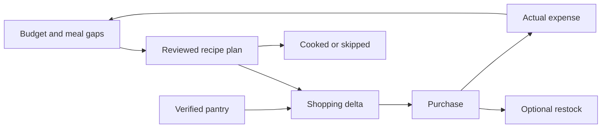

# Journey 02 — Feed the household within a grocery cap

[Index](README.md) · [Shared contracts](SHARED-DEPENDENCIES.md) · Priority **2**

## User goal and trigger

“Plan our dinners, buy what is missing, and keep the shop within $50.” Trigger: a weekly meal review, uncovered meal slots, or a deliberately user-set grocery limit. Success includes meals actually covered and actual spending captured, not just recipes suggested.

## Current behavior and evidence

**CURRENT:** Meal Planning stores recipe, planned date, person, servings, leftovers and status. `mealCoversDate` recognizes planned/shopping-added/cooked meals, excludes skipped meals and respects `for_user_id`. Chef treats failed reads as unavailable rather than an empty meal week. [Coverage helper:37](../../../src/lib/mealPlanCoverage.ts#L37), [Chef:191](../../../src/features/era/intents/resolvers/chef.ts#L191), [schema:1166](../../../migrations/schema.sql#L1166).

The meal shopping route reads saved recipe ingredients, creates Hub messages and stores their IDs on the meal. The assistant can bind `recipe.ingredients` to `shopping.add`, but its registry explicitly says no automatic deduplication or stock subtraction and warns that a partial batch is unsafe to replay. [Meal shopping:88](../../../src/app/api/meal-plans/add-to-shopping/route.ts#L88), [registry:327](../../../src/features/era/capabilities/registry.ts#L327).

Shopping check-off updates `checked_at`/`checked_by`; it does not create a transaction or restock. Inventory has its own stock and restock records. Budget reads allocations and eligible non-draft/non-deleted transactions; an explicit start/end window is needed to avoid calendar-month fallback. [Check-off:1038](../../../src/app/api/hub/messages/route.ts#L1038), [stock schema:1072](../../../migrations/schema.sql#L1072), [budget route:238](../../../src/app/api/budget-allocations/route.ts#L238).

**Gap:** no evidenced complete budget-aware recipe selection, normalized ingredient demand, purchase-to-spend-to-stock closure. Recipe-to-shopping does exist. A current `meal.assign` approval describes replacing an occupied slot for both people; do not silently broaden that to safe individualized weekly meal planning. [Chef:136](../../../src/features/era/intents/resolvers/chef.ts#L136).

## Participating modules and source of truth

| Module | Owns |
|---|---|
| Hub/ERA | Request, proposed choices, source-linked progress |
| Recipes / Meal Planning | Ingredient definition; person/date coverage and actual meal status |
| Shopping List, junction | Shared requirements and bought flags |
| Catalogue / Inventory | Product identity, stock and explicit restock |
| Budget / Transactions / Accounts / Preferences | Allocation, recorded expense, currency/account and billing window |

A shopping row, expense, stock increment and cooking log represent different facts. The proposed journey correlates their IDs; it does not merge their meanings. [Shared source matrix](../08-shared-data/SOURCE-OF-TRUTH-MATRIX.md).

## Input once

Capture days, people/servings, meal slots, grocery cap and currency, intended account/category, and any explicit constraints. Reuse saved recipes and household identity. Reconfirm questionable pantry quantities only where subtraction matters. Actual checkout amount and received quantities are new observations supplied once at purchase; never pretend they were known at planning time.

## Proposed end-to-end interaction

1. Read authorized meals, saved recipes, open shopping rows, relevant stock and budget for an explicit billing window. Show whether the $50 cap is user-entered, envelope-backed, or unsupported by a fresh budget read.
2. Suggest a few saved-recipe combinations. Deterministic logic counts person/meal coverage and leftovers. AI can explain substitutions and effort tradeoffs; it cannot certify price, dietary safety, or stock accuracy. No live merchant price feed is assumed.
3. Review the meal plan and a shopping delta. Preserve recipe revisions and serving multipliers. Subtract only user-verified, compatible stock; do not merge similar names unless product/unit identity is resolved. Ask about unknown prices or leave an explicit incomplete estimate.
4. Approve meal assignments and shopping additions with exact dates, people, quantities and list. If a slot is occupied, choose keep/replace explicitly. Retain per-meal and per-message receipts; a failed shopping addition does not undo an already saved meal without review.
5. At the shop, bought items remain distinct from outstanding quantities. Offer **Log spend** using one actual checkout total or an existing transaction, and optional **Restock** using received amounts. These linked steps are proposed; checking an item alone remains only a shopping action.
6. Cooking uses the recipe/meal tool. Record cooked or skipped and confirm leftover coverage when reality differs. Recompute the remaining grocery allowance from actual transactions, not the earlier estimate.

## Handoff events and decisions

Proposed events:

| Event | Required reference / effect | Decision owner |
|---|---|---|
| `meal.plan.approved` | Recipe revision, servings, person/date/slot → meal IDs | AI suggests; user approves; deterministic coverage |
| `ingredients.required` | Meal IDs, normalized demand, verified stock and existing-list references → shopping delta | Deterministic compatible-unit math; user resolves ambiguity |
| `shopping.purchase.recorded` | Bought message IDs, actual quantity → optional expense/restock steps | User supplies reality; no inferred spend |
| `purchase.expense.linked` | Existing/new transaction ID, actual amount/currency/date/account | Transactions owns write; budget refresh follows |
| `meal.outcome.recorded` | Meal/cooking record → remaining coverage | User marks cooked/skipped; deterministic coverage recomputation |

Opening recipe details, Inventory or an expense form needs only a link. Automating demand aggregation or multi-fact purchase closure requires C1–C7, especially C2 and C7. A new general inventory engine is unnecessary.

## Permissions and confirmations

Meal creation requires a household in the current model. Missing household is not an invitation to create/share one silently. A shared shopping list does not grant access to private account details. Show the intended account, currency, date and amount before posting a spend; confirm restock separately. Dietary constraints supplied in this request are preferences to respect, not a medical guarantee or authorization to read all health records. D2 defines budget confidence and D3 the optional purchase handoffs.

## Exceptions and interrupted work

| Condition | Proposed handling and resume behavior |
|---|---|
| Stale pantry or prices | Retain observation dates; ask to verify stock, replace price estimate, or mark unknown. Do not claim the cap is guaranteed. |
| Missing recipe ingredients / no household / failed budget read | Block only the dependent step, with a link to repair it. A user cap can still guide a tentative plan, labelled without verified affordability. |
| Contradictory units or overlapping meals | “1 bag” and “500 g” stay separate until converted explicitly. Conflicting coverage requires keep/replace, not a hidden extra meal. |
| Revoked shared recipe/list/account | Stop that branch, purge restricted cached context and allow reselection from accessible sources. Do not copy the revoked recipe into a new row. |
| Duplicate additions or repeated purchase | Reuse batch/message/transaction receipts. Never replay all ingredients after a partial batch. A second identical meal is allowed only as an intentional new plan. |
| Date/zone or billing rollover | Meal days remain local dates; approval freezes them. Refresh the explicit custom billing window and cap on resume after rollover; reconfirm material changes. |
| Interrupted after meal saved but shopping partly added | Keep meal receipt; reconcile actual shopping IDs before adding the remainder. Current APIs do not guarantee atomic cross-module rollback. |
| Purchase complete, expense uncertain | Keep bought flags, show expense as unverified and inspect Transactions before retrying. Do not record a second receipt total to make the journey look finished. |
| Ingredient unavailable or actual cost exceeds cap | Offer a substitution, fewer meals, or explicit cap increase. Reapprove changed meal/quantity effects; preserve the real expense even when over budget. |

## User-visible completion criteria

**Prepared:** chosen person/meal slots are covered, ingredients are either verified on hand or represented on the reviewed list, and estimate coverage is stated. **Outcome complete:** required purchases are accounted for, the actual expense is linked once or explicitly deferred, optional stock updates have known outcomes, and planned meals are cooked/covered or deliberately revised. Pending expense capture is not “within budget, done”.

## Fictional example

Lina and Sami plan dinners for November 9–11 in `Asia/Beirut`. The grocery envelope for October 25–November 24 is USD 120, with USD 65 already recorded: USD 55 remains. They set a stricter USD 50 shop cap. A four-serving lentil recipe covers two people on Monday and Tuesday; a two-serving omelette covers Wednesday. They verify lentils on hand, leave an ambiguous “bag of rice” out of subtraction, and enter a USD 32 estimate for the remaining basket.

The actual receipt is USD 35. One confirmed transaction leaves USD 20 in the envelope and USD 15 under the shop cap. They restock only the eggs actually received. If the expense response is lost, the journey shows “expense unverified” while preserving bought items, then links the existing transaction on reconciliation. Cooking Monday establishes the two-day meal coverage; the recipe card alone did not prove dinner happened. All values are fictional.

## Owner decisions

D2: estimate versus guaranteed limit; D3: expense/restock offers; D8: proposal retention. No price service or stock-consumption automation is assumed.
