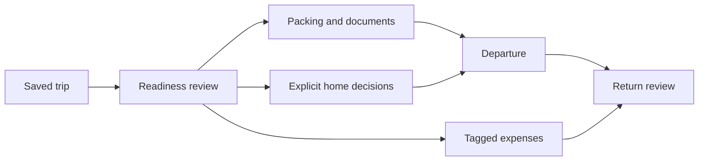

# Journey 03 — Leave ready, return with costs and commitments accounted for

[Index](README.md) · [Shared contracts](SHARED-DEPENDENCIES.md) · Priority **4**

## User goal and trigger

“Prepare our trip and make sure home is handled while we are away.” Trigger: saved trip dates, a departure review or a return review. The outcome combines readiness, actual trip costs, and explicit decisions about home commitments. It does not require activating the trip cascade.

## Current behavior and evidence

**CURRENT:** Trips has itinerary, packing, document and overview surfaces. Planner records remain useful in draft status. Dates, scope, currency and linked account are stored on `trips`. Solo trips are owner-private; household trips allow partner access to collaborative child records, while the trip lifecycle remains owner-only. [Schema:1609](../../../migrations/schema.sql#L1609), [trip access:13](../../../src/lib/tripAccess.ts#L13), [Trips overview](<../../../ERA Notes/03 - Junction Modules/Trips/Overview.md>).

The older overview describes activation skipping/pausing/reassigning home items and completion reversing them. **The source kill switch disables that cascade.** Activation still creates an expense account and updates trip state; completion updates state without running the reversal RPC. [cascade.ts:8](../../../src/features/trips/cascade.ts#L8), [activate:34](../../../src/app/api/trips/[id]/activate/route.ts#L34), [complete:32](../../../src/app/api/trips/[id]/complete/route.ts#L32). Do not advertise the documented cascade as current behavior.

Trip spend is the union of tagged transactions and transactions in the trip account, deduplicated by transaction ID, expense accounts only, separately by currency. The route excludes drafts/deleted rows, limits results to 5,000 and can fall back to account-only when the trip-tag column is unavailable. A summary can therefore lack full tag coverage under that fallback. Private partner descriptions are blanked in the aggregator, while their amounts still count in the returned rows. [Spend route:42](../../../src/app/api/trips/[id]/spend/route.ts#L42), [aggregator:26](../../../src/lib/tripSpend.ts#L26).

Document expiry is compared with trip end and a 90-day warning window in the UI; this is not immigration eligibility verification. ERA's Trips reach entry provides navigation with reads marked unverified. [OverviewTab:215](../../../src/components/trips/overview/OverviewTab.tsx#L215), [reach:58](../../../src/features/era/reach.ts#L58).

## Participating modules and source of truth

Trips owns dates/scope, itinerary places, packing and document metadata. Transactions owns actual costs; Accounts owns the account/currency. Schedule/Chores owns home commitments and their outcomes; Meal Planning owns meals that may need explicit changes. Hub/ERA is a proposed coordinating entry, not an existing travel agent. Catalogue document links are optional existing data references, not evidence of a complete picker or universal document vault.

Keep trip itinerary estimates distinct from paid transactions and packing state distinct from document validity. A trip status of `active` is neither readiness nor proof that home work was changed.

## Input once

Capture trip dates, destination, participants/scope and trip currency once; reuse the saved trip ID for every handoff. For the proposal, obtain destination and home time-zone choices explicitly because the current trip row does not store a destination zone. Reuse itinerary, packing, documents and existing cost tags. Ask only for new missing facts such as actual booking confirmation or who will handle a chore.

## Proposed end-to-end interaction

1. Open a trip review from Trips or a Hub navigation handoff. Load current trip records, costs and authorized home commitments overlapping the absence. Label unavailable sources rather than showing a falsely complete readiness score.
2. Present three concise groups: travel essentials, home decisions, and costs. AI may suggest likely missing packing items and summarize conflicts; these are suggestions. Deterministic logic compares dates, packing quantities and expense identities.
3. The owner selects home changes individually: keep, skip one occurrence, move, or ask the partner to take responsibility. Open Schedule/Chores/Meal Planning for unsupported changes. A proposal to assign work is not an actual message to the partner or acceptance by them.
4. Review document metadata and packing. Opening a document uses its current authorized file access. Expiry warnings invite review, not a conclusion that the person can legally travel. Booking external transport/accommodation remains outside this journey's evidenced capabilities.
5. Log or tag actual purchases in Transactions, including pre-trip expenses. Keep amounts in their currencies; itinerary cost estimates do not enter the ledger. Activation is optional and separately reviewed as an account/lifecycle action.
6. On return, show real trip totals and the outstanding home decisions. Do not reverse all changes blindly. A moved chore that has since been completed stays completed; only a valid source-specific correction can undo it. A draft trip can finish this human outcome without pretending it traversed active/completed lifecycle states.

## Handoff events and decisions

| Proposed event | Payload / owning destination | Decision boundary |
|---|---|---|
| `trip.readiness.reviewed` | Trip ID/date version, participants, missing facts | AI suggests; deterministic source comparisons |
| `home.commitment.change.approved` | Original occurrence/meal, explicit before/after, responsible person | User approves; owning module applies and returns receipt |
| `trip.expense.linked` | Transaction ID + trip ID | Deterministic union/dedup; actual payment supplied by user |
| `trip.return.reviewed` | Known home-effect receipts and latest source states | User chooses corrections; no automatic blanket rollback |

Links suffice for documents, packing, the trip page and expense tagging. Cross-module home effects or a future reversal mechanism require C1–C6. Do not enable the disabled cascade merely to deliver this workflow. D4 must be decided and the behavior independently verified first.

## Permissions and confirmations

Keep lifecycle editing with the trip owner, collaborative packing/places within the active household, and solo trip details private. An authorized trip viewer does not automatically gain access to all linked account, document or Schedule details. Do not expand the existing private-description behavior into exposure of private transaction text in an AI summary. Review account creation separately from home changes, with exact scope and currency. Any partner notification would require an explicit approved send action; none is assumed here.

## Exceptions and interrupted work

| Condition | Proposed handling and resume behavior |
|---|---|
| Stale trip dates or changed packing/home records | Re-read before review; recompute overlap and expiry checks when dates changed, invalidating only dependent home changes and approvals. Keep actual payments unchanged. |
| Missing booking, document or cost coverage | Show missing/unavailable, not ready/zero cost. Account-only spend fallback and capped results must be disclosed before a completeness claim. |
| Contradictory itinerary and flight document | Ask which source is current; retain both references until the user corrects the trip. Do not silently overwrite a booking time. |
| Revoked access: partner unlinked or trip becomes solo | Stop shared reads/writes and pending assignments; revalidate document access and remove restricted context. Old approval is not current authority. |
| Duplicate activation or repeated expense | Activation currently creates an account before updating trip state; a lost response needs trip/account reconciliation, not blind replay. Tagging an existing expense must not create another expense. |
| Destination time differs from home / DST transition | Retain destination wall time and chosen zone in the proposal; show home commitment times separately. No automatic conversion of date-only trip days. |
| Interrupted preparation | Resume from trip/packing records and completed source receipts; keep unanswered home decisions. Durable orchestration of all these branches is proposed. |
| Return reversal conflicts with later human edits | Leave later edits intact; propose a scoped correction only for the journey's still-matching effect. |
| Trip cancelled or shortened | Preserve real costs and required refunds as unresolved facts; cancellation is not a refund or restoration of every home item. |

## User-visible completion criteria

**Prepared:** required packing is complete or explicitly waived, documents have been reviewed, every selected home commitment has an acknowledged decision, and unresolved booking/access issues remain visible. **Outcome complete:** return decisions are closed, known expenses are linked once with per-currency totals, and pending refunds/uncertain writes remain outstanding. Neither a green readiness card nor a trip status transition suffices alone.

## Fictional example

Nour and Adam save a household Rome trip for November 20–24. They choose `Europe/Rome` for itinerary times and keep home chores in `Asia/Beirut`. A USD 320 flight purchased before departure is tagged to the trip. During travel, EUR 210 hotel and EUR 40 transport transactions are recorded: the review shows **USD 320 and EUR 250**, not one invented converted total.

They explicitly skip one home cleaning occurrence and retain an essential reminder. Adam checks the passports packed; this does not certify passport eligibility. If the phone closes after cleaning is skipped, reopening shows the saved skip and resumes the remaining decisions. On return, a chore completed by Nour is not reset. The trip can remain in planner mode throughout, because the requested outcome did not need cascade activation. All data is fictional.

## Owner decisions

D4: planner-only versus future home cascade; D7: home/destination zone policy; D8: retained review history. Current RLS, migration application and cascade RPC runtime behavior remain unverified.
