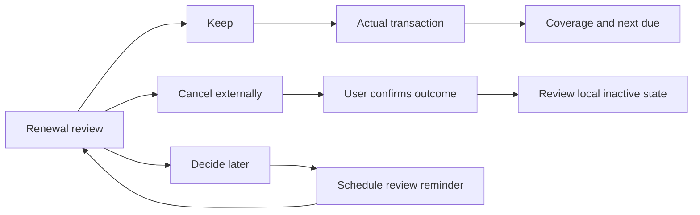

# Journey 04 — Handle an upcoming renewal once

[Index](README.md) · [Shared contracts](SHARED-DEPENDENCIES.md) · Priority **3**

## User goal and trigger

“My subscription renews soon; help me decide, remember the deadline and record what happened.” Trigger: opening an upcoming recurring commitment, asking about it in Hub, or a future opted-in review signal. The outcome is an explicit keep/cancel/defer decision and a correctly recorded financial result. A reminder being dismissed is not proof a bill was paid.

## Current behavior and evidence

**CURRENT:** Recurring stores amount, account, recurrence type, next due date, last processed date, payment method and privacy. The table uses daily/weekly/monthly/yearly values, distinct from item RRULE recurrence. A `payment_method = auto` field does not itself perform a debit. [Schema:192](../../../migrations/schema.sql#L192).

Confirming a due payment inserts a transaction, adjusts balance, then advances the recurring date. Those are sequential effects; an advancement error is logged while the route can still return success. No atomic occurrence claim is evident here. [Confirm:197](../../../src/app/api/recurring-payments/[id]/route.ts#L197).

Mark-covered uses an existing non-draft/non-deleted transaction and advances recurring dates without creating spend. ERA already offers this as a reviewed card: candidate matching reads the current billing period, multiple candidates require selection, no candidate opens a prefilled spend form, and the card rechecks `next_due_date` on tap. The resolver explicitly warns that the underlying endpoint lacks a duplicate guard. That client check is useful but not a concurrent server claim. [Mark-covered:66](../../../src/app/api/recurring-payments/[id]/mark-covered/route.ts#L66), [budgetFamilies:140](../../../src/features/era/intents/resolvers/budgetFamilies.ts#L140), [:224](../../../src/features/era/intents/resolvers/budgetFamilies.ts#L224).

**DOCUMENTED INTENT versus CURRENT:** the Feature Map says cron auto-posts recurring payments, but no such runner appears among the six [cron routes](../../../src/app/api/cron). The atlas also finds recurring payment push reminders documented-only. No evidence establishes provider payment/cancellation integration. [Atlas money capabilities](../01-atlas/CAPABILITY-MAP.md#11-money-budget-campaign).

## Participating modules and source of truth

Recurring owns the commitment and next due date. Transactions owns actual payment facts; Accounts/Balance and Budget consume their financial effects. Items/Schedule owns a separate review deadline and its completion. Notifications may deliver that item alert if configured and scheduled. Hub/ERA offers the review and existing coverage card. Statement Import may be the origin of a candidate transaction, but import is not required for this journey.

The provider's active/cancelled state is external; a user assertion or supplied confirmation is evidence, not a bank or provider API read. A future journey needs an explicit reference between review item, commitment occurrence and payment; that durable relationship is proposed, not a current schema guarantee.

## Input once

Choose the existing commitment and the occurrence under review. Reuse amount, account and recurrence. Capture the user's review-by date/time and zone, plus any actual external cancellation deadline they provide. Later capture only new facts: the decision, changed price, actual transaction selection or external cancellation confirmation. Never infer cancellation terms from `next_due_date`.

## Proposed end-to-end interaction

1. Open the commitment with its due date, expected amount/currency, current period and available payment candidates. Distinguish fresh reads from stale or unavailable data. A cash balance is not the same as budget capacity.
2. Ask the user to choose keep, cancel externally, or decide later. AI may summarize the user's stated reasons and visible spending, but cannot infer usage, contract terms or whether a provider has charged them.
3. If a decision is deferred, create an explicit review reminder through the existing Schedule tool, referencing this commitment occurrence. A generic recurring-payment auto-reminder remains a future feature.
4. For keep: if payment already exists, use the existing reviewed mark-covered path. Otherwise open the expense form or explicit recurring confirm flow for the actual payment; do not label a future intended payment as paid.
5. For cancel: link to a user-provided provider destination if available. The user performs the external cancellation and supplies its outcome. Separately review changing ERA's commitment to inactive; that local change does not cancel the service.
6. Close the review reminder only after the chosen decision is recorded. For a paid branch, verify the transaction/balance result and correct next due state. For cancellation, show external confirmation status separately from the inactive local commitment. If external action remains unknown, keep the journey unresolved.

## Handoff events and decisions

| Proposed event | Payload / destination | AI versus deterministic |
|---|---|---|
| `renewal.review.requested` | Payment ID + original due date → reviewed decision | AI explains; deterministic source/period lookup |
| `renewal.review.deferred` | Same occurrence reference + explicit review instant → Schedule | User chooses deadline; deterministic reminder |
| `renewal.payment.selected` | Transaction ID and commitment occurrence → Recurring coverage | Suggestions may rank matches; user chooses; server must claim occurrence |
| `renewal.external.outcome.recorded` | User-supplied cancellation result → local commitment review | Never inferred from a model or from reminder completion |
| `renewal.review.closed` | Verified coverage or explicit cancellation/deferral outcome → reminder status | Source checks determine completion |

Links suffice for viewing Recurring, a source transaction or the provider page. Multi-step coverage and reminder closure need C1–C6. A future server-side idempotent occurrence claim is a prerequisite for safe automated retry; the existing ERA card does not provide that guarantee alone.

## Permissions and confirmations

The current confirm route distinguishes owner from partner access to non-private commitments. Future orchestration must additionally validate access to the chosen account/transaction and bind consent to amount, currency, date and identity at the destination. Review a concrete financial effect; approval to create a reminder is not approval to create spend. Deactivation and external cancellation are separate confirmations. Undoing an ERA record does not undo an external payment or service cancellation.

## Exceptions and interrupted work

| Condition | Proposed handling and resume behavior |
|---|---|
| Stale amount or due date | Refresh and reapprove changed values. The current ERA card checks due movement; the proposal also binds amount/account/occurrence. |
| Missing transaction / failed transaction read | Distinguish no match from unavailable data. Do not turn an error into “unpaid”; retry the read or open Transactions before creating spend. |
| Contradictory bank transaction and local unpaid state | User selects verified transaction and marks covered; do not insert another expense. Ambiguous equal-amount transactions remain a choice. |
| Revoked account or household access | Stop the coverage operation and remove inaccessible details. A formerly shared commitment cannot carry old authority forward. |
| Duplicate confirm / two devices | Require destination occurrence claim + receipt in the proposed design. Current client recheck alone is insufficient; reconcile source state after uncertainty. |
| Local date, end-of-month or DST | Keep due date and paid date as local dates; use custom billing boundaries with clamping. Review reminders are instants in the chosen zone; never shift the bill day by UTC conversion. |
| Response lost after expense but before due advancement | Inspect transaction/balance and recurring state; show partial completion. Never replay the entire confirm operation merely because next due is unchanged. |
| Interrupted external cancellation | Resume at “external outcome unknown”, not a fresh cancellation attempt or automatic local deactivation. |
| Price changed / cancellation failed / refund pending | Preserve actual charge; show remaining action explicitly and reapprove changes. A pending refund does not remove the original expense. |

CURRENT billing logic: [commitments.ts:90](../../../src/features/recurring/commitments.ts#L90). The shared-data pack records period-derivation drift across other surfaces; the proposal requires one explicit window rather than assuming every “this month” label agrees.

## User-visible completion criteria

**Prepared:** a decision or explicit review reminder exists with the right commitment occurrence. **Outcome complete:** keep-and-paid has one actual payment and verified coverage/next due; cancel has user-confirmed external outcome plus deliberate local state; defer remains an open future commitment. “Reviewed”, “recorded paid” and “cancelled externally” must be distinct labels.

## Fictional example

Rami's fictional CloudBox plan is USD 24, next due November 15. On November 10 he chooses a November 12, 18:00 Beirut review reminder. He later finds a USD 24 transaction dated November 15 already recorded from his statement. He selects that transaction and confirms mark-covered: no second expense is created, and the next date becomes December 15 for this monthly commitment.

If the coverage response is lost, ERA says the outcome is unverified, reads the commitment/transaction and resumes from the known result. Completing the November 12 reminder alone would never mark the subscription paid. All values and service names are fictional.

## Owner decisions

D5: exact meaning of handled and evidence for external cancellation; D1: opt-in renewal surfacing; D7/D8: time and retained progress. Exactly-once server coverage remains a technical gap, not an owner choice to waive.
