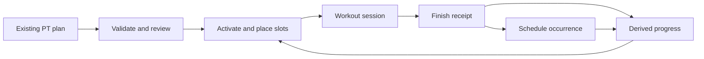

# Journey 05 — Turn a fitness plan into weekly commitments

[Index](README.md) · [Shared contracts](SHARED-DEPENDENCIES.md) · Priority **5**

## User goal and trigger

“Help me follow the training plan I already have.” Trigger: importing a PT plan, activating a reviewed draft, or restarting after a disrupted week. The outcome is a manageable week of scheduled commitments and accurately logged workouts. This is deliberately a fitness-specific goal, supported by existing entities; it is not an invented universal goal tracker or exercise-prescription service.

## Current behavior and evidence

**CURRENT:** Fitness validates `PTPlanV1` JSON. Structural errors block import; semantic issues may need correction or acknowledgement before activation. The UI offers a conversion prompt for an external AI rather than calling a model to generate a plan itself. [Validator:132](../../../src/lib/fitness/ptPlan.ts#L132), [Fitness overview](<../../../ERA Notes/02 - Standalone Modules/Fitness/Overview.md>).

Activation creates private weekly flexible Schedule items for plan slots, using existing item creation/placement primitives. A workout finish writes session completion, the Schedule occurrence and rewards in the migration's function. Conversely, Schedule completion can create a minimal schedule-source Fitness session without sets; later logging enriches it. No set performance can be inferred from that checkbox. [Migration:1003](../../../migrations/2026-10-12_fitness-module.sql#L1003), [mirror:1114](../../../migrations/2026-10-12_fitness-module.sql#L1114).

Workout writes use operation IDs/receipts, revision checks and an offline overlay. Confirmed-offline supported workout operations queue; timeouts are reconciled through receipt lookup and do not become offline writes. Setup failures return 503 with a migration reference. [Hooks:57](../../../src/features/fitness/hooks.ts#L57), [server:17](../../../src/lib/fitness/server.ts#L17). Migration application is **UNKNOWN**; the vault labels it owner-run/unapplied at its own stamp, not proof of today's deployment.

Fitness shares owner-private measurements with Healthcare and exposes only an opted-in aggregate partner summary. ERA's reach row is navigation, with conversational Fitness commands out of v1. [Fitness overview, architecture/gotchas](<../../../ERA Notes/02 - Standalone Modules/Fitness/Overview.md>), [reach:64](../../../src/features/era/reach.ts#L64).

**Gap:** the proposed value is a clearer goal-to-week review and return path across Hub, Fitness and Schedule. Much of execution is already implemented. Do not replace it with a second scheduler, reward engine or automatic training-plan author.

## Participating modules and source of truth

| Module | Authoritative responsibility |
|---|---|
| Fitness, standalone | Versioned plan, slots, sessions, set logs, operation receipts and server-derived rewards |
| Items/Schedule, standalone | Placement and occurrence actions for linked slot items |
| Plan My Day, junction | Daily intent/context; not workout completion or performance |
| Healthcare, optional standalone link | Owner's measurement records, distinct from workout success |
| Hub/ERA, proposed coordinating entry | Navigate, retain goal context and summarize only authorized implemented reads |
| Sync & Offline | Existing Fitness operation queue and pending/conflict states |

The bidirectional Fitness/Schedule mirror is an existing shared contract, not a reason to synchronize every field. Session snapshots preserve what was prescribed when the workout began; a later plan version must not rewrite that history. [Fitness overview](<../../../ERA Notes/02 - Standalone Modules/Fitness/Overview.md>).

## Input once

Select/import the existing plan, review its unresolved issues, choose start date and plan zone, then provide available training windows. Reuse the plan's weekly slot target; do not create duplicate generic “workout” reminders. Optional progress sharing is a separate choice. During workouts the user supplies actual sets once; body measurements are optional new observations, never required proof of adherence.

## Proposed end-to-end interaction

1. Hub links to Fitness with the user's goal context. Until a supported adapter exists, plan inspection and activation occur in Fitness. A plain navigation handoff must not claim it imported or activated anything.
2. Import or open the existing PT plan. Deterministic validation displays blocking issues; the user corrects or acknowledges them using current controls. AI may help explain the supplied plan or format input, but cannot invent missing prescription details or override validation.
3. Review the week's available windows against authorized Schedule facts. Offer placements for the existing slots; unknown availability remains unknown. The user activates/places through Fitness, using its current Schedule integration.
4. Each daily commitment opens the corresponding workout. Actual sets are logged in Fitness. Finishing produces the authoritative session and mirrored occurrence; merely placing the slot does not complete it.
5. If the day changes, move that slot rather than generating a new reminder. If the user pauses the plan, use Fitness's own pause/archive behavior. A missed slot remains a missed or deliberately deferred commitment, not a fabricated workout.
6. Review weekly done/target and open sessions. Optional Healthcare measurements can be opened through the existing shared measurement UI; no medical conclusion or body-change promise is inferred. If sharing is enabled, expose only the existing aggregate scope.

The Fitness-to-Schedule completion edges exist in source/migration; the encompassing Hub-led review interaction is proposed.

## Handoff events and decisions

Proposed names for existing or future boundaries:

| Event | Identity and next step | AI versus deterministic |
|---|---|---|
| `fitness.plan.reviewed` | Plan/version/fingerprint + acknowledged issues → activation | User review; validator controls readiness |
| `fitness.slot.placed` | Plan slot + Schedule item/period/occurrence index → day view | User chooses time; existing placement primitive |
| `fitness.session.finished` | Session + operation receipt → mirrored occurrence/rewards | Actual user logs; database controls completion/reward math |
| `fitness.week.reviewed` | Current week in plan zone, sessions and outstanding slots → next placements | AI may summarize; deterministic counts and no invented performance |

Links are sufficient for entry, the next workout and optional measurements. Use existing C2/C4/C5 equivalents for placement, finish and replay; C1/C3/C6 matter when a new assistant read or write adapter is added. Do not create a generic goal-completion event that awards rewards outside Fitness.

## Permissions and confirmations

Private plan/workout data stays owner-scoped; a household relationship alone does not authorize exposing sets or measurements. Use explicit import, activation, pause and placement controls. Summary sharing remains opt-in and revocable. The documented Schedule service-role partner-completion path is a current authorization caveat, so future orchestration must check owner-private Fitness actions even if it has an item ID. Do not treat a hidden UI as a permission boundary. [Fitness overview, gotchas](<../../../ERA Notes/02 - Standalone Modules/Fitness/Overview.md>).

## Exceptions and interrupted work

| Condition | Handling and resume behavior |
|---|---|
| Stale plan version / newer session | Re-read before placement or finish; keep old session snapshots. Revision conflicts require review, not last-write-wins. |
| Missing setup migration / malformed plan / no own health profile | Respect current setup-pending and validation errors. Optional measurements may be omitted; do not synthesize a health profile or bypass a blocking plan issue. |
| Apparent contradiction: Schedule says done, no sets logged | Accept the existing minimal schedule-source session as attendance; show missing performance. Do not generate repetitions or load. If session and occurrence completion actually disagree, refresh and reconcile the existing mirror rather than inventing another session. |
| Revoked summary sharing or account switch | Stop partner summary exposure and owner-incompatible resume; keep private workout receipts within owner access. |
| Duplicate import / finish / retry | Reuse current normalized plan fingerprint and operation receipts. Slot/week/session identity distinguishes real repeats from replay; no double rewards. |
| Zone travel / week boundary / DST | Keep plan zone and week identity; do not infer a new training week from the device zone. Confirm a future zone/placement change explicitly; ambiguous new times follow D7. |
| App closes mid-workout or loses network | Resume the current session and Pending overlay. Current supported offline operations replay with receipts; held conflicts need Keep mine/Discard review. Import/activation/placement are not granted the workout queue's offline behavior. |
| Finish response times out | Look up the same operation receipt; show Save unverified if unresolved. Never manufacture a second completed session. |
| Injury, changed circumstances or abandoned plan | Offer existing pause/archive and reschedule controls. Do not propose clinical treatment or silently alter the PT prescription. |

CURRENT resume details: [hooks:159](../../../src/features/fitness/hooks.ts#L159), [hooks:509](../../../src/features/fitness/hooks.ts#L509), [Fitness overview, offline/rest timer](<../../../ERA Notes/02 - Standalone Modules/Fitness/Overview.md>). The richer journey review and cross-device continuation remain proposed.

## User-visible completion criteria

**Prepared:** the reviewed plan is active and desired slots are placed, with missing setup/conflicts explicit. **Outcome complete for the week:** done/target is backed by completed sessions and mirrored occurrences; unlogged performance stays unknown, and pending/held operations remain visible. For the broader goal, adherence over the user-selected period is evidence of follow-through, not proof of a health or body-composition outcome.

## Fictional example

Jad imports his existing six-week plan with three weekly training slots. He chooses `Asia/Beirut` and places the first week on November 9, 11 and 14. The first workout is finished offline; it appears Pending, then confirms on reconnect using the same operation ID. He completes Wednesday's slot from Schedule but logs no sets: Fitness records attendance, not made-up performance. He later enriches that same session.

Saturday's slot moves to Sunday without duplication. Once all three finishes are confirmed, the week shows 3/3 and the corresponding Schedule occurrences are completed. If Jad enables summary sharing, his partner sees the allowed weekly summary, not his set log or body measurements. All details are fictional acceptance data.

## Owner decisions

D6: fitness-first scope and progress sharing; D7: travel/plan zone changes; D8: retained goal-review context. Applied migration/setup evidence is required before claiming live availability.
