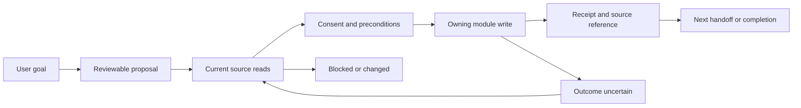

# Shared dependencies

[Index](README.md) · [Ranked opportunities](CROSS-MODULE-OPPORTUNITIES.md)

This extends the *design discussion* in [08-shared-data contracts](../08-shared-data/CROSS-MODULE-CONTRACTS.md), not the application. All C1–C7 requirements below are **PROPOSED**, unless explicitly identified as CURRENT. No schema, API, universal transaction, or new service is specified as already existing.

## Source ownership and relationships

| Fact | Current source of truth | Consumers here | Never substitute |
|---|---|---|---|
| Due task / completed occurrence | `items`, details and recurrence records; `item_flexible_schedules` for flexible placement, `item_occurrence_actions` for occurrence actions | 01, 03, 05 | A day-plan checkbox, trip itinerary or AI sentence |
| Daily intention and informal checklist | `day_plans` | 01 | Another Schedule item for every checklist line |
| Recipe definition / meal coverage | `recipes.ingredients`; `meal_plans` with person, status and leftover interval | 02; contextual 01/03 | Shopping check-off as evidence the meal was cooked |
| Shopping requirement / bought state | `hub_messages` in a shopping thread; `checked_at` | 02 | Pantry quantity or a financial transaction |
| Pantry stock | `inventory_stock` linked to Catalogue; restock history | 02 | An ingredient name match or a stale low-stock estimate |
| Grocery allowance / actual spend | `budget_allocations`; eligible `transactions` over explicit period/account scope | 02, 04 | A recipe estimate, account balance, or promise to pay |
| Renewal state | `recurring_payments.next_due_date`, `last_processed_date`; actual expense remains a transaction | 04 | AI matching confidence or the provider's external subscription state |
| Trip facts / trip cost | `trips` and child records; tagged/account transactions with ID deduplication | 03 | Itinerary estimated costs as paid expenses |
| Training plan / workout | Versioned Fitness plan and slots; `fitness_sessions`, set logs and derived rewards | 05 | A proposed slot as evidence of training |
| Permission | Current authenticated actor, active household relationship and module/source policy | All | A cached partner ID, old confirmation, or Activity audience snapshot |

Source basis: [schema](../../../migrations/schema.sql), [source-of-truth matrix](../08-shared-data/SOURCE-OF-TRUTH-MATRIX.md), [occurrence helper](../../../src/lib/utils/dayOccurrences.ts#L35), [meal coverage](../../../src/lib/mealPlanCoverage.ts#L37), [trip aggregation](../../../src/lib/tripSpend.ts#L26), [Fitness mirror](../../../migrations/2026-10-12_fitness-module.sql#L1114).

Standalone ownership remains intact. Hub/ERA and existing junctions coordinate; shared rules belong at shared boundaries, not new imports between standalone feature directories. Meal Planning is documented as a standalone with junction-like dependencies; this study does not reclassify it.

The diagram is a proposed common interaction. CURRENT foundations include `EraRun`, versioned progress, `waiting/uncertain` states, original reference date/time zone, and skipped/done step receipts. The executor explicitly does not queue offline plans. [State:82](../../../src/features/era/execution/state.ts#L82), [client:138](../../../src/features/era/execution/client.ts#L138). Extending those to the five journeys is proposed; present registry coverage is narrower.

## Proposed contracts

### C1 — Source references, coverage and freshness

Every planning input carries a source reference, actor/subject scope, observed time, relevant source version or field snapshot, and a read result: `available`, `empty`, `unavailable`, `restricted`, or `stale`. These are proposed semantic labels, not current response fields. `empty` means a successful authorized read with zero rows; it cannot stand for an error or revoked access.

Before an effect, re-read its source and permission. If an ETag/revision is unavailable, compare the decision-relevant fields, then require a server-side precondition for concurrency-sensitive writes. A client check alone cannot close the race. Money amount, account, occurrence identity, participant, recipe revision, travel dates or scope changes invalidate the dependent approval. Cosmetic title changes need not invalidate unrelated steps.

For proposals, show last observation and the missing scope; do not invent one universal freshness TTL. Budget confirmation needs a fresh spend/commitment read, stock subtraction needs a user-verified compatible quantity, and departure readiness needs the latest trip dates/documents. If offline, cached facts may support a tentative draft only. Do not announce “free”, “within budget”, “all paid” or “nothing due” from incomplete coverage.

Contradictions follow the owning source: the latest source row beats a notification, artifact, memory or checklist. Two authorized source rows that genuinely conflict require a choice; “newest wins” is not a universal rule. Retain the conflict and resume after it is resolved.

### C2 — Handoff identity and effect receipts

Each proposed handoff needs a stable journey/step ID, source and destination references, actor, intended effect, precondition, and receipt. Suggested event names in journeys are vocabulary for this contract, not evidence of an event bus. A receipt names `applied`, `not-applied`, `partial`, or `uncertain`, plus exact created/updated IDs. An HTTP success or an AI reply alone is not proof all downstream effects happened.

Idempotency is owned by the destination write. Use one operation identity across retries; identify recurring payment occurrences by original due date and payment ID, and flexible slots by their actual slot/period identity. Do not deduplicate by title, recipe name, amount alone or a date that changes when moved. Intentional repeats get new identities.

CURRENT examples worth reusing: Fitness operations and same-op receipt lookup; ERA completed-step receipts. CURRENT limitations: recipe shopping inserts messages then separately updates the meal; recurring confirmation inserts spend, changes balance, then advances the due date. These do not form one atomic journey. [Fitness hooks:57](../../../src/features/fitness/hooks.ts#L57), [meal shopping:110](../../../src/app/api/meal-plans/add-to-shopping/route.ts#L110), [renewal confirm:215](../../../src/app/api/recurring-payments/[id]/route.ts#L215).

### C3 — Consent, participation and revoked access

Bind approval to exact resolved effects and versions, not to free text such as “sort out my week”. Distinguish owner, actor, assignee and viewer using person IDs. Assignment is not authorization to mutate somebody else's private calendar. The broad journey confirmation approves only displayed supported effects; an external action or changed amount/scope needs its own decision.

On household unlink, source deletion, privacy change, account switch or consent withdrawal: stop pending dependent writes, discard restricted snapshots from active context, and revalidate links before opening. Preserve an owner's minimal operation status only where allowed; do not preserve inaccessible partner details in a resume card. Completed source changes remain facts; withdrawal does not silently reverse them.

Do not claim stronger current access enforcement than observed. Trip owner/partner roles are explicit in [tripAccess.ts:13](../../../src/lib/tripAccess.ts#L13); Activity requests current source privacy in [its route:70](../../../src/app/api/activity-log/route.ts#L70). Fitness's overview documents a Schedule service-role completion path that can affect a partner item if its ID is known; future journey adapters must check owner-private Fitness effects, not rely on UI invisibility. Live RLS remains unknown.

### C4 — Dates, zones and occurrence identity

Reuse [08-shared-data time/occurrence contracts](../08-shared-data/CROSS-MODULE-CONTRACTS.md). Preserve `LocalDate` for meal/trip/spend/billing days; preserve an instant for alerts/log timestamps; preserve wall time plus IANA zone for proposed scheduled commitments. Do not turn a date-only string into UTC midnight or recalculate “tomorrow” on resume.

CURRENT ERA runs store original `referenceDate` and `timeZone`; Schedule has a shared expansion helper and flexible placement; Fitness stores a plan zone. They are reusable foundations, not proof that every module shares a personal time-zone setting. [State:104](../../../src/features/era/execution/state.ts#L104), [date.ts:122](../../../src/lib/utils/date.ts#L122), [Fitness overview](<../../../ERA Notes/02 - Standalone Modules/Fitness/Overview.md>).

Proposal: freeze the absolute selected dates at approval. For new commitments at a DST gap/fold, ask for a valid time or first/second occurrence and persist the resolved instant; D7 must be settled before automatic placement. This is stricter than the existing wall-clock helper and the shared-data pack's suggested gap shift; it is explicitly a proposed policy, not a claim of current behavior. Traveling never silently changes a routine's home zone. Display destination times with their zone; trip itinerary storage currently lacks a destination-zone field.

Money uses one explicit custom billing window with day-29–31 clamping; pass start/end, account and currency to consumers. The budget route otherwise falls back to a calendar month. No implicit USD/LBP/EUR addition or live exchange-rate assumption. [Budget route:238](../../../src/app/api/budget-allocations/route.ts#L238), [date.ts:55](../../../src/lib/utils/date.ts#L55).

### C5 — Resumption and partial completion

Persist minimal intent, original dates/zone, selected IDs, step outcomes and unresolved questions in the existing execution model where supported. A universal cross-device journey resume surface is proposed, not already established by the ERA journal.

On resume: authenticate → check source access → retrieve receipts → refresh only dependent facts → compare approved values → show completed/remaining/changed steps → continue after any required new approval. Never start the original whole request again. A known receipt prevents repeat execution; an uncertain source write must be reconciled at its destination before retrying. If the endpoint offers no reliable correlation, keep the step uncertain and open the source for review.

No-network is distinct from timeout. Existing Fitness can queue supported workout operations with Pending visibility; an ERA journey cannot inherit that permission for meals, bills or travel. Manual precision forms remain usable according to their own offline contracts. Unsaved local day-plan edits are not a durable journey checkpoint.

### C6 — Corrections, completion and observability

Each step's inverse acts on the exact source ID and expected state. Reversing a proposal does not erase a real purchase, uncook a meal, recover money from a provider, or overwrite a partner's later correction. If safe inverse conditions no longer hold, open a correction proposal. Partial completion is visible, including declined/skipped steps; neither means completed.

A journey has two stages: **prepared** (approved commitments exist) and **outcome complete** (the source facts satisfy that journey's finish criteria). Activity/ERA artifacts link to source records for review; they do not become the completion authority. Future proactive triggers need a last successful observation/run and duplicate suppression. No scheduler or push delivery is assumed operational.

### C7 — Quantities, costs and multi-fact purchase handoffs

Needed primarily for 02. Preserve recipe revision, servings, ingredient identity, units and provenance of every price. Convert only compatible known units. Never subtract “one bag” from “500 g” without a supplied conversion, or treat “salt to taste” as zero cost. Unknown prices remain unknown; user estimates carry date/currency and are not transaction amounts.

The proposed purchase handoff correlates shopping IDs, optional expense ID and optional restock IDs, with separate receipts. One receipt total may cover many shopping rows; partial purchases leave quantities outstanding. Expense capture reuses the actual payment once, including a previously logged transaction. Restock requires actual received quantity. Current recipe shopping only sends ingredient strings and message IDs; the richer demand/receipt relationship is a gap, not an existing schema. [Shopping route:88](../../../src/app/api/meal-plans/add-to-shopping/route.ts#L88), [registry:358](../../../src/features/era/capabilities/registry.ts#L358).

## Dependency matrix and implementation restraint

| Contract | 01 | 02 | 03 | 04 | 05 |
|---|---|---|---|---|---|
| C1 freshness/source coverage | Schedule + meal availability | Budget + pantry + recipe | Trip/home/document versions | Payment and due occurrence | Plan version + open session |
| C2 identity/receipt | Item occurrence/slot | Shopping batch + purchase | Trip and individual home effects | Payment occurrence claim | Existing op/session/slot identities |
| C3 consent/access | Individual versus household | Shared list, private account | Owner lifecycle, collaborative children | Confirming actor and account access | Private plan, opt-in summary |
| C4 time/money | Week/day/zone | Meal day + billing window | Destination/home zones + currencies | Due date versus review instant | Plan zone and weekly period |
| C5 resume | Saved review and partial moves | Partial list/purchase | Packing plus pending home decisions | Uncertain coverage | Existing workout queue/receipts |
| C6 correction/completion | Complete versus postpone | Bought versus cooked | Ready versus returned | Reviewed versus paid/cancelled | Placed versus completed |
| C7 quantities/costs | Not needed | Required for automation | Cost estimates use C4; no ingredient contract | Not needed | Keep Fitness's own units |

Start with links where the destination already owns the whole operation. Introduce only the contract needed for the next real cross-module write. Do not centralize all module facts, rebuild recurrence, add a second assistant, or introduce a general dependency engine to achieve these five outcomes. Owner decisions are [D1–D8](README.md#unresolved-owner-decisions).
