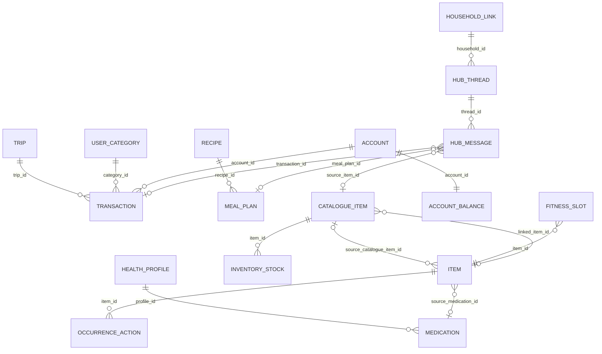

# ERA Entity Map

[README](README.md) · [Glossary](DOMAIN-GLOSSARY.md) · **Entity Map** · [Source of Truth](SOURCE-OF-TRUTH-MATRIX.md) · [Contracts](CROSS-MODULE-CONTRACTS.md)

The entities each module keeps, how they are identified and linked, the states they move through, and who they belong to. Everything here is CURRENT IMPLEMENTATION read from `migrations/schema.sql` and code at the stated commit, unless labelled. Whether post-2026-08-04 migrations are applied in production is UNKNOWN; tables they create are marked ⛁.

## 1. Core entities by module

The diagram shows only links that cross a module boundary. Each module also has its own internal tree (for example `trips` → places, packing, documents).

| Module | Entities (table) | Identifier | Owner field(s) |
|---|---|---|---|
| Accounts & balance | `accounts`, `account_balances` (one row per account), `account_balance_history` | uuid; balance keyed by `account_id` | `user_id`; `is_public` |
| Transactions & drafts | `transactions` (drafts are rows with `is_draft = true`), `transaction_templates` | uuid; `statement_hash` unique per user when set | `user_id`; `is_private`; split partner `collaborator_id` + `collaborator_account_id` |
| Transfers | `transfers`, `transfer_acknowledgements` ⛁ | uuid, client-generated for idempotent replay (`src/app/api/transfers/route.ts`) | `user_id`, `recipient_user_id`, `household_link_id` |
| Recurring payments | `recurring_payments` | uuid | `user_id`; `is_private` |
| Categories | `user_categories` (two levels via `parent_id`, per `account_id`), `default_categories` | uuid; cross-user match by `slug` | `user_id` |
| Debts | `debts` | uuid | `user_id`; counterparty `debtor_name` text |
| Budget | `budget_allocations`, `ai_budget_suggestions` | uuid | `user_id`; `assigned_to` = `user/partner/both` |
| Future purchases | `future_purchases` | uuid | `user_id` |
| Statement import | `statement_imports`, `statement_import_entries` ⛁, `statement_skipped_rows` ⛁, `merchant_mappings` | uuid; rows keyed by `statement_hash` (`v2|account|date|desc|out|in`, Feature Map `statement-import.md`) | `user_id` |
| Schedule | `items` + `reminder_details` / `event_details` (1:1), `item_recurrence_rules`, `item_recurrence_exceptions`, `recurrence_pauses`, `item_occurrence_actions`, `item_alerts`, `item_alert_suppressions`, `item_snoozes`, `item_subtasks`, `item_subtask_completions`, `item_flexible_schedules`, `item_prerequisites`, `reminder_templates`, `day_plans` | uuid; an **occurrence** is `(item_id, occurrence_date timestamptz)` | `user_id` (creator), `responsible_user_id` (doer, NOT NULL), `is_public`, `notify_all_household` |
| NFC | `nfc_tags`, `nfc_state_log`, `nfc_checklist_items`, `nfc_checklist_completions` | uuid + unguessable slug in the URL | `user_id`; `changed_by`, `completed_by` |
| Catalogue | `catalogue_modules`, `catalogue_categories` (tree), `catalogue_items` (templates, contacts, places, chore definitions, inventory products), `catalogue_sub_items`, `catalogue_item_calendar_history`, `home_rooms` ⛁ | uuid; `catalogue_items.revision` for optimistic edits ⛁ | `user_id`; `is_public` **default true** |
| Inventory | `inventory_stock` (keyed to a `catalogue_items` row), `inventory_restock_history` | uuid | `user_id` |
| Hub | `hub_chat_threads` (`purpose` incl. `shopping`, `notes`), `hub_messages` (chat lines, shopping rows, notes, voice), `hub_message_receipts`, `hub_message_actions`, `hub_notes_topics`, `shopping_groups`, `shopping_item_links`, `hub_feed`, `hub_user_stats` | uuid | `household_id` (FK to `household_links`), `sender_user_id`, `assigned_to`, `checked_by`, `hidden_for`; thread `is_private` |
| Kitchen | `recipes` (+ `recipe_versions`, `cooking_logs`), `meal_plans` | uuid; `recipes.active_version_id` | `user_id`, `household_id`; meal `for_user_id` (null = whole household) |
| Trips | `trips`, `trip_places`, `trip_packing_items`, `trip_packing_category`, `trip_packing_checkpoints` ⛁, `trip_documents`, `trip_side_effects` | uuid | `user_id`; `scope` `solo/household`; packing `assigned_to` |
| Healthcare | `health_profiles`, `health_allergies`, `health_conditions`, `health_vaccines`, `health_medications` ⛁, `health_medication_logs` ⛁, `health_measurements` ⛁ | uuid | `managing_user_id`; subject `health_profiles.user_id` (nullable) + `name`; `shared_with_household` |
| Fitness | `fitness_plans`, `fitness_plan_versions`, `fitness_plan_slots`, `fitness_plan_pauses`, `fitness_sessions`, `fitness_set_logs`, `fitness_reward_events`, `fitness_preferences`, `fitness_operations` (all ⛁) | uuid; client op ids for idempotent replay (`fitness_receipt_get/put`) | `user_id`; opt-in `fitness_preferences.share_summary` |
| Outfits | `wardrobe_profiles`, `wardrobe_items`, `outfits`, `outfit_items` | uuid | `user_id` only (never shared, locked D4) |
| Guest portal | `guest_portal_tags`, `guest_sessions`, `guest_chat_messages`, `guest_allergies`, `guest_feedback`, `guest_drinks` | uuid; public tag slug | host `user_id` on the tag; guests are names, not users |
| Notifications | `notifications`, `notification_preferences`, `push_subscriptions`, `push_event_logs` | uuid | recipient `user_id`, `household_id` |
| ERA | `era_conversations`, `era_messages`, `era_actions` ⛁, `era_runs` ⛁, `era_templates` ⛁, `era_lexicon` ⛁ | uuid | `user_id`; `era_actions.household_id` |
| Legacy AI chat | `ai_sessions`, `ai_messages`, `ai_rate_limits` | uuid | `user_id` |
| Activity Log | `household_activity` ⛁ (sequence id), `activity_log_sources` ⛁ | bigint sequence | `owner_user_id`, `actor_user_id`, `audience uuid[]` |
| Household | `household_links`, `profiles`, `household_members` (unused) | uuid; invite `code` unique | `owner_user_id`, `partner_user_id` |
| PM relay | `pm_live` (text id `cc:<installation>:<kind>[:<key>]`), `pm_commands` | text / uuid | `user_id` |

## 2. Identifier kinds

| Kind | Where | Rule today |
|---|---|---|
| Server-generated uuid | Most tables | Created by `gen_random_uuid()` / `uuid_generate_v4()` |
| Client-generated uuid | Transfers, bulk items, fitness operations, PM commands | Same id on retry; 23505 or a stored receipt means "already done" |
| Composite natural key | Occurrence `(item_id, occurrence_date)`; occurrence action `(item_id, occurrence_date, action_type)`; flexible slot `(item, period, occurrence_index)` | Instants must be byte-for-byte equal to match; `bulkComplete.ts` compares with `sameInstant()` |
| Content fingerprint | `transactions.statement_hash`, `transfers.statement_hash`, `fitness_plans.content_fingerprint` | Changing the formula orphans old values unless re-keyed (statement import `rekey`) |
| Slug | `user_categories.slug` (derived from name), NFC and guest tag slugs (public, unguessable) | A rename changes the category slug and breaks partner matching (Categories Feature Map gotcha) |
| Polymorphic reference | `era_actions(entity_type, entity_id)`, `household_activity(source_table, source_id)`, `trip_side_effects(target_table, target_id)` | Three vocabularies: ERA entity kinds (`reminder`, `transaction`, `place`…), table names, and table names again |
| Sparse typed references | `notifications.item_id / transaction_id / recurring_payment_id / message_id / alert_id / category_id`, plus `action_url` text | Only some have FKs (`alert_id`, `message_id` do not) |
| Array references | `meal_plans.shopping_message_ids uuid[]`, `catalogue_items.room_ids uuid[]`, `items.categories text[]`, `trip_places.attachment_paths text[]` | No FK; deleted targets stay in the array |
| JSON references | `items.metadata_json.fitness.{plan_id,slot_index}`, `.room_id`, `.planned_for`; `day_plans.checklist` | Invisible to the schema |
| Name references | `debts.debtor_name`, allergy `keywords[]` matched against recipe text (`src/lib/health/allergenMatch.ts`) | Text matching |

## 3. Equivalent concepts represented differently

| Concept | Representations | Consequence |
|---|---|---|
| **A person outside the app** | `debts.debtor_name`, `guest_*.guest_name`, `health_profiles.name`, Catalogue contacts | "Sami owes me $20" cannot point at the contact "Sami" ERA created |
| **Who sees a record** | `is_public` (opt-in; default true in Catalogue, false in Schedule/Accounts/Day plans), `is_private` (opt-out), `shared_with_household`, `scope`, `hidden_for`, `audience` | The same "share with partner" intent has opposite defaults by module |
| **Who does it** | `responsible_user_id` (uuid), `assigned_to` (uuid on Hub and packing; **text** on budget) | Budget's value is relative to the row owner |
| **A calendar day** | SQL `date`, `YYYY-MM-DD` text, local noon `timestamptz` + `all_day` flag, `budget_month` text | All-day reminders and all-day events use different conventions |
| **A time of day** | `time`, `HH:MM` text array, the time part of a `timestamptz` | Zone is implicit except medications and fitness |
| **A recurring thing** | Item RRULE, payment `recurrence_type` + `next_due_date`, Catalogue `recurrence_pattern`, medication `dose_times`, fitness slots, notification `frequency`/`custom_cron` | See [CROSS-MODULE-CONTRACTS §2.2](CROSS-MODULE-CONTRACTS.md#22-recurrence-and-occurrence-identity) |
| **"This one occurrence"** | Schedule recurring items: `occurrence_date` = the scheduled instant. Chores: completion writes the **actual time** to `occurrence_date` and the planned slot to `metadata_json.planned_for` (Feature Map `chores.md`; `src/features/items/bulkComplete.ts:105-107`). Medication mirror: the nearest dose slot within ±1 day of `occurrence_date` (`migrations/2026-09-26_healthcare-medications.sql:528-535`) | The occurrence key means "planned" in one module and "actual" in another |
| **Done** | See §4 | About twenty different ways to record "done" |
| **A file** | Storage path, path in a `*_url` column, or a stored one-year signed URL | Hub voice and photo links stop working one year after upload |
| **A category** | Money categories (per account, slug-matched), Catalogue tree, item tags, packing categories, shopping groups, topics, recipe tags | Only money categories cross modules (statement import, merchant map, ERA, budget) |
| **A place** | `event_details.location_text`, `items.location_text` + `location_context`, `trip_places`, Catalogue Places module (ERA `place.create`), `accounts.location_name` | ERA's "Save to Places?" writes Catalogue; trip places are separate rows |
| **A template** | `catalogue_items` (Schedule, chores), `reminder_templates`, `transaction_templates`, `era_templates`, trip `is_template` | Each is module-local; only Catalogue templates create items in another module |

## 4. Completion and lifecycle

| Entity | Progress states | "Done" recorded as | Lifecycle (archive / delete) |
|---|---|---|---|
| `items` (one-off) | `status`: `pending, in_progress, completed, cancelled, archived, dormant, draft` (`src/types/items.ts:14-21`) | `status = completed` + `reminder_details.completed_at` | `archived_at`, `deleted_at` (Recycle Bin), or hard delete (see ARCHITECTURE F-D2 in [01-atlas](../01-atlas/ARCHITECTURE.md#f-d2-three-meanings-of-delete-an-item)) |
| `items` (recurring occurrence) | `completed / postponed / cancelled / skipped` | `item_occurrence_actions` row | Exceptions, pauses |
| `item_subtasks` | — | `done_at`, or `item_subtask_completions` per occurrence | hard delete |
| `hub_messages` (shopping) | — | `checked_at`, `checked_by` | `archived_at` with `archived_reason`, `deleted_at`, `hidden_for` |
| `catalogue_items` | `status` enum (default `active`) | `last_completed_at`, `completed_at`, `next_due_date` | `archived_at`, `deleted_at`, `is_active_on_calendar` |
| `catalogue_sub_items` | — | `is_completed`, `completed_at` | hard delete |
| `nfc_checklist_items` | — | `nfc_checklist_completions` rows | `is_active` |
| `day_plans.checklist` | — | JSON entries | row delete |
| `trip_packing_items` | — | `is_packed`, `packed_quantity` | `deleted_at` (own restore route) |
| `trips` | `draft, upcoming, active, completed, archived` | `status = completed`, `completed_at` | `status = archived`; delete route |
| `meal_plans` | `planned, shopping_added, cooked, skipped` | `status = cooked`, `cooked_at`; recipe `times_cooked`, `last_cooked_at`; `cooking_logs` | row delete |
| `fitness_sessions` / `fitness_set_logs` | `in_progress, completed, abandoned` / `done, skipped` | `finished_at`, `status` | `deleted_at` via RPC |
| `fitness_plans` | `draft, ready, active, paused, archived` | — | `archived_at` |
| `health_medication_logs` | — | `taken_at` per `scheduled_at` slot | row delete on undo |
| `health_conditions` | `active, resolved` | `status = resolved` | — |
| `future_purchases` | `active, completed, cancelled, paused` | `completed_at` | `deleted_at` |
| `debts` | `open, archived, closed` | `closed_at`, `returned_amount = original_amount` | `archived_at` |
| `transactions` (split) | requested → completed | `split_completed_at` | `deleted_at` |
| `transactions` (draft) | `is_draft` true → false | confirm sets `is_draft = false` | `deleted_at` |
| `recurring_payments` | `is_active` | `last_processed_date`, advanced `next_due_date` | `is_active = false`; delete route |
| `notifications` | `is_read`, `is_dismissed`, `push_status` | `action_taken`, `action_completed_at` | `expires_at` |
| `statement_imports` | `pending, processing, completed, failed, reverted, partially_reverted` | — | revert ledger |
| `pm_commands` | `pending, claimed, done, failed, expired, unknown` | `completed_at` | — |

## 5. Who a record concerns, owns, may change, and notifies

CURRENT IMPLEMENTATION where the field exists; "—" means the concept is not modelled. "Editors" lists app-level rules found in routes; RLS may be narrower or wider and is UNKNOWN for post-snapshot tables.

| Record | Concerns (subject) | Owner | May change | Notified |
|---|---|---|---|---|
| Reminder / task / event | — (implied: doer) | `user_id` | owner, `responsible_user_id`, partner if `is_public` (`canMutateItem`) | `responsible_user_id` (fallback owner), or both members if `notify_all_household` |
| Chore | — | owner of the item | as items; whole routine hand-over writes `responsible_user_id` (Feature Map `chores.md`) | as items |
| Medication reminder | `health_profiles` person | `managing_user_id` (items `user_id` = manager) | manager only for doses (`health_set_dose`) | item rules |
| Transaction | account owner | `user_id` | owner; partner on shared splits only | split collaborator (in-app notification, `src/services/transaction.service.ts:506-530`) |
| Transfer to partner | recipient | sender `user_id` | sender | recipient via `IncomingTransferSheet` polling |
| Shopping row | — | household + `sender_user_id` | any member | other member (push), unless the thread `is_private` |
| Meal plan | `for_user_id` or everyone | `user_id` | whoever RLS allows: `meal-plans/[id]` filters only on `id` (`src/app/api/meal-plans/[id]/route.ts:86`, `:120`) | — |
| Trip | traveller (`solo`) or both (`household`) | `user_id` | owner; partner read at `household` scope (`canAccessTrip`) | — |
| Packing item | `assigned_to` | `user_id` | trip editors | — |
| Budget envelope | `assigned_to` (`user/partner/both`) | `user_id` | owner | — |
| Health record | profile person | `managing_user_id` | manager | — |
| Activity row | `owner_user_id` | the source owner | nobody (append-only) | `audience` may read |
| ERA artifact | — | `user_id` | owner (Undo/Redo) | — |

**Gaps.** Only Healthcare and Meal planning model the subject explicitly. Only Schedule models the doer and the recipients. Everything else infers them from the owner.
