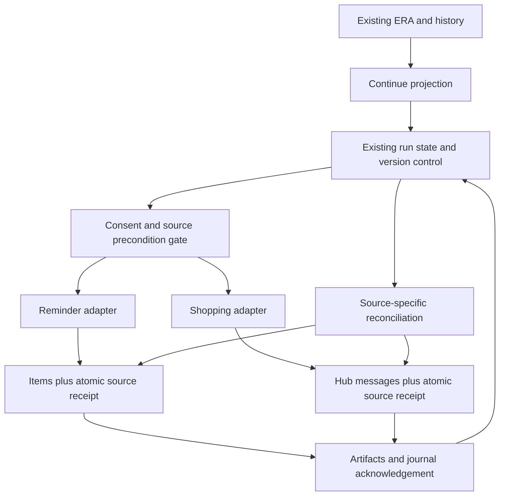

# Blueprint 01 — Finish an interrupted everyday request

Status: **proposed; not approved**. Candidate C1. Baseline: `9cd4166691edd9367ea1bd9a604e0bec13ffe870`. Shared evidence, provenance, and recovery rules: [README](README.md).

## Problem and fictional journey

A request can span several saves while the person has only a few seconds available. Returning to a conversation does not necessarily reveal which writes succeeded, which need confirmation, and which must not be repeated. The desired outcome is a completed, verifiable request with no duplicate reminder or shopping entry—not merely a reopened chat.

**Fictional example:** Maya asks ERA, “Remind me to collect the parcel tomorrow at six, and add milk to groceries.” She reviews the resolved date and the two actions. The reminder saves; the shopping request is dispatched, but her connection drops before the response. Later she opens ERA and sees “Parcel + groceries · Check 1.” The reminder opens directly. ERA reconciles the shopping operation with its source receipt: if it committed, it shows the existing milk entry; if safely proven uncommitted, it offers the remaining action. Maya does not need to remember whether she pressed Save. Completing the request means both source records are acknowledged; collecting the parcel and buying milk remain real-world tasks.

## Current implementation, intent, and gaps

| Evidence class | Finding |
|---|---|
| Implemented | [Run state](../../../src/features/era/execution/state.ts#L82) includes queued, running, done, waiting, blocked, uncertain, and skipped steps, plus original text, reference date/time zone, confirmation, and versioned run records. [Run status/result classification](../../../src/features/era/execution/state.ts#L179) distinguishes uncertain writes from blocked reads. |
| Implemented | [Execution client](../../../src/features/era/execution/client.ts#L138) confirms a run, persists step starts/results, carries completed/skipped receipts into execution, and checks before writes. Source effects and journal saves are separate calls: a failed progress save can follow a successful source write. |
| Implemented | [Run PATCH](../../../src/app/api/era/runs/%5Bid%5D/route.ts#L20) authenticates, scopes the run to the user, checks version, and invokes `save_era_run`. This is run concurrency control, not proof of source-write idempotency. [Schema](../../../migrations/schema.sql#L1534) contains the journal. |
| Implemented | [Registry](../../../src/features/era/capabilities/registry.ts#L68) has one-time reminder creation; [shopping.add](../../../src/features/era/capabilities/registry.ts#L349) supports a list and warns about partial replay. [Run cards](../../../src/components/era/EraRunCards.tsx) and [history](../../../src/components/era/EraHistorySheet.tsx) provide existing continuation surfaces. |
| Implemented limitation | Durable execution is [environment-flagged](../../../src/features/era/execution/state.ts#L14). The [ERA store](../../../src/features/era/useEraStore.ts#L123) initializes pending transcript/turn/proposal/run state in memory. This is not a universal durable unsent-draft mechanism. |
| Documented intent | [Interaction design](../10-interaction-design/README.md) proposes visible unfinished work; [product concepts](../16-product-research/SOLUTION-CONCEPTS.md) propose resuming real requests; [execution recovery](../06-action-execution/APPROVAL-AND-RECOVERY-MATRIX.md) distinguishes partial and uncertain actions. These are input proposals, not shipped behavior or owner approval. |
| Unknown | Actual feature-flag rollout, deployed receipt/RLS behavior, discoverability across all current screens, and interruption frequency. No rendered or user-tested evidence supports a claim that the existing UI is unusable. |

**Proposed difference:** a small owner-only Continue projection brings the next actionable step to the surface and uses source-specific reconciliation. It does not invent a second task engine or imply that all historic runs can be retried safely.

## Goals and non-goals

Goals are to resume without re-explaining, prevent repeated effects, distinguish saved work from remaining work, and let the user stop or correct the request. The minimum release covers persisted requests involving own ordinary one-time reminders and shopping additions in an authorized household list.

Non-goals: automatic execution on app open; money, recurring schedules, external purchases or messages; recovery of every unsent form; a new universal drafts database; bulk replay of old runs; migration of all navigation; and turning every completed request into an ongoing project.

## Requirements

| ID | Functional requirement |
|---|---|
| B1-F1 | Derive Continue entries from authorized persisted execution state. Show the source request, latest meaningful status, next permitted action, and source receipts. Empty state is “Nothing to resume”; omit decorative totals. |
| B1-F2 | Resume the existing run/conversation identity. Preserve the original relative-date anchor and show the resulting absolute date before any newly confirmed schedule write. A changed interpretation creates a new proposal revision. |
| B1-F3 | Do not rerun done steps. For uncertain writes, query a source receipt by stable operation identity. If reconciliation is unavailable, show “Check” and source links; do not relabel the step failed or offer an unsafe Retry. |
| B1-F4 | Offer Resume only for supported, authorized, safely executable remaining work. Revalidate source versions, list membership, and exact proposal consent. A revoked permission stops remaining steps. |
| B1-F5 | Keep successful receipts after partial failure. Stop cancels future work. Dismiss hides the Continue entry but preserves recovery in history. Neither deletes or completes source work. |
| B1-F6 | Offer source-supported Undo or correction from the receipt. An inverse must not erase unrelated or subsequently edited work. All mutation toasts offer Undo; failures are shown inline with recovery controls. |
| B1-F7 | Keep suggestion dismissal and execution cancellation distinct. Reopening a dismissed request is explicit; no new reminder or daily cleanup requirement follows from leaving it unfinished. |

| ID | Nonfunctional requirement |
|---|---|
| B1-N1 | Reconciliation and receipt recording must be deterministic and server-authorized. Stable operation identity survives device changes and transport attempts; deduplication based on text/time is prohibited. |
| B1-N2 | Use bounded, paginated owner-only projections; initially request at most 20 entries. Do not send all conversations or unrelated source records to a model to build Continue. |
| B1-N3 | Cached state can render immediately with its stale status; unavailable source checks disable unsafe actions. A timeout never becomes proof of offline status or failure. No automatic offline replay is introduced. |
| B1-N4 | Keep all actions keyboard reachable, label icon controls, preserve focus on return, announce status changes, and provide a mobile view with visible actions above the software keyboard. Validate these behaviors with a rendered prototype before release. |
| B1-N5 | Log operation/attempt IDs, status, source reference, authorization outcome, and error class without copying private request bodies into diagnostics. Retention follows owner decision D7. |

## Minimum release and increments

**Minimum useful release:** one Continue entry point inside existing ERA, original request preview, one-time reminder and shopping-add support, exact result links, source-local receipts for those two adapters, safe resume/check/stop, and persistent correction access. A request may contain both adapters, but remains within the existing plan step limit ([plan module](../../../src/features/era/capabilities/plan.ts)). Do not evade that limit by silently splitting a request into independently executing plans.

Prerequisite work for a later implementation plan: prove durable execution availability, implement/verify atomic receipt-plus-effect handling for each supported source, and validate owner/household access. If an adapter cannot meet this contract, its minimum-release behavior is inspect/correct, not retry. Do not market the release as automatic recovery until the two selected adapters satisfy the tests below.

Follow-up increments, separately justified: more source adapters with their own conformance cases; a Continue shortcut from existing navigation if discoverability testing warrants it; owner-scoped unsent composer recovery with explicit deletion/retention; precision-form handoffs tied to the same source identity. Existing history/run-card improvements may satisfy the need without a separate Continue screen.

## Interaction and screen responsibilities

1. **ERA entry:** show a compact “Continue” entry only when there is relevant persisted work; no duplicate action strip beside each composer. Entry opens the most recent actionable request or a small list when ambiguous.
2. **Continue list:** title derived from the request, last activity, and “Review”, “Resume”, or “Check”. Sorting prioritizes uncertainty and then recency, not an AI urgency score. History holds dismissed/stopped entries.
3. **Request detail:** show “Saved” receipts first, followed by only the remaining steps. Use “Reminder saved”, “Shopping: checking”, “Resume”, “Stop”, “Open”. Expand technical details only on demand.
4. **Review:** show changed fields and current source/audience. Only this screen grants new consent. A stale date reads “Date changed” with the old and proposed date, not an automatic conversion of yesterday's “tomorrow”.
5. **Source detail:** owns editing, completion, and richer fields. Return restores the prior request and scroll position. Avoid an obligatory conversational acknowledgement to perform a button action.

Essential inputs are the original request, resolved target/date when needed, selected shopping list if ambiguous, and explicit confirmation of writes. Category, project, priority, tags, and explanatory follow-up text are not mandatory. Existing source-required fields still apply.

Desktop can place receipts and the remaining-step review side by side. Mobile uses a single stacked view and a single primary action. Keyboard users can open Continue, choose a row, review, and activate a named button without a double-click gesture or drag. For a ten-second interruption, simply reopening the request must not change it; the last acknowledged receipt and current pending step remain visible.

Empty and error copy: “Nothing to resume”; “Couldn't load requests” / “Retry”; “Check this save” / “Open”; “Access changed”; “Saved elsewhere” after authoritative reconciliation. Do not show “Saved” before source acknowledgement. Do not bury errors in disappearing toasts.

## Entities and contracts

| Entity/contract | Existing or proposed | Minimum data and meaning |
|---|---|---|
| `EraRun`, `RunState`, steps | Existing | Owner, conversation, version, plan, frozen reference date/zone, step states and results; reuse rather than parallel workflow records |
| Continue entry | Proposed read projection | Run ID, display label, next action, status, updated time, source links. No independently editable completion flag |
| Proposal revision | Proposed tightening of existing confirmation | Stable fingerprint of target IDs, values, audience, source preconditions, original date interpretation; changed fingerprint invalidates prior consent |
| Logical source operation | Proposed adapter contract | Operation ID distinct from attempt ID; run/step reference, actor, target scope, payload fingerprint, expected version, intended effect |
| Source receipt | Proposed where not already proven | Operation ID, source IDs, actual effect/result version, committed timestamp, inverse capability. Persist with the source mutation, not only in ERA |
| Reconcile result | Proposed | Committed with receipt; safely retryable under the same idempotent operation; conflict; restricted; unknown. “No matching title” never establishes safely retryable |

The source receipt is not authorization to reveal a deleted or newly private record. Re-resolve display permissions. A journal may retain an opaque receipt while the UI shows “Access changed”. Deleting history must not delete source work; receipt retention/deletion must be settled under D7 before shipping.

AI may shorten the displayed request label and interpret a new request. It does not choose whether an uncertain write happened, authorize a retry, or generate an inverse. Fixed capability adapters and source validation own those decisions.

## Architecture, integrations, and boundaries

The diagram includes **proposed** receipt/gating extensions. Existing ERA run persistence is not a transaction spanning Items and Hub. Source writes remain independent and sequential; successful first steps survive a later failure. Existing [artifact registry](../../../src/lib/era/artifacts.ts) supplies canonical entity/deep links and mutation history. Avoid a new per-feature logging switch.

Use existing app authentication. Run history stays owner-only; shopping scope requires current active household/list authorization at the server. Session expiry retains the journal and asks for sign-in without dispatching work. No new external connector or OAuth permission is needed. Existing AI-provider failure affects interpretation only; persisted detail and direct controls remain usable. No background worker should resume writes on its own.

Implementation boundaries: ERA owns navigation/projection/orchestration; Items and Hub own mutation, receipt, and inverse guarantees; shared artifact/cache contracts own result propagation. Schema and RLS design, if required, are future reviewed migration deliverables. This document creates none.

## Edge cases and recovery

| Condition | Proposed behavior |
|---|---|
| No persisted run / flag disabled | Do not imply recoverability. Existing history still opens; feature entry is unavailable or limited to inspect-only behavior. Unsent text is outside this release. |
| Stale source or target deleted | Refetch; show unavailable/deleted context; require a new reviewed target. Never recreate a deleted reminder silently. |
| Duplicate request or double-click | Same operation returns the same receipt. A genuinely new request gets a new identity and may ask whether to open a similar existing record; similarity alone does not deduplicate it. |
| Interrupted after source commit | Read the source operation receipt, reconcile the journal, and never reissue the completed effect. If proof is unavailable, remain uncertain. |
| Partial success | Preserve “Saved” source links; offer only the remaining supported actions. No global rollback promise. |
| Provider/network outage | Read available cached state with status; permit source inspection where possible; disable unsafe resume. AI outage does not block deterministic reconciliation. |
| Correction/Undo after another edit | Compare current source version. Refuse stale inverse and open current source for a new correction. Stop never implies deletion. |
| Device/account/household change | Reload owner scope; clear unauthorized local projection; recheck list permissions. Do not carry one account's draft or consent to another. |

## Acceptance scenarios

These are proposed tests, not executed results. Use mocked providers and deterministic source fixtures.

| ID | Given / When | Expected result |
|---|---|---|
| B1-A1 | Two-step request; reminder committed, shopping still queued; user returns | Existing reminder receipt is visible; Resume dispatches shopping only; request completes after acknowledgement. |
| B1-A2 | Shopping committed but its response and journal update were lost | Reconciliation finds the operation receipt; no second message is inserted; journal reflects the existing result. |
| B1-A3 | Same loss, but the source cannot prove the outcome | “Check” remains; no automatic retry or offline enqueue; user can inspect and explicitly correct the source. |
| B1-A4 | Two devices confirm the same run version concurrently | One transition wins or the loser refreshes; stable source operation identity prevents repeated effects even if both dispatch paths are reached. |
| B1-A5 | Original “tomorrow at six” request reopened two days later | Original resolved date/zone remains visible; no silent rebasing. A new date is a separately reviewed revision. |
| B1-A6 | User stops after one successful step, then dismisses | No later dispatch; existing reminder remains; history can reopen the stopped request. |
| B1-A7 | Household access is revoked between review and save | Server refuses remaining shopping write; prior receipt stays scoped; no partner data is disclosed. |
| B1-A8 | User invokes Undo after another device edits the source | Stale inverse cannot overwrite the edit; source detail and correction are offered. |
| B1-A9 | Model unavailable, or run projection empty/unavailable | Deterministic resume still works where eligible; empty and unavailable are distinct; no hallucinated request list. |
| B1-A10 | Mobile keyboard open or keyboard-only use; user leaves and returns | Actions remain accessible, focus restoration is sensible, and no save occurs merely from navigation. Validate on rendered UI. |

## Alternatives, decisions, and reasons not to build

Improving existing history and run cards is the smallest alternative and should be prototyped first. A global task inbox would make more work visible but risks a second maintenance obligation. Automatic retry appears convenient but is unacceptable without source identity and idempotency. A separate universal workflow service would add complexity before the adapter contracts are proven.

Owner decisions: D1 prioritization, D2 entry/retention presentation, D7 private content and receipt retention. Technical unknowns: deployed journal support, operation receipt atomicity, source inverse coverage, and permission posture. Open product question: can “Check” be understood without forcing users to debug the system?

Do not build if interruptions mainly occur before any run is persisted, if current history already solves the observed problem, or if safe source receipts cannot be established for the selected adapters. In those cases, improve the specific composer/history path or retain inspect-only recovery. Do not expand scope to make the concept seem more valuable.
