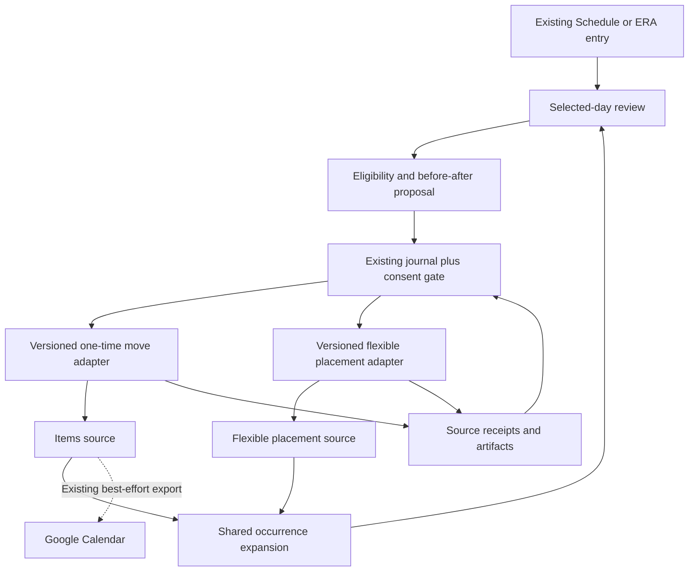

# Blueprint 02 — Reset the remaining day

Status: **proposed; not approved**. Candidate C2. Baseline: `9cd4166691edd9367ea1bd9a604e0bec13ffe870`. Shared contracts and unresolved owner decisions: [README](README.md).

## Problem and fictional journey

A disrupted day leaves the user deciding what to keep, move, or leave unscheduled across several source records. A chat that repeatedly asks for priorities, durations, and categories can take longer than moving the items directly. The desired outcome is a small, understandable revision of remaining commitments, with original identities and completed work preserved.

**Fictional example:** Sam loses an afternoon to an unexpected appointment. In Schedule, Sam chooses “Reset day.” ERA shows an ordinary parcel reminder and a flexible laundry placement; a fixed appointment and a partner-owned task remain visible but cannot be moved here. Sam keeps the appointment, moves the parcel reminder to tomorrow at 10:00, and returns laundry to its current weekly pool. After reviewing two changes, Sam saves. The reminder move succeeds; the laundry result is uncertain after a timeout. ERA shows the saved move and “Check laundry.” Sam can leave immediately and resume that exact review later. The outcome is an honest, revised schedule—not a claim that everything fits or has been done.

## Current implementation, intent, and gaps

| Evidence class | Finding |
|---|---|
| Implemented | [Shared occurrence expansion](../../../src/lib/utils/dayOccurrences.ts#L39) skips flexible items in the RRULE loop and injects scheduled flexible rows. This is the source of schedule occurrence semantics to reuse. |
| Implemented | [Flexible scheduling hook](../../../src/features/items/useFlexibleRoutines.ts#L756) upserts by `item_id,period_start_date,occurrence_index`, including date/time, then invalidates affected caches. It does not expose a source-version precondition in the inspected mutation. Slot identity is not just a displayed date. |
| Implemented | [ERA reminder rescheduling capability](../../../src/features/era/capabilities/registry.ts#L89) is limited to owned, open, nonrecurring reminders and requires a resolved item reference and date. This is narrower than moving arbitrary displayed Schedule rows. |
| Implemented | [Day-plan schema](../../../migrations/schema.sql#L1703) stores date, title, intent, notes, checklist, and visibility. [Day-plan POST](../../../src/app/api/day-plans/route.ts#L65) upserts the daily record and maps omitted title/intent/notes to null. It is not an hourly scheduling engine or a safe partial patch for unrelated fields. |
| Implemented | [Google Calendar sync](../../../src/lib/gcal/sync.ts#L1) is an app-to-Google backup path. Its [mutation behavior](../../../src/lib/gcal/sync.ts#L149) is best-effort and does not block the primary mutation. No inbound external availability contract is established by this source. |
| Documented intent | [Plan My Day overview](../../../ERA%20Notes/03%20-%20Junction%20Modules/Plan%20My%20Day/Overview.md) describes triage, placement, and preview. [Journey dependencies](../03-life-journeys/SHARED-DEPENDENCIES.md) propose stable occurrence identity and stale-consent checks; [product concepts](../16-product-research/SOLUTION-CONCEPTS.md) propose resetting a day. |
| Unknown | Actual calendar completeness, how users distinguish fixed from movable work, deployed permission behavior, duration reliability, and comfort with a triage review. No rendered layout or observed scheduling behavior was tested here. |

**Proposed difference:** a user-invoked review of one to three eligible changes in existing Schedule. It uses direct Keep/Move/Return controls, current source facts, and explicit confirmation. It does not create a competing calendar or infer a complete free-time map.

## Goals and non-goals

Goals: reduce the work of revising a few commitments; preserve due/occurrence semantics; protect shared and fixed work; make partial application visible; and offer safe correction after interruption.

Non-goals: automatic time blocking, new recurrence expansion, task-priority inference from language or emotion, clinical/fitness scheduling, moving a partner's work, moving recurring series, reconciling every overdue item, measuring productivity, or importing a third-party calendar planner. No requirement to estimate all durations or maintain a daily dashboard.

## Requirements

| ID | Functional requirement |
|---|---|
| B2-F1 | Load a bounded selected-day view using the existing schedule source, plus current eligible flexible placements. Distinguish unavailable sources from an empty day. Show the date and time zone explicitly in review. |
| B2-F2 | Allow only positively identified, own ordinary open one-time reminders and supported own flexible placements. Protect fixed/user-locked, partner-owned, completed, recurring-series, clinical, fitness, and otherwise source-managed work. If provenance/eligibility is unknown, offer Open only. |
| B2-F3 | Keep is a no-op. Move edits the same source identity. Return to pool removes only an eligible flexible placement within its existing period; it does not delete the underlying routine or complete an occurrence. |
| B2-F4 | Require a target date for Move; time is required only when the chosen source action needs it. Preserve explicit existing time/date-only intent unless the user changes it. Never invent duration, priority, or recurrence. |
| B2-F5 | Show exact before/after values and source links. Protect existing day-plan title/intent/notes/checklist by leaving that record untouched in the minimum release. |
| B2-F6 | Apply reviewed source operations sequentially with stable IDs and server-checked preconditions. Stop on conflict or uncertain result. Preserve acknowledged changes and resume only safe remaining operations. |
| B2-F7 | Show known ERA conflicts or missing evidence without claiming global availability. External sync status is separate from the successful ERA write. |
| B2-F8 | Allow dismissing the review without changing the day; Undo restores an unchanged affected source placement/value, not the entire day's snapshot. |

| ID | Nonfunctional requirement |
|---|---|
| B2-N1 | Reuse shared date/occurrence utilities and stable source keys; no parallel recurrence expansion or overloaded payment-recurrence engine. Display local dates separately from instants and retain IANA zone in the proposal. |
| B2-N2 | Validate rights, source version, eligibility, period boundaries, and operation identity at the server mutation boundary. Client-only checks are insufficient. |
| B2-N3 | Work without an AI response. No automatic retries of uncertain writes or background mutation on reopening. Offline/cached views are visibly provisional and cannot grant new consent against unknown source state. |
| B2-N4 | Use a single review surface with named keyboard controls, no mandatory dragging, and preserved focus/selection on mobile return. No mandatory daily review cadence. |
| B2-N5 | Log the operation, original occurrence key, changed fields, result, and inverse reference using canonical artifacts; avoid raw personal task text in diagnostics. Invalidate all affected source views after acknowledged changes. |

## Minimum release and increments

**Minimum useful release:** an entry inside Schedule for the selected day; one to three user-selected eligible changes; direct Keep/Move/Return controls; before/after review; source-precondition and receipt support for one-time moves and flexible placement removal/moves; partial-result continuation; source-level Undo. The cap is a proposed usability/scope boundary, not a claim about usage. It fits under the existing six-step ERA plan limit if the journal is reused.

This release does not write `day_plans`, infer a new daily intent, or rewrite a whole day. A new flexible-placement adapter is required for this orchestrated flow; the existing direct hook is a foundation, not an already safe cross-module transaction. If either adapter lacks conformance, restrict the tool to the supported action and label that boundary.

Follow-up increments: optional explanations using the existing AI path; user-authored fixed/movable preferences if source eligibility needs them; additional source-managed actions only through their domain contracts; richer planning constraints or external calendars only after a separate permissions and completeness design. Each increment must preserve the direct manual path. Do not require BP03 or a global Home redesign.

## Interaction and screen responsibilities

1. **Schedule:** “Reset day” opens a temporary review for the visible day. Current day selection carries over. A natural-language request can open the same review, but the user need not enter chat.
2. **Selection:** eligible rows offer “Keep”, “Move”, and, for flexible placements only, “Return”. Protected rows offer “Open”. Limit selection, not the user's ability to inspect the source. Show no scolding overdue count or planning score.
3. **Move editor:** date, optional time, and visible zone; preserve source title. Optional note belongs in the source precision form, not a mandatory reason-for-change field.
4. **Review:** “2 changes” with old and new values. “Apply” is the sole write action. “Back” preserves choices; “Cancel” leaves sources unchanged. Conflict copy is “Changed elsewhere” / “Review”.
5. **Result:** receipts read “Parcel moved” and “Laundry: check”. “Open”, “Undo”, and safe “Resume” target specific effects. Completed work remains separately represented by its source.

Essential inputs: chosen records, exact move destination where applicable, and confirmation. Optional inputs: explicit constraints or a reason. No category, mood, priority score, duration estimate, or AI conversation is required.

Desktop may show selection and preview together. Mobile uses sequential panels with one sticky action that does not cover content or the keyboard. Keyboard users can select and move through labeled controls; no hover-only buttons. During a short interruption, the persisted review may be reopened, but its source preconditions are revalidated before Apply. A never-saved local selection is not falsely advertised as cross-device recoverable.

Empty state: “No changes needed” when no eligible work remains, with Schedule still accessible. If protected work exists, show it with Open rather than implying the day is empty. Read failure: “Schedule unavailable” / “Retry”. Unknown duration: omit a finish-time estimate. External events not read: a compact “ERA schedule only” scope label, with details behind help.

## Data entities and decision contracts

| Contract | Existing foundation / proposed extension |
|---|---|
| Schedule snapshot | Existing source items and shared occurrence expansion; proposed envelope carries fetch time, availability, source version, zone, and coverage scope |
| One-time target | Existing item ID and current due value; proposed eligibility proof plus expected source version and before/after fields |
| Flexible target | Existing `item_id`, `period_start_date`, `occurrence_index`, placement date/time; proposed versioned operation references this stable tuple even when placement changes |
| Reset review | Proposed persisted proposal in the existing execution/conversation mechanism: owner, selected local date, zone, source references, decisions, fingerprint, per-step receipts. No second day-plan completion flag |
| Move/return receipt | Proposed source-local atomic operation ID and effect, prior values, result version, inverse capability. Returning a placement requires a receipt even though the row may be removed |
| Conflict result | Proposed typed changed/restricted/out-of-period/unavailable/uncertain response; includes only authorized current evidence |

A local date such as `2026-11-07` is not midnight UTC. A timed reminder requires the existing source date conversion contract, preserving the proposal zone. If a chosen local time is ambiguous or nonexistent across a DST transition, stop for explicit time/offset review instead of silently selecting a different instant. This is a proposed interaction requirement to reconcile with shared timezone utilities during implementation planning. Travel after review triggers a visible zone check, not silent rebasing.

AI may parse “move my parcel reminder to tomorrow morning,” but must ask for or expose an exact time if “morning” is not already an explicit user preference. Deterministic logic owns the candidate set, eligibility, recurrence/period identity, conflicts, date conversion, authorization, and effects. Suggestions cannot infer that a quiet calendar means free time.

## Architecture, integrations, and boundaries

Versioned adapter/receipt contracts are **proposed additions**. The junction orchestrates; Items and flexible placement retain domain validation. No standalone-to-standalone import or new generic scheduler is required. Reuse the [B1 recovery contract](BLUEPRINT-01.md#entities-and-contracts), but prove separate conformance for these operations.

Authentication uses the existing app session. Server rechecks actor ownership and current sharing rights; a household relationship does not grant permission to move a partner's item in this release. Shared visibility is not edit authority. Explicit confirmation covers exact reviewed edits only. No new OAuth scopes are required. Existing Google export remains optional; ERA save success and export failure must remain distinguishable. External calendar backfill/import is outside scope.

Logging uses canonical source artifacts plus operation metadata, and records “stopped after N acknowledged changes” rather than “day reset” if later effects are unknown. The result screen supplies durable recovery controls; diagnostics do not need full task descriptions. Privacy/retention requires D7. Nothing in this blueprint authorizes production DB changes or live provider tests.

## Edge cases and recovery

| Condition | Proposed response |
|---|---|
| Missing or stale schedule | Cached preview may be inspected; Apply requires current source checks. Unavailable is not empty. |
| Duplicate selection or repeated Apply | Collapse by stable source identity in the review; reuse operation IDs across retries. A repeated Apply cannot add another flexible occurrence. |
| Changed recurrence, completion, or ownership | Eligibility is recalculated. Remove the invalid proposed action and explain “Changed elsewhere”; do not coerce it into another occurrence. |
| Period boundary | Return affects only the selected placement in its existing period. Moving across periods is unsupported initially; open the source tool rather than inventing a new occurrence. |
| Interrupted/partial application | Keep successful receipts, pause on unknown outcome, and reconcile that operation before later dispatch. No whole-day replay. |
| Provider outage | AI explanation can fail without losing direct controls. Google outage does not reverse an acknowledged ERA move; show sync issue separately. Source outage blocks new writes. |
| Undo after unrelated edits | Restore only affected fields under current-version checks. If the affected record changed, open a correction review rather than overwriting it. |
| No valid alternatives | Keep the existing schedule. Do not move important work merely to produce a nonempty plan. Dismissal changes no source record. |

## Acceptance scenarios

These are future test cases, not executed results.

| ID | Given / When | Expected result |
|---|---|---|
| B2-A1 | Own ordinary reminder and a flexible placement selected; user moves one and returns the other | Same reminder ID with reviewed due value; only the selected placement removed; routine persists; two source receipts. |
| B2-A2 | Selected day also contains partner, completed, recurring-series, clinical, or unknown-origin work | These remain Open-only; no unauthorized/source-managed mutation is dispatched. |
| B2-A3 | User selects Keep for all rows or cancels review | No source write, no fake success artifact, and no daily-plan metadata change. |
| B2-A4 | Other device changes the due time after review | Server precondition rejects the move; fresh before/after review required. |
| B2-A5 | First operation commits; second times out | First receipt remains; second stays uncertain; reopening does not replay the first or silently enqueue the second. |
| B2-A6 | Flexible placement is moved within period, then repeated Apply occurs | One placement remains at the new date with the original period/index identity; no extra occurrence. |
| B2-A7 | Proposed flexible move crosses its period, or local time crosses a DST gap/fold | Unsupported period move links to source; invalid/ambiguous local time requires explicit review; no silent shift. |
| B2-A8 | Day-plan title/intent/notes already exist | All remain byte-for-byte unaffected by the reset flow's writes. |
| B2-A9 | Google export fails after an ERA move | ERA receipt shows success; external sync issue remains separate; no false claim that all calendars match. |
| B2-A10 | User undoes a placement after it was edited elsewhere | No stale overwrite; current placement opens for correction. |
| B2-A11 | Schedule fetch fails versus genuinely no eligible rows | Distinct unavailable and empty/protected-only states; no assertion of free time. |
| B2-A12 | Mobile or keyboard-only user pauses during review and returns | Choices remain where persistence was acknowledged; source checks rerun; Apply is reachable without dragging and navigation performs no mutation. |

## Alternatives, decisions, and reasons not to build

Alternative one is better direct multi-select inside Schedule, with no AI interpretation. This may be the best implementation of the concept. Alternative two is a conversational sequence; it accepts vague input well but risks repeated clarification and hidden source changes. Alternative three is a full optimizer or external calendar service; it requires duration/priority/availability evidence the reviewed implementation does not establish. Choose the small review first.

Owner decisions: D1 value, D3 eligibility and protection semantics, D4 coverage/zone disclosure, D7 retention. Resolve how “fixed” is represented without requiring classification of every item; until reliable evidence exists, only positively eligible records are movable. Technical questions include source CAS/receipt support, metadata side effects of a due change, flexible period rules, and existing Google retry observability.

Do not build if the owner's problem is missing task data rather than replanning, if most remaining work is intentionally fixed or source-managed, or if the review requires more interaction than the current Schedule controls. Defer broad optimization if external commitments cannot be read reliably. The tool must remain useful without filling in durations, priorities, or a daily planning ritual.
