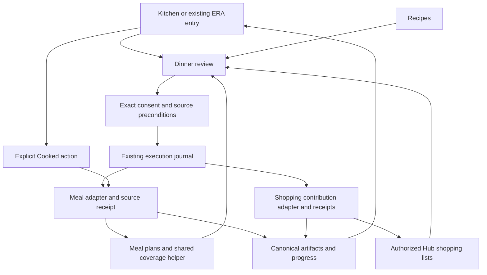

# Blueprint 03 — Dinner through shopping and cooking

Status: **proposed; not approved**. Candidate C3. Baseline: `9cd4166691edd9367ea1bd9a604e0bec13ffe870`. Shared source, receipt, consent, and privacy contracts: [README](README.md).

## Problem and fictional journey

Choosing a recipe, making a usable shopping list, and later finding what to cook are parts of one household outcome. They become extra work when the user must repeat ingredients, remember which list belongs to which meal, or infer what a generic “done” means. The desired outcome is one chosen dinner, a reviewed list of ingredients to obtain, and an explicit record when cooking actually happens.

**Fictional example:** Leila and Noor need dinner tomorrow. Leila opens Kitchen and chooses “Plan dinner.” ERA shows that lunch is covered, but no dinner covers both people on that date. Leila selects a saved lentil soup recipe, keeps its recorded quantities, and unchecks oil because she knows they have it. She reviews the dinner slot and selected grocery list, then confirms. The meal saves and four ingredient contributions are added with linked receipts. Noor can open the meal from the shopping list. Later, Leila opens the recipe and taps “Cooked.” Checking groceries never marks dinner cooked, and the flow never assumes that buying food restocked inventory.

## Current implementation, intent, and gaps

| Evidence class | Finding |
|---|---|
| Implemented | [Meal coverage helper](../../../src/lib/mealPlanCoverage.ts#L36) checks status, audience, optional meal type, and inclusive local-date range. Planned, shopping-added, and cooked meals count as coverage; skipped meals do not. This is plan coverage, not proof food is physically available or safe to eat. |
| Implemented | [Meal schema](../../../migrations/schema.sql#L1166) includes recipe, household, date, meal type, status, cooked timestamp, shopping IDs, audience, leftovers-through date, and servings. |
| Implemented | [Meal creation](../../../src/app/api/meal-plans/route.ts#L107) requires an active household. [Slot handling](../../../src/app/api/meal-plans/route.ts#L140) updates an existing exact date/type/audience slot or inserts one; its fallback type is lunch. The proposed dinner flow must explicitly specify dinner and cannot rely on that fallback. |
| Implemented | [Ingredient-to-shopping route](../../../src/app/api/meal-plans/add-to-shopping/route.ts#L71) selects indices, treating an empty index list as all ingredients, inserts Hub messages with `meal_plan_id`, then separately updates meal shopping metadata. The inspected metadata updates are not checked before returning success. No operation key is present in that request contract. |
| Implemented | [Meal PATCH](../../../src/app/api/meal-plans/%5Bid%5D/route.ts#L69) can change status and sets `cooked_at` when status becomes cooked. The inspected branch does not clear that timestamp when changing status away from cooked. No cross-entity cooking transaction is established by this evidence. |
| Implemented | [ERA recipe ingredients](../../../src/features/era/capabilities/registry.ts#L327) uses a uniquely matched saved recipe and actual ingredient strings; [meal assignment](../../../src/features/era/capabilities/registry.ts#L253) defaults to lunch/both and allows occupied-slot replacement. [Shopping addition](../../../src/features/era/capabilities/registry.ts#L349) does not deduplicate or subtract stock automatically. |
| Documented intent | [Meal Planning overview](../../../ERA%20Notes/03%20-%20Junction%20Modules/Meal%20Planning/Overview.md), [journey dependencies](../03-life-journeys/SHARED-DEPENDENCIES.md), and [product concepts](../16-product-research/SOLUTION-CONCEPTS.md) describe coverage, ingredient provenance, and a linked meal/shopping journey. A week-to-shopping assistant is not established as implemented by this prose. |
| Unknown | Production household permissions/RLS, actual recipe completeness, effects of other cooking UI paths on recipe statistics/logs, and user willingness to record cooking. No screen rendering or household usage data was inspected. |

**Proposed difference:** one reviewed dinner sequence with source links and separate meal, shopping, and cooked receipts. The first release uses an empty dinner slot and original saved-recipe quantities. It avoids silent replacement, automatic pantry deduction, and a weekly maintenance dashboard.

## Goals and non-goals

Goals: avoid retyping recipe ingredients; make the dinner's audience/date explicit; preserve provenance between meal and shopping; resume partial preparation safely; and distinguish planned, list prepared, and cooked outcomes.

Non-goals: automatic food ordering, grocery-price or affordability guarantees, nutritional/medical advice, allergy certification, full pantry accounting, automatic stock consumption/restock, automatic expense creation, portion inference, a universal meal optimizer, or replacing recipe/meal precision screens. The flow must work without an AI conversation or maintaining inventory.

## Requirements

| ID | Functional requirement |
|---|---|
| B3-F1 | Read dinner coverage for the selected local date and each intended person using the shared helper. Existing lunch must not cover dinner; skipped or other-person meals must not cover the selected audience. |
| B3-F2 | Require a saved accessible recipe, explicit date, dinner type, audience, and confirmation. Show original ingredient quantities and recipe serving information if available. Unknown quantity stays unknown; do not manufacture a number. |
| B3-F3 | Start with an empty supported dinner slot. If any selected person is already covered, show the source meal and offer Open or a different date/audience. Replacement remains outside the minimum release. |
| B3-F4 | Let the user select ingredients to add and choose an authorized shopping list if ambiguous. “Have it” means an exclusion from this proposal only, not a durable stock assertion. Explicitly selecting none means no shopping write. |
| B3-F5 | Preview the meal save and exact ingredient contributions before confirmation. Bind ingredient identity to the recipe version and ingredient snapshot; invalidate consent if recipe, slot, audience, or selected list changes. |
| B3-F6 | Apply meal and shopping operations sequentially with source-local receipts. Do not call the whole workflow successful if shopping failed or its outcome is unknown. Repeated submission of the same operation cannot duplicate contributions. |
| B3-F7 | Keep links between meal, recipe, and created shopping entries. A later shopping check-off changes shopping state only. “Cooked” requires an explicit user action on the meal with current permission. |
| B3-F8 | Support source-checked corrections: move/edit via the source tool, undo own unchanged contributions, and restore prior meal status/timestamp coherently. Stop affects future work only; buying/cooking are never reversed by UI Undo. |
| B3-F9 | Reopen the chosen meal/recipe without chat reconstruction. Dismissing a dinner suggestion does not skip or delete an existing meal; skipping a saved meal is a distinct reviewed source action. |

| ID | Nonfunctional requirement |
|---|---|
| B3-N1 | One dinner per minimum-release proposal. Use bounded date/audience reads and the existing plan step limit; a shopping batch is a source-domain operation with per-contribution receipts, not an artificial bypass of plan limits. |
| B3-N2 | Server validates active household membership, recipe visibility, target meal access, and shopping-list access for every write. `for_user_id` is audience, not a private-data boundary or grant of edit permission. |
| B3-N3 | Preserve exact ingredient text and source provenance. Deterministic arithmetic is allowed only when quantities and units are explicitly compatible in a later increment. No AI unit guessing. |
| B3-N4 | Use ordinary keyboard controls and a mobile sequential review with one primary action. No mandatory drag, hover, classification, pantry inventory, or daily cleanup. |
| B3-N5 | Core selection, list preparation, and cooked recording work without AI. Provider outage cannot invent a substitute recipe or convert uncertainty to success. Log IDs/statuses and redacted failure classes, not dietary or household text unnecessarily. |

## Minimum release and increments

**Minimum useful release:** one dinner in an empty slot, one saved recipe, known audience/date, original quantities, manual ingredient exclusions, selected existing shopping list, linked save/list receipts, and an explicit cooked action with safe correction. All-needed-ingredients-already-owned is valid: save the meal, acknowledge no shopping was requested, and preserve the recipe link.

Prerequisites: source-precondition support for slot creation and cooked status; source-local idempotent shopping-contribution batches; a server permission audit; source artifact integration; and a deliberate status/timestamp inverse. The current route's empty-indices-means-all behavior must not be reused for an explicit “none” selection. The later implementation should define a typed contract that separates omitted/default selection from an intentionally empty array.

Follow-up increments: two or three dinners with shared provenance; deterministic aggregation of compatible quantities; explicitly reviewed recipe serving scaling where source data supports it; occupied-slot replacement with linked-contribution handling; optional inventory evidence displayed with freshness rather than automatically subtracted; optional user-requested suggestions. Solo planning needs a separate decision because the current source requires a household. No new push notification or recipe-generation provider is required.

## Interaction and screen responsibilities

1. **Kitchen/meal calendar:** “Plan dinner” starts with the visible date and explicit audience. Show an existing covered meal immediately. Do not add another persistent daily checklist.
2. **Recipe choice:** search/select a saved recipe, inspect actual ingredients, and show known dietary information and unknowns. A direct list works if AI suggestions are unavailable. If an explicit known restriction conflicts with recipe evidence, do not recommend it as suitable; let the user inspect the source without a safety claim.
3. **Ingredient review:** original quantity/text, selected checkbox, recipe link, and optional “Have it”. Unknown amounts remain visible. Optional handwritten additions use the existing list tool, not an inferred generated ingredient list.
4. **Confirmation:** date, “Dinner”, audience, recipe, shopping list, selected ingredient count, and exact list entries. One “Save” authorizes the displayed operations. Existing list items with similar text can be opened; no automatic merge is implied.
5. **Result and return:** “Dinner saved”, “4 added”, or “Shopping: check”, with Open/Undo and safe remaining-step controls. When cooking, “Open recipe” and “Cooked” are direct actions. No conversational reply is required to mark cooked.

Essential inputs are date, dinner slot, audience, recipe, and consent; shopping target is essential only if ingredients are selected. Optional inputs are ingredient exclusions, source-supported notes, and explicit leftovers-through date. Keep recipe servings as source information in the minimum release; do not offer a scaling control that cannot reliably scale the ingredients.

Desktop can show recipe and list preview alongside each other. Mobile shows them sequentially, preserving selection and scroll on return. Keyboard users can select ingredients and confirm with named buttons; Enter inside free text must not accidentally submit the entire proposal. For a short interruption after a persisted review, reopen the same recipe/version and selection, then recheck source changes before Save.

Concise empty/error copy: “No saved recipes” / “Add recipe”; “Dinner already planned” / “Open”; “No ingredients listed” / “Edit recipe”; “Choose a list”; “Recipe changed” / “Review”; “Shopping unavailable” / “Retry”. Missing ingredient data does not block saving a meal-only plan if the user explicitly chooses that path; it does block claiming a complete ingredient list.

## Entities and contracts

| Entity/contract | Existing foundation / proposed extension |
|---|---|
| Recipe | Existing recipe ID and ingredients; proposed version/hash plus ingredient identity or version-bound index and original quantity/unit/text snapshot |
| Dinner selection | Proposed proposal fields: owner, household, local date, explicit `meal_type=dinner`, audience, recipe reference, source preconditions, optional leftovers date, selected contributions, fingerprint |
| Meal plan | Existing authoritative meal record; proposed create-if-slot-still-empty precondition including coverage for the selected people, not merely matching exact `for_user_id` |
| Shopping contribution | Existing Hub message and `meal_plan_id`; proposed stable contribution/operation ID, recipe ingredient provenance, source version, actual message ID, and applied quantity/text |
| Batch receipt | Proposed source-local atomic result or explicit per-contribution terminal results. The contract must define whether a batch is atomic; UI never assumes it. Retrying a completed contribution returns its original result |
| Cooked receipt | Existing status/cooked timestamp fields; proposed versioned change with previous status and timestamp, operation identity, source artifact, and safe inverse |
| Progress projection | Proposed derived display from receipts and current sources. Meal saved, list prepared, and cooked remain separate facts; no extra generic “complete” column |

In the minimum release, keep separate ingredient contributions rather than automatically consolidating with existing unrelated list entries. Identical text may represent another meal or a manual purchase; similarity is not operation identity. A later merge must retain each contribution's origin so removing one meal does not remove another's groceries.

Keep leftover coverage semantic: `eats_through_date` records the user's plan. It does not certify storage, freshness, or actual leftovers. If an existing cooked meal covers tomorrow in the source, show that plan and allow inspection; do not assert the food remains edible. The application does not infer completion from date passing.

AI may help find an existing recipe or explain a suggestion using fetched evidence. It cannot invent recipe quantities, infer allergens are absent, select an unreviewed household audience, merge ambiguous units, mark cooked, or create expenses. Deterministic logic owns coverage, slot conflict, provenance, stable IDs, supported arithmetic, permissions, and all writes.

## Architecture, integrations, and boundaries

Receipt, contribution, and source-version extensions are **proposed**. Reuse the [B1 execution/recovery contract](BLUEPRINT-01.md#entities-and-contracts), while keeping meal and shopping transactions independent. A meal can save while shopping fails. A successful shopping insert followed by meal-metadata failure must be recoverable from its source receipt, not by inserting the batch again.

Use existing app authentication and household relationships; no grocery provider, payment permission, email, or new OAuth integration is needed. Current recipe and list access must be validated server-side, including relationships between the chosen meal and list. Existing route calls to `getUser()` and RLS-scoped queries are evidence of an auth path, not proof of the deployed authorization matrix. Deployment permissions require approved evidence before implementation estimates.

The Kitchen junction coordinates Recipes, Meal Planning, and Hub; each source owns storage, validation, and inverse behavior. Shared artifacts connect records without copying all recipe content into logs. Existing query keys/cache invalidation must refresh meal calendar, recipe detail where affected, shopping lists, ERA receipts, and Activity Log. Do not add a competing pantry or shopping store.

Before implementing Cooked, trace the full existing cooking action and any recipe statistics/history updates. The release must reuse that authoritative behavior or explicitly keep this action scoped to the meal status; it must not double-count cooking across two paths. This dependency is unknown from the inspected meal PATCH alone and is an implementation discovery gate, not an asserted defect.

## Edge cases and recovery

| Condition | Proposed response |
|---|---|
| No household, inaccessible recipe/list | State the missing requirement and offer the existing setup/source path. No automatic household creation or private fallback copy. Solo mode remains outside the first release. |
| Missing/stale ingredients | Show unknown quantities; require review after source change. Meal-only save is allowed with explicit selection; complete shopping-list claims are not. |
| All ingredients excluded | Zero shopping operations. Never pass an empty selection into the existing all-ingredients behavior. |
| Existing meal/leftovers/person conflict | Use dinner-specific per-person coverage; protect occupied coverage and open the existing meal. No silent replacement or reset of cooked status. |
| Duplicate submit or partial shopping result | Stable operation/contribution IDs return original receipts; resume only known uncommitted contributions under the source contract. Unknown remains Check. |
| Interrupted after meal save | Keep that meal receipt; resume shopping without overwriting or recreating the meal. If someone changed the meal, review a new proposal. |
| Model, source, or network outage | Direct recipe choice remains when data is available; source outage blocks writes; provider failure never invents a meal/list. Cached recipe evidence is labeled and revalidated. |
| User edits/checks an added grocery before Undo | Preserve the changed entry and offer correction. Do not delete purchased/edited household work because the originating meal was removed. |
| Cooked marked accidentally | Version-checked inverse restores prior status and prior cooked timestamp together; it does not adjust stock, refund a purchase, or erase unrelated cooking history. |
| Dismiss recommendation versus skip meal | Dismiss affects presentation only. Skip is a separate source change with confirmation, artifact, and inverse. |

## Acceptance scenarios

These are proposed deterministic fixture and interaction tests, not executed results.

| ID | Given / When | Expected result |
|---|---|---|
| B3-A1 | Lunch exists tomorrow but dinner is empty for both people | Dinner flow offers the empty dinner slot; saved meal explicitly uses dinner, not the API's lunch fallback. |
| B3-A2 | One person's meal or skipped meal exists, or shared leftovers cover the selected dinner | Coverage evaluates audience, status, date, and meal type correctly; occupied selected coverage opens its source and cannot be silently replaced. |
| B3-A3 | User selects a recipe, excludes oil, and confirms three ingredients | One meal and exactly three linked contributions are acknowledged; oil is not added or recorded as stock. |
| B3-A4 | User excludes every ingredient | Meal saves; no shopping write occurs; UI does not claim ingredients were added. |
| B3-A5 | Recipe changes between preview and save | Source precondition fails; updated ingredients require review; old indices cannot select different ingredients silently. |
| B3-A6 | Same shopping operation is sent twice, or response is lost after insertion | Original contribution receipts are returned/reconciled; no duplicate grocery messages. |
| B3-A7 | Shopping inserts succeed but meal shopping-metadata update fails | Progress reports the known source contributions and metadata repair need; never repeats inserts to repair linkage. |
| B3-A8 | Meal saves, then list permission disappears | Meal receipt persists; remaining shopping action is denied; no partner/list data leaks or implicit rollback. |
| B3-A9 | Groceries are checked off or dinner date passes | Meal is not marked cooked and stock/expenses remain unchanged. Only explicit Cooked changes that source state. |
| B3-A10 | User marks cooked, then invokes Undo before any conflicting edit | Prior status and cooked timestamp are restored coherently; related source effects follow the audited cooking contract once, not twice. |
| B3-A11 | A shopping contribution was edited or checked before Undo | The inverse cannot erase the changed household entry; Open/correction remains available. |
| B3-A12 | AI is unavailable, recipe lacks quantities, or no recipe exists | Direct selection works when possible; unknown amounts stay unknown; missing data and empty collections have distinct actions; no generated ingredient claims. |
| B3-A13 | Mobile/keyboard-only user leaves after meal save and returns | Source receipts and selection are recoverable; safe remaining actions are reachable without chat re-entry, dragging, or obscured buttons. |

## Alternatives, decisions, and reasons not to build

A clearer existing “Add ingredients” picker with meal links may achieve most of the benefit; prototype that before a new multi-step assistant. A weekly meal optimizer offers breadth but increases slot, quantity, and preference complexity. A pantry-driven system could reduce purchases, but it requires trusted stock and repeated upkeep. External grocery ordering introduces new providers, permissions, prices, and irreversible actions. These are unnecessary for the selected dinner outcome.

Owner decisions: D1 usefulness, D5 household-only scope, D6 dietary/quantity presentation, D7 retention. Confirm whether marking cooked is valuable enough to keep as an explicit optional follow-through rather than a required daily chore. Technical decisions include batch atomicity, ingredient identity strategy, slot/coverage concurrency, source permission proofs, and whether cooking statistics/history belong to the existing authoritative cooked action.

Do not build if saved recipes rarely contain usable ingredients, if the owner does not plan dinner in ERA, or if list preparation is already faster through the current picker. Do not expand into pantry tracking to compensate for sparse recipes. Defer automated suggestions if dietary evidence is inadequate; direct recipe selection and source-linked shopping can still be useful without AI.
