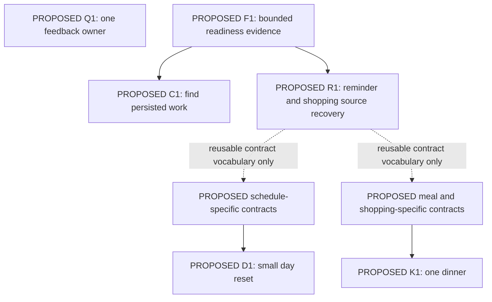

# Dependency map

**Status: PROPOSED — every node and gate below is proposed, not scheduled.** IDs match [PRIORITY-MATRIX](PRIORITY-MATRIX.md). Evidence references resolve in [README](README.md).

Solid arrows are prerequisites for the bounded proposal. Dotted arrows mean reusable patterns, **not that reminder/shopping conformance certifies another source**. Q1 has no dependency on recovery work. C1 and R1 are independently useful: C1 may remain inspect-only, while R1 can operate in current run cards without a new Continue entry. D1 and K1 need neither each other nor a global Home redesign. They can be reconsidered before R1's UI work if their own safety contracts are proved.

## Necessary foundations, scoped to the consumer

| PROPOSED foundation | Consumer | Required evidence / deliverable before use | Reason / exit if unavailable |
|---|---|---|---|
| F1a — Truthful readiness | C1, R1 | Owner-supplied current journal migration/flag/access evidence, isolated owner-bound fixtures, documented unavailable behavior | Flag exists in source, rollout is unknown (E3/E5). Keep current history; never enable a flag based on a research document |
| F1b — Bounded documentation repair | C1, R1 | Update existing assistant documentation only in a separately authorized implementation/discovery task: distinguish implemented, enabled, verified, and unknown; identify evidence owner/date | Avoid a competing backlog or evergreen status database. This task itself changes no existing doc |
| Current scope and source evidence | C1, R1, D1, K1, M1 | Owner/user scope, source identity, current access, unavailable versus empty, stale-state label | A run receipt does not grant access to a source that became private; fail closed on unauthorized content |
| Source-local operation receipt | R1; independently D1/K1 | Stable logical operation ID, payload identity, atomic receipt plus effect or equivalent proven contract, deterministic reconciliation | Journal attempt/version is insufficient (E4). Without proof, retain Check/Open; never match by title/time and infer safe retry |
| Effective consent and version preconditions | R1, D1, K1 | Exact target/audience/date/value review; server rejects changed source or changed permission; new review on change | Historical consent does not authorize a changed operation. Source-managed work stays excluded |
| Safe inverse and cache/artifact propagation | R1, D1, K1 | Inverse's own identity/permission checks, source revision guard, source refresh, canonical artifact deep links | Stop only future steps; correction cannot erase later household edits. No cross-module rollback guarantee |
| Accessibility and truthful feedback | Q1, C1 and every future UI | One feedback owner, named keyboard actions, 390 px and both-theme checks, honest pending/unknown states | Do not broaden into shell redesign to solve a local interaction defect |

A foundation is not permission to standardize every module. Implement only contracts consumed by a selected increment. Keep source validation in its standalone module; junction/shared layers coordinate. Do not create another recurrence engine, offline queue, memory store, universal draft table, or generic completion field (E1/E6).

## Independent options and their gates

| PROPOSED option | Independent prerequisites | Explicitly unnecessary |
|---|---|---|
| M1 source-rich recall | Memory storage/access evidence, identity/age output, ambiguity handling and correct source destination | R1 writes, vector database, automatic extraction |
| A1 proactive pilot | One reliable situation, suppression/dismissal/freshness semantics, privacy/silence fixtures, owner interest | New push/cron, autonomous writes, N1 Home migration |
| N1 shell consolidation | Observed wrong turns, installed-app/deep-link audit, owner-approved destination and retention/search scope | New assistant brain, replacing all precision forms |
| Z1 no build | A conscious comparison of current flow with the proposed outcome | Any new queue, telemetry deployment or recurring review ceremony |

## Implementation and deployment boundary

If future source changes need SQL, the implementation deliverable is a migration plus matching schema change under existing rules; only the owner applies production changes. Current RLS must come from approved current evidence, not an old schema or prose. These gates request evidence; they do not authorize any production query/write or flag change in this task.

Validation for later work is replay/fixture-based first: lost responses, two devices, partial success, permission revocation, changed source, stale date/zone and provider outage. Any live paid API pass requires the owner's separate authorization. No new provider is required by the initial set.

There is no dependency on PM campaign creation, model selection, external accounts, an autonomous scheduler, or universal data consolidation. A future implementation task would reconcile current operational ownership at that time; this pack supplies no operational state.
